# Capítulo IV: Product Design

## 4.1. Style Guidelines

En este apartado estableceremos los criterios visuales y de comunicación que se utilizarán en el diseño del Landing Page y de la Web Application. El diseño estará centrado en transmitir una imagen simple, moderna y confiable, utilizando colores, tipografías, botones e iconos que permitan entender fácilmente la información. Como SmartStock está dirigido a propietarios y administradores de minimarkets y bodegas de barrio, se evitará un diseño demasiado complejo y se priorizará una interfaz sencilla y fácil de usar para los usuarios.

### 4.1.1. General Style Guidelines

#### Branding

SmartStock es operado por NexoStock. El logo se usa como ícono de 42 x 42px junto al nombre de marca en la cabecera (reducido a 34 x 34px en pantallas móviles menores a 720px), manteniendo consistencia en todas las vistas.

#### Typography

Para la identidad visual del producto, se seleccionó una tipografía que combine claridad, accesibilidad y un estilo tecnológico.

- **Tipografía:** Manrope, disponible en Google Fonts.
- **Peso 400 (Regular):** utilizado para el texto de cuerpo.
- **Peso 600 (Semibold):** aplicado en labels, botones y elementos de navegación.
- **Peso 700 (Bold):** utilizado en los títulos principales.
- **Estilo:** sans-serif geométrica, elegida para transmitir un tono técnico pero accesible.
- **Enfoque:** busca adaptarse a un producto de monitoreo IoT dirigido a dueños de bodegas, quienes no necesariamente cuentan con conocimientos técnicos.

#### Colors

La paleta se construyó sobre un azul marino como color de marca, con dos acentos adicionales (cian y verde menta) incorporados para reforzar puntos de interés visual en etiquetas, testimonios y elementos decorativos:

**Tabla 20**

*Paleta de colores y tokens de diseño de SmartStock*

| Token | Valor | Uso |
| --- | --- | --- |
| `--navy` | `#082b4c` | Titulares, marca, botón primario, foco de navegación |
| `--blue` | `#1266d4` | Enlaces, acentos, estado hover de botones |
| `--cyan` | `#0ea5a8` | Etiquetas destacadas (eyebrow) y acentos secundarios |
| `--mint` | `#2fcf78` | Detalles decorativos (blobs de fondo, indicador de tarjeta al hover) |
| `--ink` | `#172033` | Texto de cuerpo |
| `--muted` | `#667085` | Texto secundario / descripciones |
| `--border` | `#dce6ef` | Bordes y separadores |
| `--soft` | `#f5f9fd` | Fondos alternos de sección |

*Nota. Elaboración propia*

El blanco (#ffffff) es el fondo dominante, reforzando una identidad limpia y confiable, apropiada para un producto que maneja datos de inventario de un negocio.
Estas decisiones se sustentan en los principios de claridad, confianza y accesibilidad: el azul marino como color dominante transmite seriedad y profesionalismo sin resultar frío; los acentos cian y verde menta se reservan para elementos puntuales de refuerzo visual (etiquetas, indicadores de interacción), evitando sobrecargar la interfaz; y el uso del blanco como fondo dominante prioriza la legibilidad de los datos de inventario que el producto presenta al usuario. 

**Figura 20**

*Paleta de colores de SmartStock*

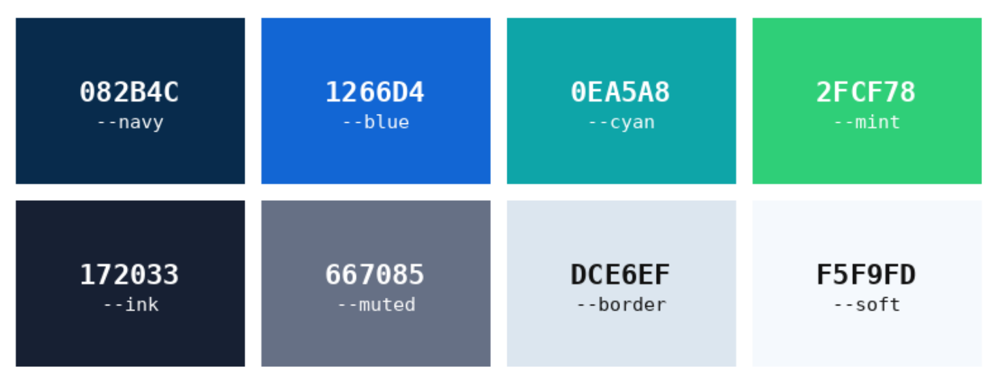

*Nota. Elección y elaboración propia*

#### Spacing

Para mantener una interfaz consistente y facilitar la lectura, se establecieron criterios de espaciado y dimensiones para los componentes.

- **Border-radius:** escala de 12px como base (inputs y contenedores generales), 10px en botones y 14px en tarjetas y tablas, dando mayor presencia visual a los elementos interactivos y a los contenedores de datos.
- **Ancho máximo de contenido:** 1040px.
- **Propósito:** mantener líneas de lectura cómodas y evitar que el contenido se extienda demasiado en pantallas grandes.

#### Tono de comunicación

El tono de comunicación definido es cercano, práctico y directo, priorizando la confianza y la facilidad de comprensión sobre el lenguaje técnico.

- **Testimonios:** se utilizan testimonios en primera persona para generar identificación con los usuarios.
  - "Antes me enteraba de que el arroz se había acabado cuando un cliente lo pedía…"
- **Llamadas a la acción:** son directas y orientadas a la acción.
  - "Empezar prueba gratuita"
  - "Sin tarjeta · Instalación en menos de un día"
- **Enfoque:** en las cuatro dimensiones de tono definidas para el producto:
  - **Divertido – Serio:** más cerca de Serio, priorizando la confianza sobre el humor, dado que se maneja información de inventario y ventas del negocio.
  - **Formal – Casual:** más cerca de Casual, evitando lenguaje corporativo rígido para conectar con dueños de bodegas y minimarkets.
  - **Respetuoso – Irreverente:** más cerca de Respetuoso, reconociendo que el usuario no necesariamente cuenta con conocimientos técnicos y evitando minimizar sus dudas.
  - **Entusiasta – Sereno:** más cerca de Entusiasta, transmitiendo confianza y motivación para adoptar la solución.
- **Objetivo:** facilitar la comprensión del producto y conectar con los usuarios sin recurrir a tecnicismos innecesarios.

### 4.1.2. Web Style Guidelines

- **Botones:** se definieron tres variantes: `.btn` como botón primario, con relleno en degradado de navy y estado hover con elevación (desplazamiento sutil hacia arriba) y sombra reforzada; `.btn.ghost` como botón secundario, con borde y sin relleno; y `.btn.block` como botón de ancho completo, utilizado en las tarjetas de planes. Las tres variantes cuentan con un estado hover definido.

**Figura 21**

*Botones del Landing Page: primario, secundario y de selección de plan*

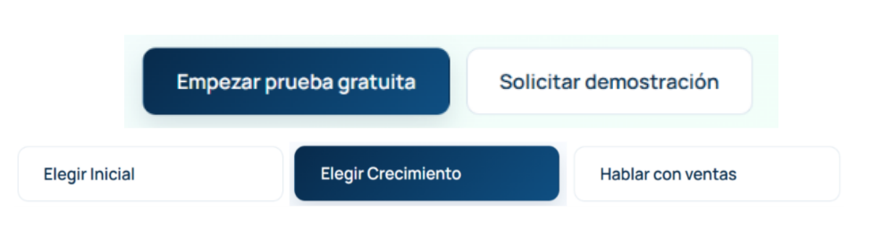

*Nota. Elaboración propia*

- **Formularios:** los campos de entrada utilizan un borde de 1px y un radio de 8px. El estado de error se identifica mediante `aria-invalid="true"`, acompañado de un borde rojo `#c0392b` y un mensaje de error asociado mediante `aria-describedby`. La validación se ejecuta en el evento `blur`, en lugar de realizarse mientras el usuario escribe, evitando marcar como inválido un campo que aún se encuentra en proceso de completarse.

**Figura 22**

*Estado de error de validación en el formulario de demostración del Landing Page*

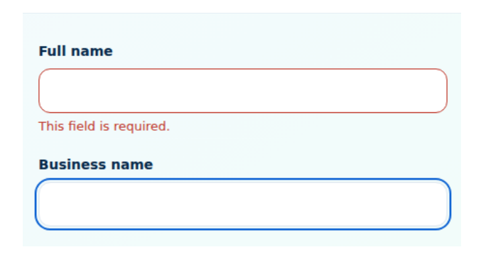

*Nota. Elaboración propia*

- **Foco visible:** se define `:focus-visible` con un outline azul de 2px en toda la interfaz, facilitando la navegación mediante teclado como parte de los criterios de accesibilidad.
- **Avatares de testimonios:** cada testimonio incorpora un avatar circular con las iniciales de la persona sobre un fondo en degradado (rosa, azul o verde según el caso), reforzando la identificación visual de cada historia sin depender de fotografías reales.
- **Responsive breakpoints:** se establecen dos puntos de quiebre principales: 900px, donde las grillas de 3 o 2 columnas se reducen a una sola columna; y 720px, donde la barra de navegación se transforma en un menú hamburguesa y el botón "Crear cuenta" se incorpora dentro del menú móvil. Adicionalmente, se definieron puntos de quiebre intermedios (850px, 980px y 1180px) para ajustar con mayor precisión el espaciado y la disposición de secciones específicas como testimonios y tarjetas.
- **Reduced motion:** se respeta la configuración `prefers-reduced-motion: reduce`, desactivando las transiciones y animaciones para los usuarios que tienen activada esta preferencia en su sistema, como parte del compromiso de accesibilidad e inclusión declarado en el propio sitio (sección 6 de Términos y Condiciones).

## 4.2. Information Architecture

La arquitectura de información de SmartStock integra tanto el Landing Page como la Web Application dentro de una misma estructura, debido a que ambos productos comparten una lógica de navegación coherente, una misma preferencia de idioma almacenada en el navegador y un lenguaje visual y de interacción consistente.

Ambos productos utilizan la misma preferencia de idioma mediante `localStorage`, utilizando la clave `smartstock.lang`, lo cual permite mantener el idioma seleccionado por el usuario al navegar entre ambos sistemas.

### Mapa de Arquitectura de Información

**Figura 23**

*Mapa de arquitectura de información de SmartStock*

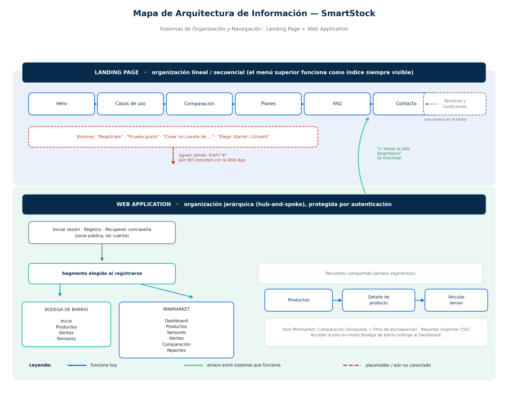

*Nota. Elaboración propia*

El mapa de arquitectura de información representa la organización de ambos productos y muestra también las conexiones existentes entre ellos. Asimismo, permite identificar visualmente la navegación que ya se encuentra implementada y aquella integración que todavía se encuentra pendiente.

### 4.2.1. Organization Systems

Para la organización visual del contenido, SmartStock utiliza diferentes esquemas dependiendo del tipo de información y del flujo que realiza el usuario.

#### Organización jerárquica

La organización jerárquica se utiliza principalmente en la Web Application.

El Dashboard funciona como el punto central de navegación y, desde ahí, el usuario puede acceder a las principales funcionalidades del sistema.

Dentro de la sección de productos existe una jerarquía más profunda:

**Dashboard → Productos → Detalle de producto → Vincular sensor**

Esto permite que el usuario avance desde una sección general hacia información cada vez más específica.

Además, dentro del sidebar, las funcionalidades principales se muestran primero, mientras que opciones secundarias como Configuración y Cerrar sesión se encuentran ubicadas al final del menú.

**Figura 24**

*Dashboard con barra lateral de la Web Application para minimarkets*

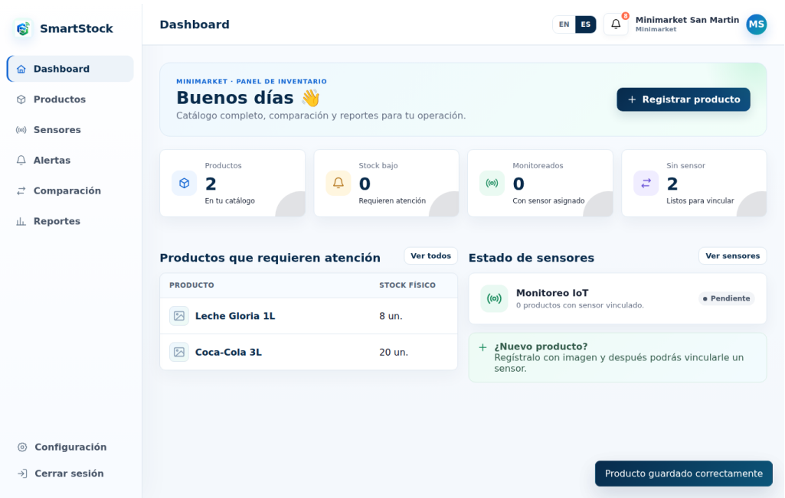

*Nota. Elaboración propia*

**Figura 25**

*Pantalla de inicio de la Web Application para bodegas de barrio*

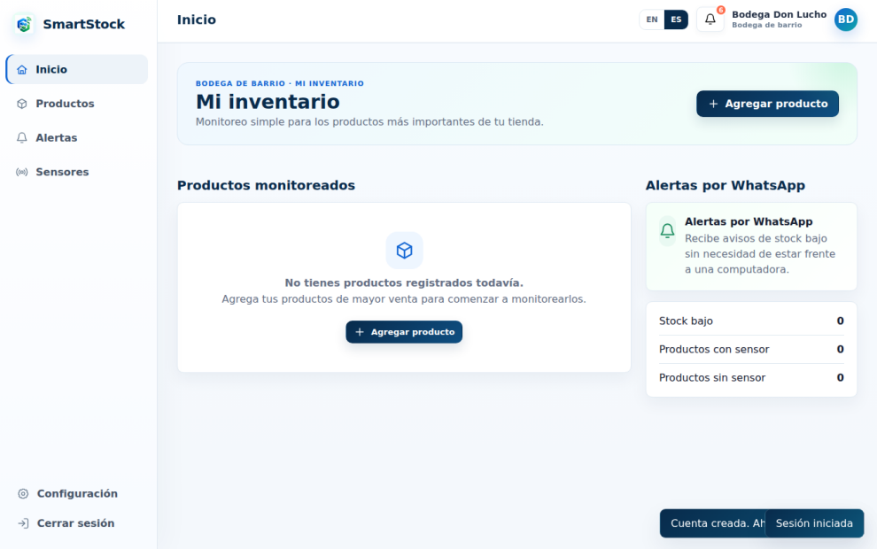

*Nota. Elaboración propia*

#### Organización secuencial

La organización secuencial se utiliza en los procesos que requieren que el usuario complete una serie de pasos en un orden determinado.

Por ejemplo, durante el proceso de incorporación del usuario se sigue el siguiente flujo:

**Registro → Elección de segmento → Inicio de sesión → Registro del primer producto**

De esta manera, el usuario es guiado paso a paso hasta comenzar a utilizar el sistema.

Este mismo principio también se aplica en el Landing Page, cuya información está organizada para ser recorrida de arriba hacia abajo:

**Hero → Casos de uso → Comparación → Planes → FAQ → Contacto**

#### Organización matricial

La organización matricial se utiliza principalmente en las tablas de Productos y Comparación.

En la sección Productos, cada producto se relaciona con diferentes atributos como:

- Categoría.
- Estado.
- Stock.
- Umbral.
- Sensor.

En la sección Comparación, cada producto se relaciona principalmente con:

- Stock físico.
- Stock registrado.
- Diferencia entre ambos valores.

Este tipo de organización permite visualizar diferentes atributos de un mismo producto dentro de una sola fila y aplicar filtros sin perder el contexto de la información.

#### Organización por audiencia

La organización por audiencia representa una de las decisiones más importantes dentro de SmartStock.

**Figura 26**

*Pantalla de creación de cuenta con selección de segmento*

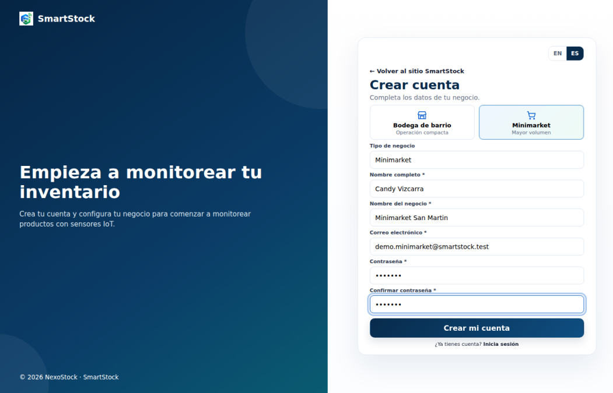

*Nota. Elaboración propia*

Las funcionalidades disponibles se organizan dependiendo del segmento seleccionado por el usuario durante el registro.

Los segmentos utilizados son:

- Bodega de barrio.
- Minimarket.

Esta diferenciación se aplica tanto en el menú lateral como en las rutas disponibles dentro de la aplicación.

De esta manera, cada tipo de usuario visualiza únicamente las funcionalidades correspondientes a las necesidades de su negocio.

#### Organización por tópicos

El Landing Page utiliza una organización por tópicos.

Cada sección presenta un tema específico dentro de la página, por ejemplo:

- Casos de uso.
- Comparación.
- Planes.
- FAQ.

Estas secciones pueden ser accedidas directamente desde el menú mediante enlaces internos.

#### Organización cronológica

La organización cronológica se utiliza en la sección de Alertas.

Los eventos más recientes aparecen primero mediante referencias de tiempo como:

- Hace 4 min.
- Hace 12 min.
- Hace 30 min.

Esto permite que el usuario pueda identificar primero los eventos más recientes y atender rápidamente las situaciones que puedan requerir su atención.

#### Organización alfabética

Actualmente no se utiliza una organización alfabética dentro del producto.

Debido a que los catálogos manejados durante el alcance actual del proyecto son relativamente pequeños, se priorizó la organización basada en el estado de los productos.

Por ejemplo, los productos con stock bajo pueden mostrarse antes que los productos con niveles normales, ya que esta información resulta más relevante para la gestión del inventario.

#### Limitación actual de integración

Actualmente existe una limitación de integración entre el Landing Page y la Web Application.

Desde la Web Application, el usuario puede regresar hacia el Landing Page utilizando el logo de SmartStock o mediante el enlace:

**“← Volver al sitio SmartStock”**

Sin embargo, actualmente el Landing Page todavía no redirige hacia la Web Application.

Los siguientes botones continúan utilizando enlaces temporales `href="#"`:

- Regístrate.
- Prueba gratis.
- Crear mi cuenta de bodega.
- Crear mi cuenta de minimarket.
- Elegir Starter.
- Elegir Growth.

Por este motivo, esta funcionalidad se considera una limitación conocida del alcance actual del proyecto y no una integración completamente implementada.

### 4.2.2. Labeling Systems

Las etiquetas utilizadas en SmartStock fueron diseñadas buscando mantener textos simples, cortos y fáciles de comprender.

#### Landing Page

En el Landing Page, las etiquetas del menú corresponden directamente con los títulos de las diferentes secciones.

Por ejemplo:

- Casos de uso.
- Comparación.
- Planes.
- FAQ.

Estas etiquetas utilizan una o dos palabras y funcionan al mismo tiempo como enlaces internos hacia las secciones correspondientes.

Esto evita inconsistencias entre el nombre mostrado en el menú y el contenido al cual dirige cada opción.

#### Web Application

En la Web Application, los elementos del sidebar combinan un ícono con una etiqueta corta.

Entre las principales etiquetas se encuentran:

- Dashboard.
- Productos.
- Sensores.
- Alertas.
- Comparación.
- Reportes.

Los íconos ayudan a complementar visualmente el significado de cada opción, permitiendo mantener textos cortos sin perder claridad.

**Figura 27**

*Pantalla de registro de producto de la Web Application*

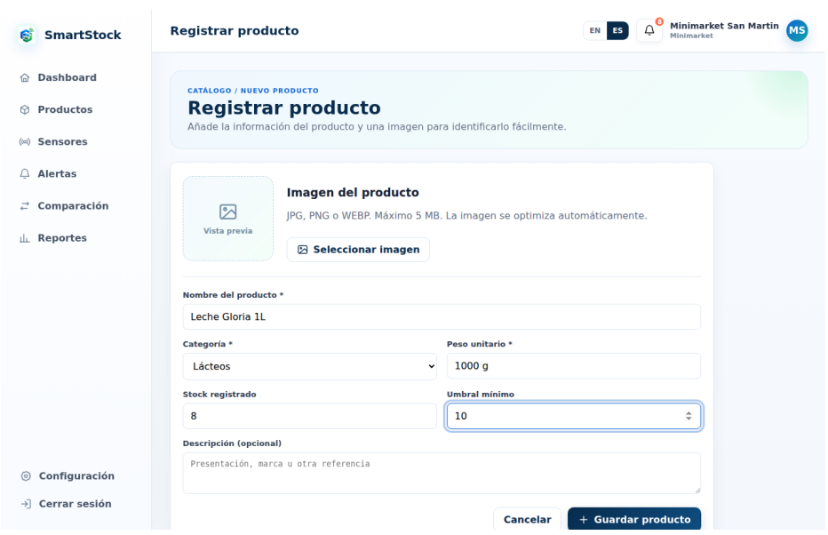

*Nota. Elaboración propia*

Además, tanto el Landing Page como la Web Application se encuentran disponibles en inglés y español.

Ambos productos comparten la misma preferencia de idioma mediante `localStorage`.

Clave utilizada:

`smartstock.lang`

Esto permite que el idioma seleccionado por el usuario permanezca activo al desplazarse entre ambos productos.

#### Diferencia de etiquetado según el segmento

Existe una diferencia intencional en la etiqueta utilizada para la ruta interna `#dashboard`.

Para usuarios del segmento Bodega de barrio, esta sección se denomina:

**Inicio**

Mientras que para los usuarios del segmento Minimarket, la misma sección se denomina:

**Dashboard**

Esta diferencia fue implementada de manera intencional para utilizar una terminología más sencilla en el segmento de negocio más pequeño.

### 4.2.3. SEO Tags and Meta Tags

#### Landing Page

El Landing Page incluye las principales etiquetas SEO y Meta Tags solicitadas.

Tanto `index.html` como `terms-of-service.html` cuentan con:

- `<title>`
- `<meta name="description">`
- `<meta name="keywords">`
- `<meta name="author">`

La etiqueta `<title>` contiene un título descriptivo de la página.

La etiqueta `<meta name="description">` contiene una descripción del contenido y puede mostrarse de acuerdo con el idioma seleccionado.

La etiqueta `<meta name="keywords">` contiene términos relacionados con el proyecto como:

- minimarket.
- corner store.
- SmartStock.
- NexoStock.

Finalmente, la etiqueta de autor utiliza:

`<meta name="author" content="NexoStock">`

#### Web Application

Actualmente la Web Application solo cuenta con la etiqueta `<title>` y todavía no incluye las etiquetas:

- Description.
- Keywords.
- Author.

Debido a que la rúbrica solicita estas etiquetas en las páginas principales de ambos productos, se considera un pendiente real de implementación que debe ser corregido antes de la entrega.

Las etiquetas que deben agregarse son las siguientes:

`<meta name="description" content="SmartStock Web Application — gestiona tu inventario monitoreado por sensores IoT, alertas y comparaciones de stock.">`

`<meta name="keywords" content="SmartStock, NexoStock, gestión de inventario, sensores IoT, monitoreo de stock">`

`<meta name="author" content="NexoStock">`

Adicionalmente, podría incorporarse de forma opcional:

`<meta name="robots" content="noindex">`

Esta última etiqueta permitiría indicar explícitamente a los motores de búsqueda que la Web Application, al encontrarse protegida mediante autenticación, no está pensada para ser indexada.

Sin embargo, esta etiqueta adicional no reemplaza las etiquetas requeridas por la rúbrica.

### 4.2.4. Searching Systems

#### Landing Page

El Landing Page no utiliza un sistema de búsqueda.

Esto se debe a que se trata de una página de una sola vista y su contenido se encuentra dividido en secciones claramente identificadas mediante el menú superior.

Por este motivo, actualmente no resulta necesario implementar un buscador interno.

#### Web Application

La Web Application sí dispone de sistemas funcionales de búsqueda y filtrado.

Estos sistemas se encuentran principalmente en las secciones Productos, Comparación y Alertas.

#### Productos

La sección Productos dispone de un campo de búsqueda que filtra los resultados en tiempo real.

La búsqueda puede realizarse utilizando:

- Nombre del producto.
- Categoría.

Además, el buscador puede combinarse con un filtro de estado que contiene las siguientes opciones:

- Todos los estados.
- Stock bajo.
- Normal.
- Sin sensor.

**Figura 28**

*Sección Productos con búsqueda y filtro por estado*

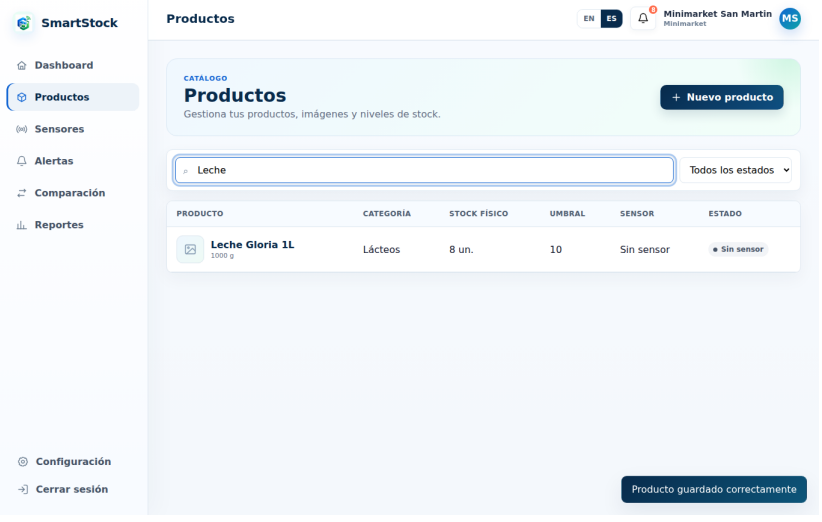

*Nota. Elaboración propia*

Después de realizar una búsqueda, las filas que no coinciden con los criterios ingresados se ocultan.

Las filas que sí coinciden continúan mostrando toda su información correspondiente, como:

- Imagen.
- Categoría.
- Stock.
- Umbral.
- Sensor.
- Estado.

De esta manera, el usuario puede encontrar rápidamente un producto sin perder información relevante de los resultados encontrados.

#### Comparación

La sección Comparación también utiliza un campo de búsqueda.

En este caso, la búsqueda funciona por prefijo del nombre del producto.

Esto significa que solamente se muestran productos cuyo nombre comienza con el texto ingresado por el usuario.

Este comportamiento es diferente al sistema utilizado en Productos.

La búsqueda también puede combinarse con un filtro de discrepancias:

- Todos.
- Con discrepancia.
- Sin discrepancia.

Después de realizar una búsqueda o aplicar un filtro, el sistema recalcula automáticamente:

- El número de productos visibles.
- El número de productos que superan el 10 % de diferencia entre el stock registrado y el stock físico.

Esto permite que los indicadores mostrados se mantengan consistentes con los resultados actualmente visibles.

**Figura 29**

*Sección Comparación con búsqueda y filtro de discrepancias*

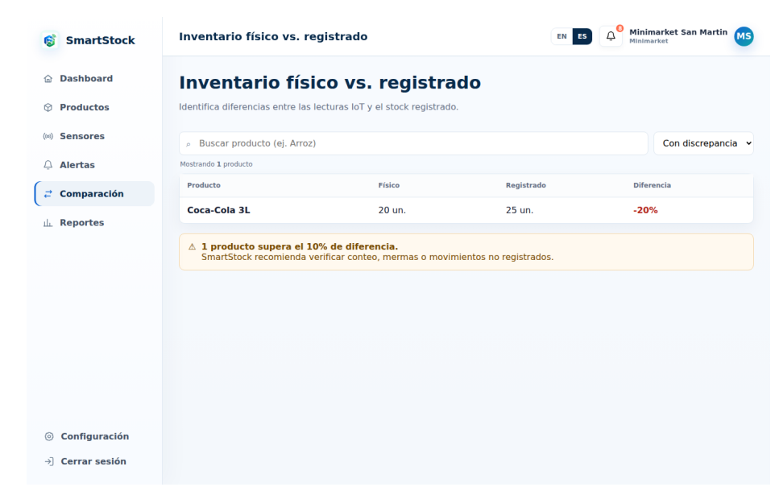

*Nota. Elaboración propia*

#### Alertas

La sección Alertas utiliza pestañas que funcionan como filtros por categoría.

Las opciones disponibles son:

- Todas.
- Stock bajo.
- Discrepancias.
- Sensores.

Cada pestaña cuenta con un contador actualizado.

Después de seleccionar una categoría, únicamente permanecen visibles las alertas relacionadas con ese tipo.

Cada alerta conserva información relevante como:

- Ícono.
- Mensaje.
- Marca de tiempo relativa.

De esta manera, el usuario puede filtrar rápidamente las alertas y concentrarse únicamente en aquellas que necesita revisar.

**Figura 30**

*Sección Alertas con pestañas por categoría*

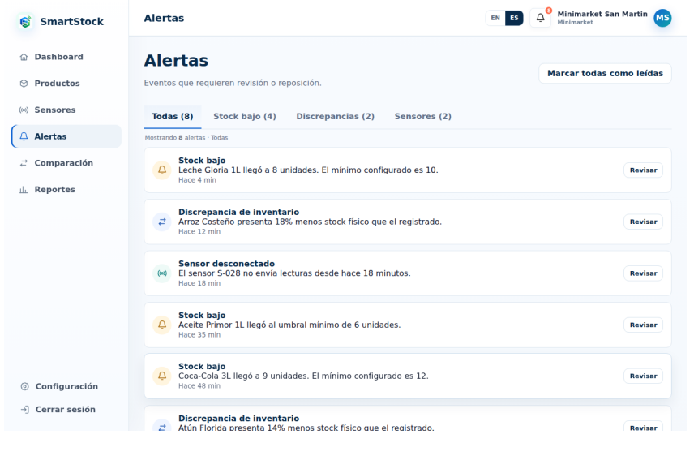

*Nota. Elaboración propia*

### 4.2.5. Navigation Systems

SmartStock utiliza diferentes sistemas de navegación para facilitar el desplazamiento del usuario tanto dentro del Landing Page como dentro de la Web Application. 

#### Landing Page

El Landing Page combina diferentes sistemas de navegación.

El principal es un menú superior persistente que funciona como sistema de navegación global.

Este menú permite acceder directamente a las diferentes secciones de la página mediante enlaces internos.

El Footer funciona como un sistema de navegación contextual y permite acceder principalmente a:

- Enlaces legales.
- Redes sociales.
- Información secundaria.

También se utiliza navegación mediante anchors, permitiendo desplazarse directamente hacia una sección específica sin abandonar la página principal.

#### Web Application

La Web Application utiliza un sidebar persistente como sistema de navegación global.

Las opciones disponibles dentro del sidebar cambian dependiendo del segmento del usuario.

Para pantallas pequeñas se utiliza un menú hamburguesa que contiene las mismas opciones disponibles en el menú lateral.

La barra superior también incorpora diferentes elementos de navegación y orientación, entre ellos:

- Selector de idioma.
- Campana de notificaciones.
- Contador de notificaciones no leídas.
- Nombre del negocio.
- Tipo de negocio.
- Avatar con las iniciales del usuario.

La campana de notificaciones permite acceder directamente hacia la sección de Alertas.

El bloque que contiene la información del negocio funciona además como un indicador de identidad, ayudando al usuario a reconocer qué cuenta y qué tipo de negocio está utilizando.

Dentro del Detalle de producto también se proporciona contexto adicional mediante una navegación similar a un breadcrumb:

**Figura 31**

*Sección Sensores IoT de la Web Application*

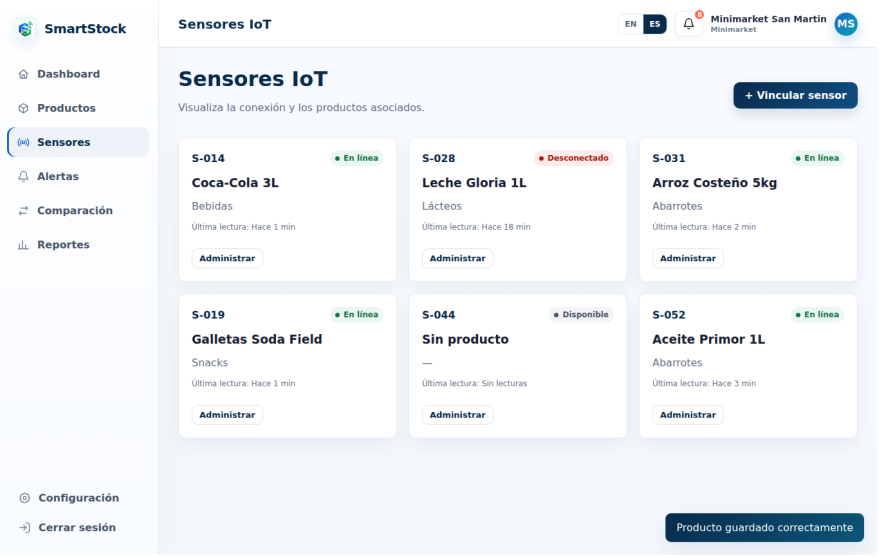

*Nota. Elaboración propia*

#### Navegación entre el Landing Page y la Web Application

Actualmente, la Web Application permite regresar al Landing Page mediante:
El logotipo de SmartStock.
La opción **← Volver al sitio SmartStock**

**Figura 32**

*Pantalla de inicio de sesión de la Web Application*

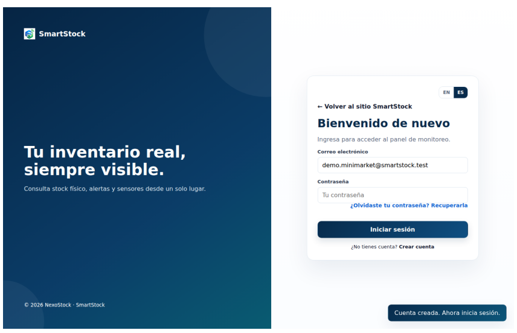

*Nota. Elaboración propia*

Sin embargo, desde el Landing Page todavía no existe una conexión funcional hacia la Web Application, debido a que los principales botones Call to Action continúan utilizando enlaces temporales.

Esta situación se considera una limitación conocida correspondiente al estado actual del proyecto.

## 4.3. Landing Page UI Design

El diseño de la interfaz de usuario (UI) de la página de inicio de SmartStock es clave para captar la atención de los administradores y propietarios de bodegas y minimarkets, ya que los guía hacia una acción clara: comprender y adoptar una solución inteligente de gestión de inventarios. Se ha priorizado una experiencia continua, de modo que cada elemento de la página sea accesible, interactivo y fácil de usar, transmitiendo confianza, mientras refleja el compromiso de SmartStock con la innovación tecnológica y la claridad en la comunicación. 

### 4.3.1. Landing Page Wireframe

El wireframe de SmartStock organiza de forma clara la página de inicio, mostrando la secuencia lógica de secciones: desde el problema de la gestión del inventario, pasando por las funcionalidades principales, hasta los beneficios que ofrece la plataforma.

**Desktop:**

**Figura 33**

*Interfaz principal de bienvenida del landing page de SmartStock*

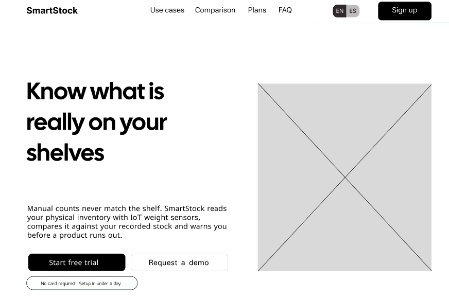

* Nota. Wireframe de la estructura principal de inicio del landing page de SmartStock en versión de escritorio.*

**Figura 34**

*Interfaz de la sección de problemas y beneficios de SmartStock en versión de escritorio*

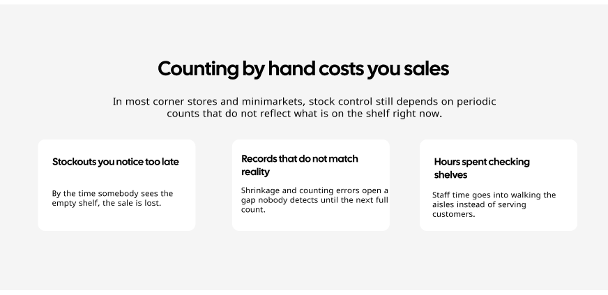

*Nota. Wireframe de la estructura de la sección de problemas y beneficios de SmartStock en versión de escritorio.*

**Figura 35**

*Interfaz de la sección de casos de uso de SmartStock en versión de escritorio*

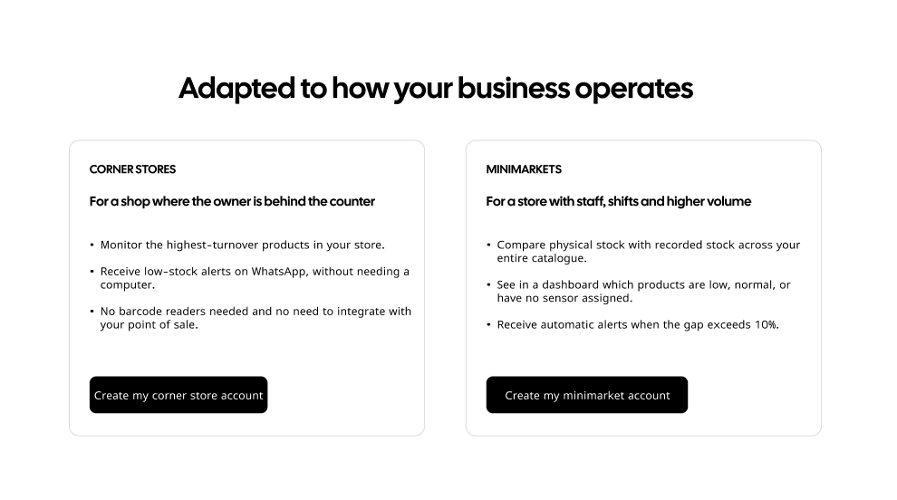

*Nota. Wireframe de la estructura de la sección de casos de uso de SmartStock en versión de escritorio.*

**Figura 36**

*Interfaz de la sección comparativa de SmartStock en versión de escritorio*

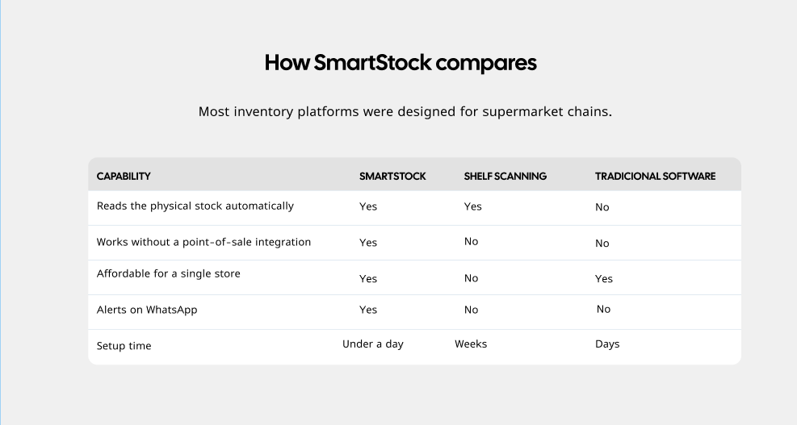

*Nota. Wireframe de la estructura de la sección comparativa de SmartStock en versión de escritorio.*

**Figura 37**

*Interfaz de la sección de planes de SmartStock en versión de escritorio*

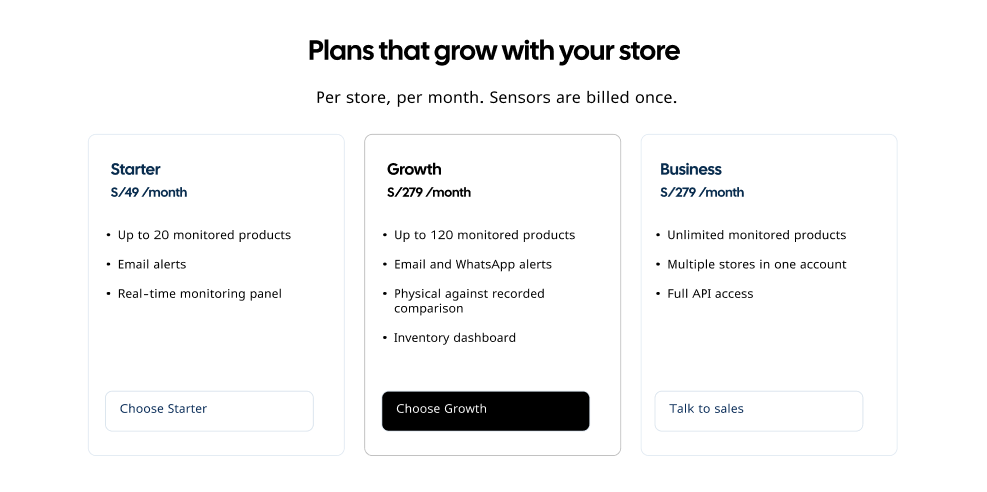

*Nota. Wireframe de la estructura de la sección de planes de SmartStock en versión de escritorio.*

**Figura 38**

*Interfaz de la sección de testimonios de SmartStock en versión de escritorio*

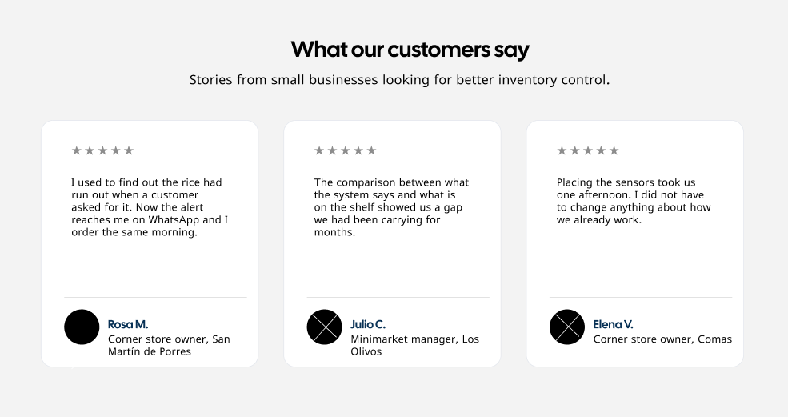

*Nota. Wireframe de la estructura de la sección de testimonios de SmartStock en versión de escritorio.*

**Figura 39**

*Interfaz de la sección de preguntas frecuentes de SmartStock en versión de escritorio*

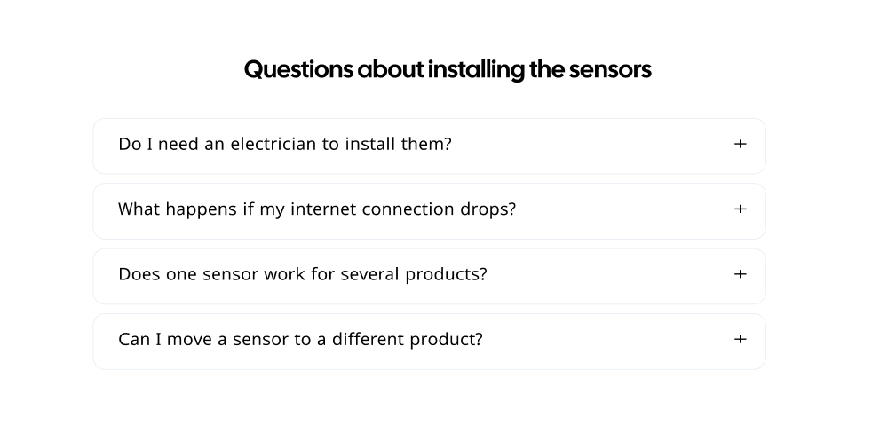

*Nota. Wireframe de la estructura de la sección de preguntas frecuentes de SmartStock en versión de escritorio.*

**Figura 40**

*Interfaz del formulario de demostración de SmartStock en versión de escritorio*

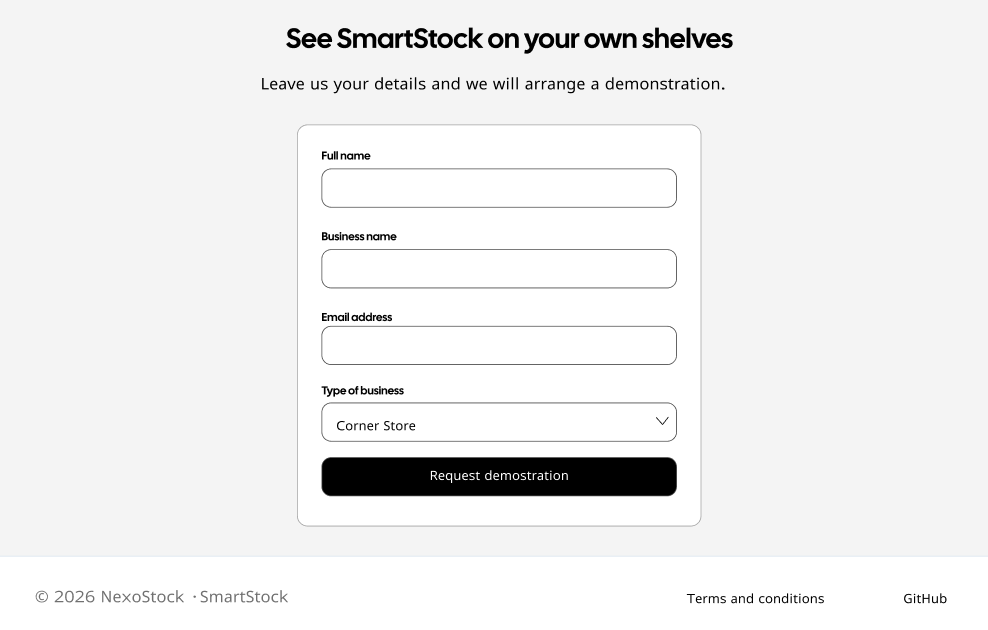

*Nota. Wireframe de la estructura del formulario de demostración de SmartStock en versión de escritorio.*

**Figura 41**

*Pie de página del landing page de SmartStock*

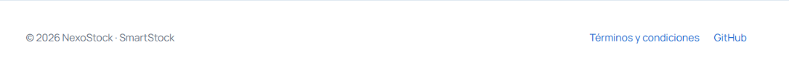

*Nota. Wireframe del pie de página del landing page de SmartStock*

**Mobile:**

**Figura 42**

*Interfaz principal de inicio de SmartStock en versión móvil*

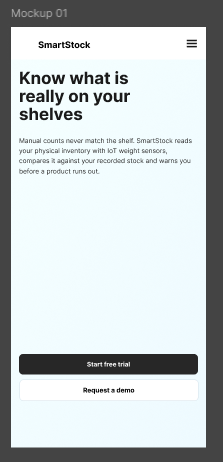

*Nota. Wireframe de la estructura principal de inicio del landing page de SmartStock adaptada para dispositivos móviles.*

**Figura 43**

*Interfaz de la sección de problemas y beneficios de SmartStock en versión móvil*

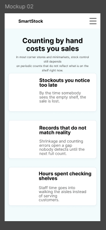

*Nota. Wireframe de la estructura de la sección de problemas y beneficios de SmartStock adaptada para dispositivos móviles.*

**Figura 44**
 
*Interfaz de la sección de casos de uso de SmartStock en versión móvil*

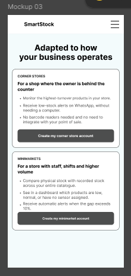

*Nota. Wireframe de la estructura de la sección de casos de uso de SmartStock adaptada para dispositivos móviles.*

**Figura 45**

*Interfaz de la sección comparativa de SmartStock en versión móvil*

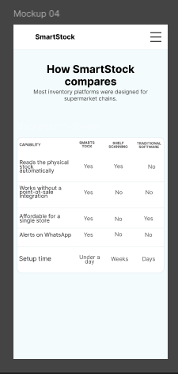

*Nota. Wireframe de la estructura de la sección comparativa de SmartStock adaptada para dispositivos móviles.*

**Figura 46**

*Interfaz de la sección de planes de SmartStock en versión móvil*

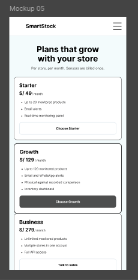

*Nota. Wireframe de la estructura de la sección de planes de SmartStock adaptada para dispositivos móviles.*

**Figura 47**

*Interfaz de la sección de testimonios de SmartStock en versión móvil*

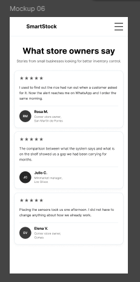

*Nota. Wireframe de la estructura de la sección de testimonios de SmartStock adaptada para dispositivos móviles.*

**Figura 48**

*Interfaz de la sección de preguntas frecuentes de SmartStock en versión móvil*

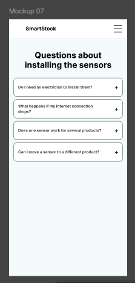

*Nota. Wireframe de la estructura de la sección de preguntas frecuentes de SmartStock adaptada para dispositivos móviles.*

**Figura 49**

*Interfaz del formulario de demostración de SmartStock en versión móvil*

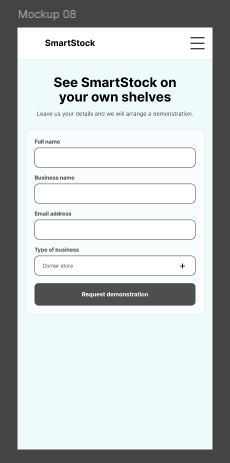

*Nota. Wireframe de la estructura del formulario de demostración de SmartStock adaptada para dispositivos móviles.*

**Figura 50**

*Interfaz del menú de navegación de SmartStock en versión móvil*

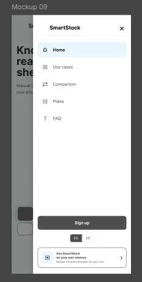

*Nota. Wireframe de la estructura del menú de navegación de SmartStock adaptado para dispositivos móviles.*

### 4.3.2. Landing Page Mock-up

El mock-up de la página de inicio de SmartStock actúa como un mapa visual que organiza la estructura y el flujo de la información, mientras cada sección conduce al usuario desde la identificación del problema hasta la presentación de las funcionalidades y beneficios de la plataforma. 

**Desktop:**

**Figura 51**

*Interfaz principal de inicio del landing page de SmartStock en versión de escritorio*

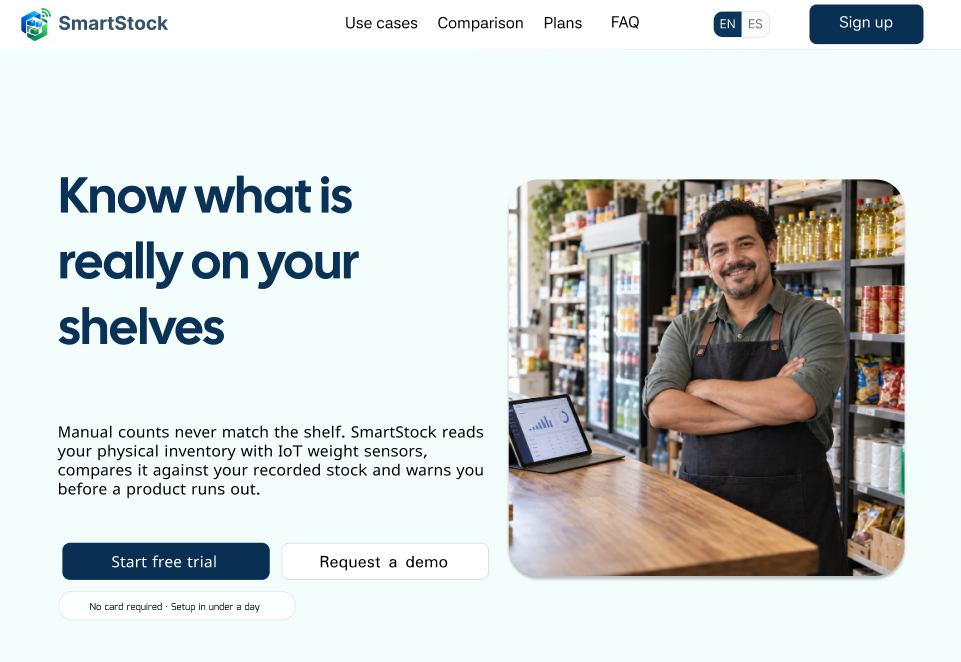

*Nota. Mockup de la interfaz principal de inicio del landing page de SmartStock en versión de escritorio.*

**Figura 52**

*Interfaz de problemas y beneficios de SmartStock en versión de escritorio*

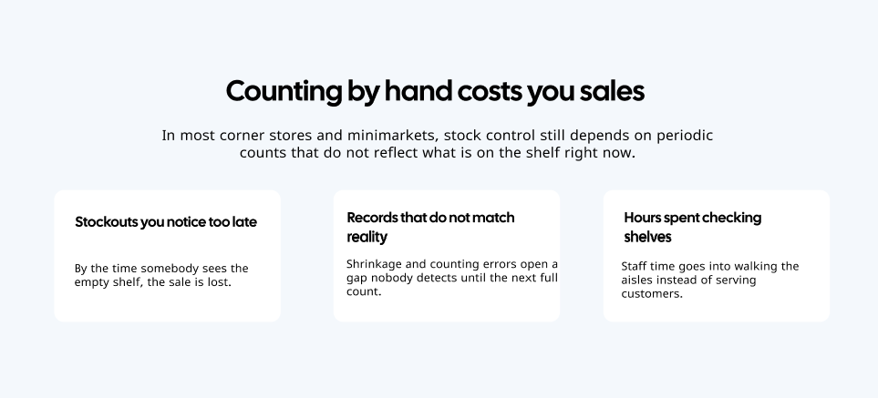

*Nota. Mockup de la interfaz de problemas y beneficios de SmartStock en versión de escritorio.*

**Figura 53**

*Interfaz de casos de uso de SmartStock en versión de escritorio*

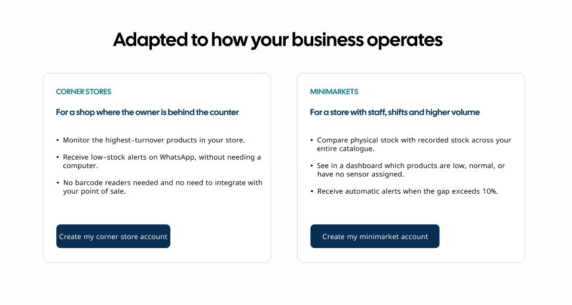

*Nota. Mockup de la interfaz de casos de uso de SmartStock en versión de escritorio.*

**Figura 54**

*Interfaz de la sección comparativa de SmartStock en versión de escritorio*

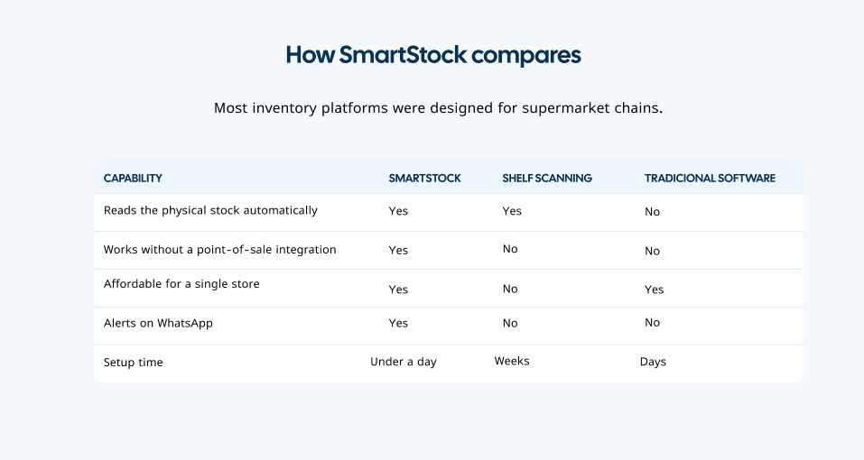

*Nota. Mockup de la interfaz de la sección comparativa de SmartStock en versión de escritorio.*

**Figura 55**

*Interfaz de planes de SmartStock en versión de escritorio*

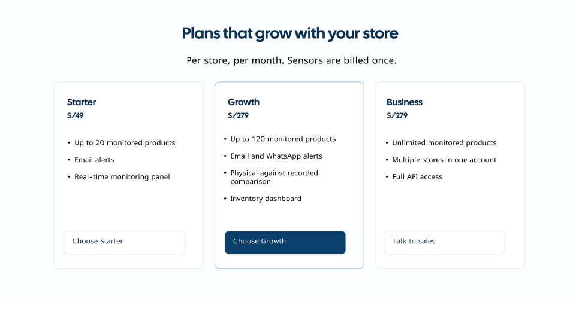

*Nota. Mockup de la interfaz de planes de SmartStock en versión de escritorio.*

**Figura 56**

*Interfaz de testimonios de SmartStock en versión de escritorio*

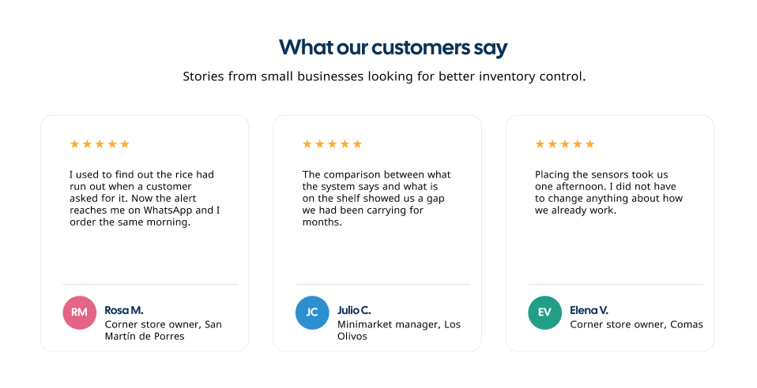

*Nota. Mockup de la interfaz de testimonios de SmartStock en versión de escritorio.*

**Figura 57**

*Interfaz de preguntas frecuentes de SmartStock en versión de escritorio*

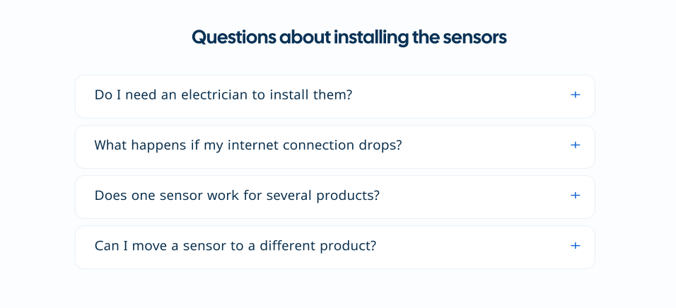

*Nota. Mockup de la interfaz de preguntas frecuentes de SmartStock en versión de escritorio.*

**Figura 58**

*Interfaz del formulario de demostración y pie de página de SmartStock en versión de escritorio*

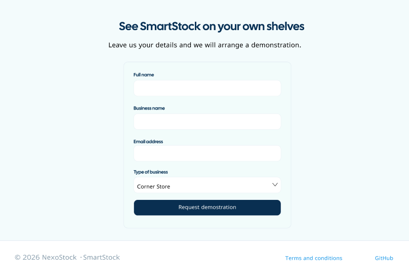

*Nota. Mockup de la interfaz del formulario de demostración y del pie de página de SmartStock en versión de escritorio.*

**Figura 59**

*Pie de página de la verizon de escritorio de SmartStock*

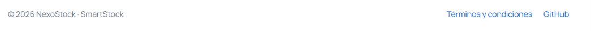

*Nota. Mockup del pie de página de SmartStock*

**Mobile:**

**Figura 60**

*Interfaz principal de inicio del landing page de SmartStock en versión móvil*

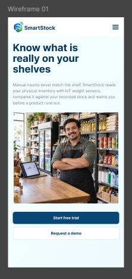

*Nota. Mock-up de la interfaz principal de inicio del landing page de SmartStock adaptada para dispositivos móviles.*

**Figura 61**

*Interfaz de problemas y beneficios de SmartStock en versión móvil*

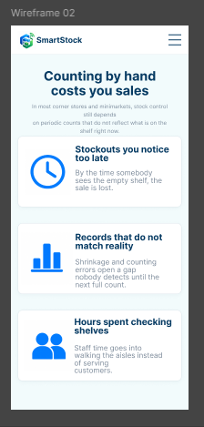

*Nota. Mock-up de la interfaz de problemas y beneficios de SmartStock adaptada para dispositivos móviles.*

**Figura 62**

*Interfaz de casos de uso de SmartStock en versión móvil*

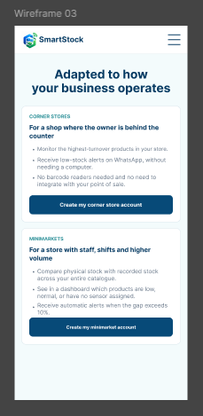

*Nota. Mock-up de la interfaz de casos de uso de SmartStock adaptada para dispositivos móviles.*

**Figura 63**

*Interfaz de la sección comparativa de SmartStock en versión móvil*

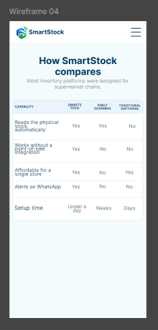

*Nota. Mock-up de la interfaz de la sección comparativa de SmartStock adaptada para dispositivos móviles.*

**Figura 64**

*Interfaz de planes de SmartStock en versión móvil*

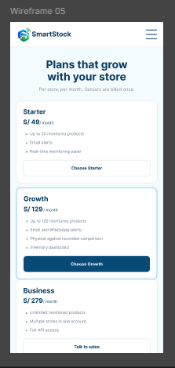

*Nota. Mock-up de la interfaz de planes de SmartStock adaptada para dispositivos móviles.*

**Figura 65**

*Interfaz de testimonios de SmartStock en versión móvil*

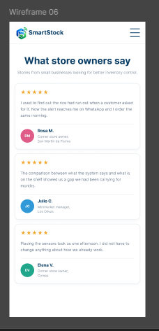

*Nota. Mock-up de la interfaz de testimonios de SmartStock adaptada para dispositivos móviles.*

**Figura 66**

*Interfaz de preguntas frecuentes de SmartStock en versión móvil*

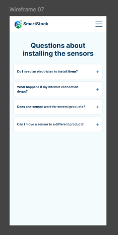

*Nota. Mock-up de la interfaz de preguntas frecuentes de SmartStock adaptada para dispositivos móviles.*

**Figura 67**

*Interfaz del formulario de demostración de SmartStock en versión móvil*

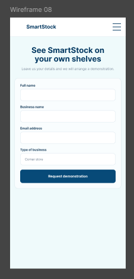

*Nota. Mock-up de la interfaz del formulario de demostración de SmartStock adaptada para dispositivos móviles.*

**Figura 68**

*Interfaz del menú de navegación de SmartStock en versión móvil*

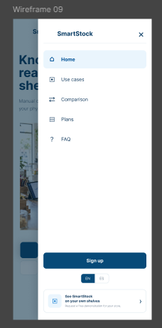

*Nota. Mock-up del menú de navegación del landing page de SmartStock adaptado para dispositivos móviles.*

## 4.4. Web Applications UX/UI Design

En esta sección se presenta la propuesta de diseño UX/UI de la aplicación web de SmartStock, describiendo la estructura visual, los elementos de interfaz y los patrones de interacción que guían la experiencia del usuario.

El diseño está orientado a los propietarios y administradores de minimarkets y bodegas de barrio, priorizando una interacción clara, eficiente y alineada con sus necesidades de gestión y monitoreo del inventario. Asimismo, se mantiene la coherencia con los Style Guidelines y la Information Architecture definidos previamente, garantizando una experiencia intuitiva, consistente y accesible en toda la plataforma.

### 4.4.1. Web Applications Wireframes

#### Dueños y administradores de Minimarkets

**Figura 69**

*Wireframe 1 de la aplicación web para propietarios y administradores de minimarkets*

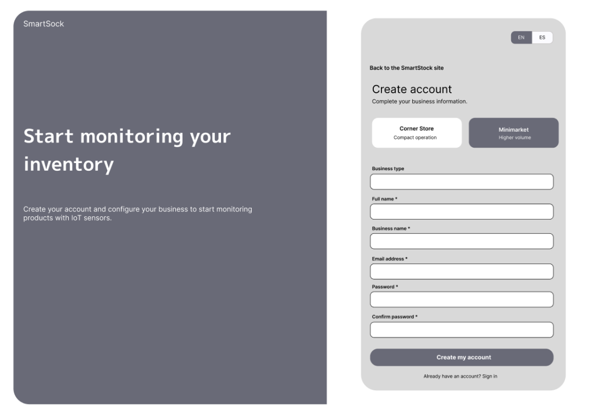

*Nota. Elaboración propia.*

**Figura 70**

*Wireframe 2 de la aplicación web para propietarios y administradores de minimarkets*

*Nota. Elaboración propia.*

**Figura 71**

*Wireframe 3 de la aplicación web para propietarios y administradores de minimarkets*

*Nota. Elaboración propia.*

**Figura 72**

*Wireframe 4 de la aplicación web para propietarios y administradores de minimarkets*

*Nota. Elaboración propia.*

**Figura 73**

*Wireframe 5 de la aplicación web para propietarios y administradores de minimarkets*

*Nota. Elaboración propia.*

**Figura 74**

*Wireframe 6 de la aplicación web para propietarios y administradores de minimarkets*

*Nota. Elaboración propia.*

**Figura 75**

*Wireframe 7 de la aplicación web para propietarios y administradores de minimarkets*

*Nota. Elaboración propia.*

**Figura 76**

*Wireframe 8 de la aplicación web para propietarios y administradores de minimarkets*

*Nota. Elaboración propia.*

**Figura 77**

*Wireframe 9 de la aplicación web para propietarios y administradores de minimarkets*

*Nota. Elaboración propia.*

**Figura 78**

*Wireframe 10 de la aplicación web para propietarios y administradores de minimarkets*

*Nota. Elaboración propia.*

**Figura 79**

*Wireframe 11 de la aplicación web para propietarios y administradores de minimarkets*

*Nota. Elaboración propia.*

**Figura 80**

*Wireframe 12 de la aplicación web para propietarios y administradores de minimarkets*

*Nota. Elaboración propia.*

**Figura 81**

*Wireframe 13 de la aplicación web para propietarios y administradores de minimarkets*

*Nota. Elaboración propia.*

**Figura 82**

*Wireframe 14 de la aplicación web para propietarios y administradores de minimarkets*

*Nota. Elaboración propia.*

**Figura 83**

*Wireframe 15 de la aplicación web para propietarios y administradores de minimarkets*

*Nota. Elaboración propia.*

**Figura 84**

*Wireframe 16 de la aplicación web para propietarios y administradores de minimarkets*

*Nota. Elaboración propia.*

**Figura 85**

*Wireframe 17 de la aplicación web para propietarios y administradores de minimarkets*

*Nota. Elaboración propia.*

**Figura 86**

*Wireframe 18 de la aplicación web para propietarios y administradores de minimarkets*

*Nota. Elaboración propia.*

**Figura 87**

*Wireframe 19 de la aplicación web para propietarios y administradores de minimarkets*

*Nota. Elaboración propia.*

#### Dueños y administradores de Bodegas

**Figura 88**

*Wireframe 1 de la aplicación web para propietarios y administradores de bodegas de barrio*

*Nota. Elaboración propia.*

**Figura 89**

*Wireframe 2 de la aplicación web para propietarios y administradores de bodegas de barrio*

*Nota. Elaboración propia.*

**Figura 90**

*Wireframe 3 de la aplicación web para propietarios y administradores de bodegas de barrio*

*Nota. Elaboración propia.*

**Figura 91**

*Wireframe 4 de la aplicación web para propietarios y administradores de bodegas de barrio*

*Nota. Elaboración propia.*

**Figura 92**

*Wireframe 5 de la aplicación web para propietarios y administradores de bodegas de barrio*

*Nota. Elaboración propia.*

**Figura 93**

*Wireframe 6 de la aplicación web para propietarios y administradores de bodegas de barrio*

*Nota. Elaboración propia.*

**Figura 94**

*Wireframe 7 de la aplicación web para propietarios y administradores de bodegas de barrio*

*Nota. Elaboración propia.*

**Figura 95**

*Wireframe 8 de la aplicación web para propietarios y administradores de bodegas de barrio*

*Nota. Elaboración propia.*

**Figura 96**

*Wireframe 9 de la aplicación web para propietarios y administradores de bodegas de barrio*

*Nota. Elaboración propia.*

**Figura 97**

*Wireframe 10 de la aplicación web para propietarios y administradores de bodegas de barrio*

*Nota. Elaboración propia.*

**Figura 98**

*Wireframe 11 de la aplicación web para propietarios y administradores de bodegas de barrio*

*Nota. Elaboración propia.*

**Figura 99**

*Wireframe 12 de la aplicación web para propietarios y administradores de bodegas de barrio*

*Nota. Elaboración propia.*

**Figura 100**

*Wireframe 13 de la aplicación web para propietarios y administradores de bodegas de barrio*

*Nota. Elaboración propia.*

**Figura 101**

*Wireframe 14 de la aplicación web para propietarios y administradores de bodegas de barrio*

*Nota. Elaboración propia.*

**Figura 102**

*Wireframe 15 de la aplicación web para propietarios y administradores de bodegas de barrio*

*Nota. Elaboración propia.*

**Figura 103**

*Wireframe 16 de la aplicación web para propietarios y administradores de bodegas de barrio*

*Nota. Elaboración propia.*

### 4.4.2. Web Applications Wireflow Diagrams

Los wireflows muestran las rutas que siguen los usuarios entre las diferentes pantallas de la aplicación según su segmento. Cada wireflow parte de un objetivo del usuario (User Goal), presenta las pantallas involucradas con su código, indica la ruta esperada con una línea azul y las rutas alternativas o de error con una línea roja discontinua, y se acompaña de una explicación del flujo y de su condición principal.
Se elaboraron wireflows para los dos segmentos objetivo de SmartStock: propietarios y administradores de minimarkets, y propietarios y administradores de bodegas de barrio. Los flujos cubren el acceso a la cuenta, la gestión del catálogo, el monitoreo del stock con sensores IoT, el registro de compras, ventas y proveedores, la reposición desde una alerta de stock bajo y la comparación de inventario. El conjunto completo de wireflows puede consultarse en el siguiente enlace. 

**Link:**
`https://www.figma.com/board/Tdon4igryTEOc1wl7f5I15/Wireflow-diagrams-SmartStock?node-id=0-1&t=ik1xWHtOIA29fNXh-1`

#### Dueños y administradores de Minimarkets

Para este segmento se presentan 12 wireflows, que cubren el acceso a la cuenta, la gestión del catálogo, el monitoreo del stock con sensores IoT, la configuración del umbral mínimo de stock, el registro de compras, ventas y proveedores, la reposición desde una alerta de stock bajo y la comparación entre el inventario físico y el registrado. 

**Figura 104**

*Wireflow 1 de la aplicación web para propietarios y administradores de minimarkets: iniciar sesión (US02)*

*Nota. Elaboración propia.*

**Figura 105**

*Wireflow 2 de la aplicación web para propietarios y administradores de minimarkets: registrar una cuenta (US01)*

*Nota. Elaboración propia.*

**Figura 106**

*Wireflow 3 de la aplicación web para propietarios y administradores de minimarkets: consultar el resumen del negocio y navegar a sus módulos (US15)*

*Nota. Elaboración propia.*

**Figura 107**

*Wireflow 4 de la aplicación web para propietarios y administradores de minimarkets: registrar un producto en el catálogo (US13)*

*Nota. Elaboración propia.*

**Figura 108**

*Wireflow 5 de la aplicación web para propietarios y administradores de minimarkets: consultar el stock de un producto y su peso en el sensor (US07, US08, US06)*

*Nota. Elaboración propia.*

**Figura 109**

*Wireflow 6 de la aplicación web para propietarios y administradores de minimarkets: vincular un sensor IoT a un producto (US04)*

*Nota. Elaboración propia.*

**Figura 110**

*Wireflow 7 de la aplicación web para propietarios y administradores de minimarkets: configurar el umbral mínimo de stock (US05)*

*Nota. Elaboración propia.*

**Figura 111**

*Wireflow 8 de la aplicación web para propietarios y administradores de minimarkets: registrar una compra (US30)*

*Nota. Elaboración propia.*

**Figura 112**

*Wireflow 9 de la aplicación web para propietarios y administradores de minimarkets: registrar una venta (US26)*

*Nota. Elaboración propia.*

**Figura 113**

*Wireflow 10 de la aplicación web para propietarios y administradores de minimarkets: registrar un proveedor (US211)*

*Nota. Elaboración propia.*

**Figura 114**

*Wireflow 11 de la aplicación web para propietarios y administradores de minimarkets: reponer un producto desde una alerta de stock bajo (US32)*

*Nota. Elaboración propia.*

**Figura 115**

*Wireflow 12 de la aplicación web para propietarios y administradores de minimarkets: comparar el inventario físico con el registrado (US11, US12)*

*Nota. Elaboración propia.*

#### Dueños y administradores de Bodegas

Para este segmento se presentan 11 wireflows. Son los mismos flujos que en minimarkets, salvo la comparación entre inventario físico y registrado, que no forma parte del recorrido de este segmento. Las pantallas se adaptan al tipo de negocio, de modo que cambian el menú y las funciones disponibles. 

**Figura 116**

*Wireflow 1 de la aplicación web para propietarios y administradores de bodegas de barrio: iniciar sesión (US02)*

*Nota. Elaboración propia.*

**Figura 117**

*Wireflow 2 de la aplicación web para propietarios y administradores de bodegas de barrio: registrar una cuenta (US01)*

*Nota. Elaboración propia.*

**Figura 118**

*Wireflow 3 de la aplicación web para propietarios y administradores de bodegas de barrio: consultar el resumen del negocio y navegar a sus módulos (US15)*

*Nota. Elaboración propia.*

**Figura 119**

*Wireflow 4 de la aplicación web para propietarios y administradores de bodegas de barrio: registrar un producto en el catálogo (US13)*

*Nota. Elaboración propia.*

**Figura 120**

*Wireflow 5 de la aplicación web para propietarios y administradores de bodegas de barrio: consultar el stock de un producto y su peso en el sensor (US07, US08, US06)*

*Nota. Elaboración propia.*

**Figura 121**

*Wireflow 6 de la aplicación web para propietarios y administradores de bodegas de barrio: vincular un sensor IoT a un producto (US04)*

*Nota. Elaboración propia.*

**Figura 122**

*Wireflow 7 de la aplicación web para propietarios y administradores de bodegas de barrio: configurar el umbral mínimo de stock (US05)*

*Nota. Elaboración propia.*

**Figura 123**

*Wireflow 8 de la aplicación web para propietarios y administradores de bodegas de barrio: registrar una compra (US30)*

*Nota. Elaboración propia.*

**Figura 124**

*Wireflow 9 de la aplicación web para propietarios y administradores de bodegas de barrio: registrar una venta (US26)*

*Nota. Elaboración propia.*

**Figura 125**

*Wireflow 10 de la aplicación web para propietarios y administradores de bodegas de barrio: registrar un proveedor (US29)*

*Nota. Elaboración propia.*

**Figura 126**

*Wireflow 11 de la aplicación web para propietarios y administradores de bodegas de barrio: reponer un producto desde una alerta de stock bajo (US32)*

*Nota. Elaboración propia.*

### 4.4.3. Web Applications Mock-ups

Los mock-ups presentan el diseño visual final de las pantallas de la aplicación web de SmartStock, con la paleta de colores, la tipografía y los componentes definidos en el Style Guide. Se elaboraron para los dos segmentos objetivo y siguen los flujos descritos en los wireflows.

#### Dueños y administradores de Minimarkets

**Figura 127**

*Mock-up 1 de la aplicación web para propietarios y administradores de minimarkets: registro de cuenta (US01)*

*Nota. Elaboración propia.*

**Figura 128**

*Mock-up 2 de la aplicación web para propietarios y administradores de minimarkets: inicio de sesión (US02)*

*Nota. Elaboración propia.*

**Figura 129**

*Mock-up 3 de la aplicación web para propietarios y administradores de minimarkets: inicio de sesión con credenciales incorrectas (US02)*

*Nota. Elaboración propia.*

**Figura 130**

*Mock-up 4 de la aplicación web para propietarios y administradores de minimarkets: dashboard inicial del negocio (US15)*

*Nota. Elaboración propia.*

**Figura 131**

*Mock-up 5 de la aplicación web para propietarios y administradores de minimarkets: catálogo de productos sin registros (US07)*

*Nota. Elaboración propia.*

**Figura 132**

*Mock-up 6 de la aplicación web para propietarios y administradores de minimarkets: formulario para registrar un producto (US13)*

*Nota. Elaboración propia.*

**Figura 133**

*Mock-up 7 de la aplicación web para propietarios y administradores de minimarkets: catálogo con el producto registrado (US07)*

*Nota. Elaboración propia.*

**Figura 134**

*Mock-up 8 de la aplicación web para propietarios y administradores de minimarkets: detalle de un producto y nivel de stock (US08)*

*Nota. Elaboración propia.*

**Figura 135**

*Mock-up 9 de la aplicación web para propietarios y administradores de minimarkets: listado de sensores IoT (US06)*

*Nota. Elaboración propia.*

**Figura 136**

*Mock-up 10 de la aplicación web para propietarios y administradores de minimarkets: vincular un sensor a un producto (US04)*

*Nota. Elaboración propia.*

**Figura 137**

*Mock-up 11 de la aplicación web para propietarios y administradores de minimarkets: confirmación de sensor vinculado (US04)*

*Nota. Elaboración propia.*

**Figura 138**

*Mock-up 12 de la aplicación web para propietarios y administradores de minimarkets: alertas, vista de todas*

*Nota. Elaboración propia.*

**Figura 139**

*Mock-up 13 de la aplicación web para propietarios y administradores de minimarkets: alertas de stock bajo*

*Nota. Elaboración propia.*

**Figura 140**

*Mock-up 14 de la aplicación web para propietarios y administradores de minimarkets: alertas de discrepancias de inventario*

*Nota. Elaboración propia.*

**Figura 141**

*Mock-up 15 de la aplicación web para propietarios y administradores de minimarkets: alertas de sensores*

*Nota. Elaboración propia.*

**Figura 142**

*Mock-up 16 de la aplicación web para propietarios y administradores de minimarkets: comparación del inventario físico con el registrado (US11, US12)*

*Nota. Elaboración propia.*

**Figura 143**

*Mock-up 17 de la aplicación web para propietarios y administradores de minimarkets: reportes de consumo (US25)*

*Nota. Elaboración propia.*

**Figura 144**

*Mock-up 18 de la aplicación web para propietarios y administradores de minimarkets: configuración del negocio*

*Nota. Elaboración propia.*

**Figura 145**

*Mock-up 19 de la aplicación web para propietarios y administradores de minimarkets: confirmación de cambios en la configuración*

*Nota. Elaboración propia.*

#### Dueños y administradores de Bodegas

**Figura 146**

*Mock-up 1 de la aplicación web para propietarios y administradores de bodegas de barrio: registro de cuenta (US01)*

*Nota. Elaboración propia.*

**Figura 147**

*Mock-up 2 de la aplicación web para propietarios y administradores de bodegas de barrio: inicio de sesión (US02)*

*Nota. Elaboración propia.*

**Figura 148**

*Mock-up 3 de la aplicación web para propietarios y administradores de bodegas de barrio: pantalla de inicio "Mi inventario" (US15)*

*Nota. Elaboración propia.*

**Figura 149**

*Mock-up 4 de la aplicación web para propietarios y administradores de bodegas de barrio: catálogo de productos sin registros (US07)*

*Nota. Elaboración propia.*

**Figura 150**

*Mock-up 5 de la aplicación web para propietarios y administradores de bodegas de barrio: formulario para registrar un producto (US13)*

*Nota. Elaboración propia.*

**Figura 151**

*Mock-up 6 de la aplicación web para propietarios y administradores de bodegas de barrio: catálogo con el producto registrado (US07)*

*Nota. Elaboración propia.*

**Figura 152**

*Mock-up 7 de la aplicación web para propietarios y administradores de bodegas de barrio: detalle de un producto y nivel de stock (US08)*

*Nota. Elaboración propia.*

**Figura 153**

*Mock-up 8 de la aplicación web para propietarios y administradores de bodegas de barrio: alertas, vista de todas*

*Nota. Elaboración propia.*

**Figura 154**

*Mock-up 9 de la aplicación web para propietarios y administradores de bodegas de barrio: alertas de stock bajo*

*Nota. Elaboración propia.*

**Figura 155**

*Mock-up 10 de la aplicación web para propietarios y administradores de bodegas de barrio: alertas de sensores*

*Nota. Elaboración propia.*

**Figura 156**

*Mock-up 11 de la aplicación web para propietarios y administradores de bodegas de barrio: listado de sensores IoT (US06)*

*Nota. Elaboración propia.*

**Figura 157**

*Mock-up 12 de la aplicación web para propietarios y administradores de bodegas de barrio: vincular un sensor a un producto (US04)*

*Nota. Elaboración propia.*

**Figura 158**

*Mock-up 13 de la aplicación web para propietarios y administradores de bodegas de barrio: confirmación de sensor vinculado (US04)*

*Nota. Elaboración propia.*

**Figura 159**

*Mock-up 14 de la aplicación web para propietarios y administradores de bodegas de barrio: configuración del negocio*

*Nota. Elaboración propia.*

**Figura 160**

*Mock-up 15 de la aplicación web para propietarios y administradores de bodegas de barrio: confirmación de cambios en la configuración*

*Nota. Elaboración propia.*

### 4.4.4. Web Applications User Flow Diagrams

Los user flows muestran, desde el punto de vista del usuario, el recorrido que sigue para lograr un objetivo concreto dentro de la aplicación según su segmento. Cada user flow parte de un objetivo del usuario (User Goal) e indica las pantallas por las que pasa, la ruta esperada con una línea azul y las rutas alternativas o de error con una línea roja discontinua, además de una explicación del flujo y de su condición principal.
Se elaboraron user flows para los dos segmentos objetivo de SmartStock: propietarios y administradores de minimarkets, y propietarios y administradores de bodegas de barrio. Los flujos cubren el acceso a la cuenta, la gestión del catálogo, el monitoreo del stock con sensores IoT, el registro de compras, ventas y proveedores, y la reposición desde una alerta de stock bajo. El conjunto completo puede consultarse en el siguiente enlace.

**Link:**
`https://www.figma.com/board/Q4SExEhBOi9wb1iWULW9ce/User-Flow-diagrams-SmartStock?node-id=0-1&t=GD9ioBq6MAOymx5J-1`

#### Dueños y administradores de Minimarkets

Para este segmento se presentan 12 user flows. Los de acceso corresponden al inicio de sesión y al registro de la cuenta; los de gestión, al registro de productos, la consulta del stock, la vinculación de sensores y la configuración del umbral mínimo; y los de operación, al registro de compras, ventas y proveedores, la reposición desde una alerta y la comparación entre el inventario físico y el registrado.

**Figura 161**

*User Flow 1 de la aplicación web para propietarios y administradores de minimarkets: iniciar sesión (US02)*

*Nota. Elaboración propia.*

**Figura 162**

*User Flow 2 de la aplicación web para propietarios y administradores de minimarkets: registrar una cuenta (US01)*

*Nota. Elaboración propia.*

**Figura 163**

*User Flow 3 de la aplicación web para propietarios y administradores de minimarkets: consultar el resumen del negocio y navegar a sus módulos (US15)*

*Nota. Elaboración propia.*

**Figura 164**

*User Flow 4 de la aplicación web para propietarios y administradores de minimarkets: registrar un producto en el catálogo (US13)*

*Nota. Elaboración propia.*

**Figura 165**

*User Flow 5 de la aplicación web para propietarios y administradores de minimarkets: consultar el stock de un producto y su peso en el sensor (US07, US08, US06)*

*Nota. Elaboración propia.*

**Figura 166**

*User Flow 6 de la aplicación web para propietarios y administradores de minimarkets: vincular un sensor IoT a un producto (US04)*

*Nota. Elaboración propia.*

**Figura 167**

*User Flow 7 de la aplicación web para propietarios y administradores de minimarkets: configurar el umbral mínimo de stock (US05)*

*Nota. Elaboración propia.*

**Figura 168**

*User Flow 8 de la aplicación web para propietarios y administradores de minimarkets: registrar una compra (US30)*

*Nota. Elaboración propia.*

**Figura 169**

*User Flow 9 de la aplicación web para propietarios y administradores de minimarkets: registrar una venta (US26)*

*Nota. Elaboración propia.*

**Figura 170**

*User Flow 10 de la aplicación web para propietarios y administradores de minimarkets: registrar un proveedor (US29)*

*Nota. Elaboración propia.*

**Figura 171**

*User Flow 11 de la aplicación web para propietarios y administradores de minimarkets: reponer un producto desde una alerta de stock bajo (US32)*

*Nota. Elaboración propia.*

**Figura 172**

*User Flow 12 de la aplicación web para propietarios y administradores de minimarkets: comparar el inventario físico con el registrado (US11, US12)*

*Nota. Elaboración propia.*

#### Dueños y administradores de Bodegas

Para este segmento se presentan 11 user flows, que cubren el acceso a la cuenta, la gestión del catálogo, el monitoreo del stock con sensores IoT, el registro de compras, ventas y proveedores, y la reposición desde una alerta de stock bajo. Las pantallas se adaptan al tipo de negocio, de modo que cambian el menú y las funciones disponibles.

**Figura 173**

*User Flow 1 de la aplicación web para propietarios y administradores de bodegas de barrio: iniciar sesión (US02)*

*Nota. Elaboración propia.*

**Figura 174**

*User Flow 2 de la aplicación web para propietarios y administradores de bodegas de barrio: registrar una cuenta (US01)*

*Nota. Elaboración propia.*

**Figura 175**

*User Flow 3 de la aplicación web para propietarios y administradores de bodegas de barrio: consultar el resumen del negocio y navegar a sus módulos (US15)*

*Nota. Elaboración propia.*

**Figura 176**

*User Flow 4 de la aplicación web para propietarios y administradores de bodegas de barrio: registrar un producto en el catálogo (US13)*

*Nota. Elaboración propia.*

**Figura 177**

*User Flow 5 de la aplicación web para propietarios y administradores de bodegas de barrio: consultar el stock de un producto y su peso en el sensor (US07, US08, US06)*

*Nota. Elaboración propia.*

**Figura 178**

*User Flow 6 de la aplicación web para propietarios y administradores de bodegas de barrio: vincular un sensor IoT a un producto (US04)*

*Nota. Elaboración propia.*

**Figura 179**

*User Flow 7 de la aplicación web para propietarios y administradores de bodegas de barrio: configurar el umbral mínimo de stock (US05)*

*Nota. Elaboración propia.*

**Figura 180**

*User Flow 8 de la aplicación web para propietarios y administradores de bodegas de barrio: registrar una compra (US30)*

*Nota. Elaboración propia.*

**Figura 181**

*User Flow 9 de la aplicación web para propietarios y administradores de bodegas de barrio: registrar una venta (US26)*

*Nota. Elaboración propia.*

**Figura 182**

*User Flow 10 de la aplicación web para propietarios y administradores de bodegas de barrio: registrar un proveedor (US29)*

*Nota. Elaboración propia.*

**Figura 183**

*User Flow 11 de la aplicación web para propietarios y administradores de bodegas de barrio: reponer un producto desde una alerta de stock bajo (US32)*

*Nota. Elaboración propia.*

## 4.5. Web Applications Prototyping

El prototipo interactivo de la aplicación web se elaboró en Figma a partir de los mock-ups de la sección 4.4.3. Permite recorrer los flujos principales de cada segmento (registro e inicio de sesión, gestión del catálogo, monitoreo del stock con sensores IoT, atención de alertas y configuración) tal como se describen en los wireflows y user flows. Cada segmento tiene su propio prototipo, con el menú y las funciones que corresponden a su tipo de negocio.

### Segmento 1: Propietarios y administradores de minimarkets

**Link:**

`https://www.figma.com/proto/UmhwfXcaFyV0VVuE27ASL8/NexoStock-SmartStock-Open-Source?node-id=67-2322&t=AVcSMMYJ210vCUeU-1&scaling=min-zoom&content-scaling=fixed&page-id=3%3A2&starting-point-node-id=67%3A2322`

### Segmento 2: Propietarios y administradores de bodegas de barrio

**Link:**

`https://www.figma.com/proto/UmhwfXcaFyV0VVuE27ASL8/NexoStock-SmartStock-Open-Source?node-id=294-757&t=xqYqzXGZf9cDlHhC-1&scaling=min-zoom&content-scaling=fixed&page-id=3%3A3`

### Prototipo Mobile

**Link:**

`https://www.figma.com/design/ZXJ7Yk6gBQYIItE5B7hcvj/Wireframes-y-mockup-Mobile?node-id=0-1&t=gTdd0STYXGH6kUgr-1`

## 4.6. Domain-Driven Software Architecture

### 4.6.1. Design-Level Event Storming

Se utilizó la guía de Philippe Bourgau, proporcionada en la rúbrica del Final Problem Statement, para llevar a cabo el proceso de Design-Level EventStorming, con el objetivo de identificar los Bounded Contexts, siguiendo sus etapas:

- Unstructured Exploration
- Timelines
- Pain Points
- Pivotal Points
- Commands
- Policies
- Read Models
- External Systems
- Aggregates
- Bounded Contexts

**Miro Board Link:**

`https://miro.com/welcomeonboard/WXlEQy9hRngvZnRPQkVlR3pJMDN5M25TTmpLSUY1Rk1kckJOVU15UnczNVNWQURZN3dUVFAxcitFSFJsUXJFaU5ET1JCc2VweWsrNytLZFliMGRLeEU2Y0VkT2ZMMEZSQmZXeXFHL3dBZ1VuR1Y3emdReUdaZHV1WFFLd3BrWDVNakdSWkpBejJWRjJhRnhhb1UwcS9BPT0hdjE=?share_link_id=815705743217`

**Figura 184**

*Design-Level EventStorming de SmartStock con los seis Bounded Contexts*

*Nota. Elaboración propia.*

### 4.6.2. Software Architecture Context Diagram

El diagrama de contexto presenta la relación del propietario o administrador con SmartStock para gestionar el inventario, registrar compras y ventas y consultar alertas y reportes. También muestra la integración con los sensores IoT, que envían lecturas de peso y estado, y con los servicios externos de WhatsApp y correo electrónico para las notificaciones.

**Figura 185**

*Diagrama de contexto C4 de SmartStock*

*Nota. Elaboración propia.*

### 4.6.3. Software Architecture Container Diagrams

SmartStock adopta una arquitectura de monolito modular: una sola aplicación backend en Spring Boot, organizada en seis módulos correspondientes a los bounded contexts. Esta decisión separa las responsabilidades del dominio y permite un único despliegue del backend, reduciendo la complejidad para el alcance del proyecto. La Landing Page presenta el producto y dirige al frontend Angular, que consulta la API para realizar las operaciones del negocio. El backend ejecuta las reglas y persiste la información mediante Spring Data JPA en MySQL.
Angular permite organizar la interfaz por contexto y reutilizar componentes; Spring Boot facilita la implementación de los servicios web y Spring Data JPA el acceso a los datos. Los sensores IoT envían lecturas de peso y estado al backend para verificar el inventario físico. Las ventas descuentan el stock registrado y las compras lo aumentan al confirmar su recepción, dejando movimientos de inventario. El backend solicita las notificaciones a los servicios externos de correo electrónico y WhatsApp. Este diagrama representa la arquitectura prevista para el backend real del Sprint 3; en el Sprint 2, el frontend utiliza una Fake API.

**Figura 186**

*Diagrama de contenedores C4 de SmartStock*

*Nota. Elaboración propia.*

### 4.6.4. Software Architecture Components Diagrams

A continuación se presentan los diagramas de componentes de cada uno de los seis bounded contexts del backend de SmartStock, con la descripción de sus componentes y una leyenda de colores.

**Figura 187**

*Diagrama de componentes C4 del bounded context IAM*

*Nota. Elaboración propia.*

**Descripción:** El diagrama detalla IAM dentro del Backend API previsto en Spring Boot. Auth Controller recibe las solicitudes del frontend Angular y las deriva a los servicios de autenticación, registro de cuentas y recuperación de contraseña. User Repository persiste las cuentas y los tokens mediante Spring Data JPA en MySQL. El servicio externo de correo entrega los mensajes de registro y recuperación.

**Leyenda:** Azul oscuro: frontend Angular; azul claro: componentes de IAM; amarillo: servicio externo de correo; verde: MySQL. Los recuadros delimitan el sistema, el backend y el módulo; las flechas indican solicitudes y acceso a datos.

**Figura 188**

*Diagrama de componentes C4 del bounded context Product Catalog*

*Nota. Elaboración propia.*

**Descripción:** Product Controller recibe las solicitudes de registro, consulta y actualización de productos. Product Service gestiona sus datos, incluidos categoría, peso unitario, precio, costo y referencia al proveedor; Threshold Service configura el umbral mínimo. Product Repository persiste esta información en MySQL. IoT Device consulta los datos para vincular sensores, mientras Inventory Monitoring los utiliza en compras y ventas y proporciona la información de proveedores. 

**Leyenda:** Azul oscuro: frontend Angular; azul claro: componentes de Product Catalog; morado: módulos relacionados; verde: MySQL. Los recuadros delimitan el sistema, el backend y el módulo; las flechas muestran operaciones, consultas entre módulos y persistencia.

**Figura 189**

*Diagrama de componentes C4 del bounded context IoT Device*

*Nota. Elaboración propia*

**Descripción:** Sensor Controller recibe las lecturas de los sensores y las solicitudes del frontend Angular. Sensor Reading Service valida, registra y comunica las lecturas; Connection Monitor determina la conexión según la última lectura; Sensor Linking Service vincula el sensor con un producto del catálogo. Sensor Repository persiste los datos en MySQL. Las lecturas se comunican a Inventory Monitoring mediante ReadingReceived para calcular el stock físico y compararlo con el registrado.

**Leyenda:** Azul oscuro: frontend Angular; azul claro: componentes de IoT Device; amarillo: sensores externos; morado: módulos relacionados; verde: MySQL. Los recuadros delimitan el sistema, el backend y el módulo; las flechas representan solicitudes, lecturas, consultas y comunicación entre módulos.

**Figura 190**

*Diagrama de componentes C4 del bounded context Inventory Monitoring*

*Nota. Elaboración propia*

**Descripción:** Inventory Controller coordina las operaciones de compras, ventas, proveedores e inventario. Sales Service registra las ventas y Purchases Service gestiona las compras y su recepción. Stock Movement Service registra los movimientos y actualiza el stock registrado: las ventas lo disminuyen y las compras lo aumentan al confirmar su recepción. Inventory Comparison Service utiliza las lecturas IoT para detectar discrepancias sin modificar automáticamente ese stock. Inventory Repository persiste la información en MySQL y el módulo comunica cambios y discrepancias a Alerts & Restocking. 

**Leyenda:** Azul oscuro: frontend Angular; azul claro: componentes de Inventory Monitoring; morado: módulos relacionados; verde: MySQL. Los recuadros delimitan el sistema, el backend y el módulo; las flechas muestran operaciones, consultas y comunicación de lecturas o cambios de stock.

**Figura 191**

*Diagrama de componentes C4 del bounded context Alerts & Restocking*

*Nota. Elaboración propia*

**Descripción:** Alerts Controller atiende las consultas, la configuración de notificaciones y la acción Registrar compra. Alert Evaluation Service compara el umbral del catálogo con el stock del sensor cuando está en línea; si no está disponible, utiliza el stock registrado. Restocking Service gestiona las necesidades de reposición y solicita iniciar una compra en Inventory Monitoring. Notification Service solicita el envío por los canales activos de correo y WhatsApp. Alerts Repository persiste las alertas, necesidades y preferencias en MySQL.

**Leyenda:** Azul oscuro: frontend Angular; azul claro: componentes de Alerts & Restocking; morado: módulos relacionados; amarillo: servicios externos de notificación; verde: MySQL. Los recuadros delimitan el sistema, el backend y el módulo; las flechas indican evaluación del stock, reposición, envío de notificaciones y persistencia.

**Figura 192**

*Diagrama de componentes C4 del bounded context Analytics & Reporting*

*Nota. Elaboración propia*

**Descripción:** Analytics Controller recibe las consultas del dashboard y de reportes por período. Dashboard Query Service construye resúmenes de stock, compras, ventas y alertas; Report Query Service consulta las operaciones y los movimientos del período. Inventory Data Reader y Alerts Data Reader obtienen la información mediante los módulos correspondientes, sin modificar sus datos. Inventory Monitoring y Alerts & Restocking mantienen su propia persistencia en MySQL.

**Leyenda:** Azul oscuro: frontend Angular; azul claro: componentes de Analytics & Reporting; morado: módulos consultados; verde: MySQL. Los recuadros delimitan el sistema, el backend y el módulo; las flechas representan consultas y acceso a la información mediante los módulos responsables.

## 4.7. Software Object-Oriented Design

### 4.7.1. Class Diagrams

A continuación se presentan los diagramas de clases de cada bounded context, con las entidades, los objetos de valor y las relaciones que componen su modelo de dominio.

**Figura 193**

*Diagrama de clases del bounded context IAM*

*Nota. Elaboración propia.*

**Figura 194**

*Diagrama de clases del bounded context Product Catalog Management*

*Nota. Elaboración propia.*

**Figura 195**

*Diagrama de clases del bounded context IoT Device Management*

*Nota. Elaboración propia.*

**Figura 196**

*Diagrama de clases del bounded context Inventory Monitoring*

*Nota. Elaboración propia.*

**Figura 197**

*Diagrama de clases del bounded context Alerts & Restocking*

*Nota. Elaboración propia.*

**Figura 198**

*Diagrama de clases del bounded context Analytics & Reporting*

*Nota. Elaboración propia.*

## 4.8. Database Design

### 4.8.1. Database Diagrams

El diagrama presenta el diseño relacional de SmartStock en MySQL. Cada negocio se relaciona con sus usuarios, productos, sensores y operaciones de inventario. Las compras se vinculan con proveedores y detalles de productos; las ventas también contienen sus respectivos detalles. Los movimientos registran las entradas por compras recibidas y las salidas por ventas, actualizando el stock registrado. Las lecturas IoT permiten comparar el stock físico con el registrado. Las alertas se relacionan con productos, notificaciones y necesidades de reposición, y pueden originar una compra. Las claves primarias y foráneas identifican los registros y mantienen sus relaciones.

**Figura 199**

*Diagrama de base de datos de SmartStock*

*Nota. Elaboración propia.*