# Capítulo V: Product Implementation, Validation & Deployment

En este capítulo se explica y evidencia el proceso de implementar, comprobar, desplegar y validar la solución de SmartStock, compuesta por el Landing Page, los RESTful Web Services y la Frontend Web Application, todos ellos con diseño web responsive. El Landing Page presenta el modelo de negocio y da acceso a la aplicación web. Los procesos del negocio digital, tanto los procesos core como los de soporte (autenticación y autorización, suscripciones, entre otros), están soportados por la Frontend Web Application y los RESTful Web Services.

## 5.1. Software Configuration Management

En esta sección se establecen las decisiones y convenciones que permiten mantener la consistencia del producto durante todo su ciclo de vida, abarcando la configuración del ambiente de desarrollo, la gestión del código fuente, las convenciones de estilo de código y la configuración del despliegue.

### 5.1.1. Software Development Environment Configuration

A continuación se detallan los productos de software que utilizan los miembros del equipo para colaborar en el ciclo de vida del producto digital, agrupados por tipo de actividad, indicando el propósito de uso en el proyecto y la ruta de referencia o de descarga según corresponda.

#### Project Management

**Tabla 21**

*Herramientas de gestión de proyectos*

| Producto | Propósito de uso en el proyecto | Ruta |
| --- | --- | --- |
| Trello | Gestión del Product Backlog y de los Sprint Backlogs mediante tableros por sprint, con el registro de los work-items y su estado. |`https://trello.com`|
| Microsoft Teams | Realización de las sesiones síncronas del equipo, incluyendo Sprint Planning, Sprint Review y Retrospective. |`https://www.microsoft.com/microsoft-teams`|

*Nota. Elaboración propia.*

#### Requirements Management

**Tabla 22**

*Herramientas de gestión de requisitos*

| Producto | Propósito de uso en el proyecto | Ruta |
| --- | --- | --- |
| UXPressia | Elaboración de los User Personas, Empathy Maps, User Journey Maps e Impact Maps de los segmentos objetivo. |`https://uxpressia.com`|
| Miro | Realización de las sesiones de Big Picture Event Storming y Design-Level Event Storming. |`https://miro.com`|

*Nota. Elaboración propia.*

#### Product UX/UI Design

**Tabla 23**

*Herramientas de diseño UX/UI del producto*

| Producto | Propósito de uso en el proyecto | Ruta |
| --- | --- | --- |
| Figma | Elaboración de los wireframes, mock-ups y prototipos del Landing Page y de la Web Application, en sus versiones para Desktop y Mobile Web Browser. |`https://www.figma.com`|
| FigJam | Elaboración de los Wireflow Diagrams y de los User Flow Diagrams de la Web Application. |`https://www.figma.com/figjam`|
| LucidChart | Elaboración de los Class Diagrams de UML y de los Database Diagrams de cada bounded context. |`https://www.lucidchart.com`|
| Structurizr | Elaboración de los diagramas de C4 Model en sus niveles de Context, Container y Component. |`https://structurizr.com`|

*Nota. Elaboración propia.*

#### Software Development

**Tabla 24**

*Herramientas de desarrollo de software*

| Producto | Propósito de uso en el proyecto | Ruta |
| --- | --- | --- |
| IntelliJ IDEA Ultimate | Entorno de desarrollo integrado para la implementación de los Web Services en Java con Spring Boot. Disponible mediante la JetBrains Educational License. |`https://www.jetbrains.com/idea/download`|
| WebStorm | Entorno de desarrollo integrado para la implementación de la Frontend Web Application en Angular y del Landing Page. Disponible mediante la JetBrains Educational License. |`https://www.jetbrains.com/webstorm/download`|
| Java Development Kit (JDK) 21 LTS | Kit de desarrollo del lenguaje Java utilizado para la implementación de los Web Services. |`https://adoptium.net/temurin/releases`|
| Spring Boot | Framework open source utilizado para la implementación del RESTful API, junto con Spring Data JPA para la persistencia. |`https://start.spring.io`|
| Node.js y npm | Entorno de ejecución y gestor de paquetes requeridos por Angular CLI. |`https://nodejs.org/en/download`|
| Angular CLI | Herramienta de línea de comandos para la creación, ejecución y construcción de la Frontend Web Application. |`https://angular.dev/tools/cli`|
| Angular Material | Biblioteca de componentes de interfaz de usuario basada en Material Design, utilizada en la Web Application. |`https://material.angular.io`|
| MySQL Community Server | Sistema de gestión de base de datos relacional utilizado para la persistencia de los Web Services. |`https://dev.mysql.com/downloads/mysql`|
| Postman | Verificación manual de las solicitudes y respuestas de los endpoints del RESTful API durante el desarrollo. |`https://www.postman.com/downloads`|

*Nota. Elaboración propia.*

#### Software Documentation

**Tabla 25**

*Herramientas de documentación de software*

| Producto | Propósito de uso en el proyecto | Ruta |
| --- | --- | --- |
| Swagger UI (springdoc-openapi) | Generación y publicación de la documentación del RESTful API bajo la especificación OpenAPI. |`https://springdoc.org`|
| GitHub | Alojamiento del informe del proyecto en formato Markdown y de la documentación de cada repositorio. |`https://github.com/NexoStock`|

*Nota. Elaboración propia.*

#### Software Deployment

**Tabla 26**

*Herramientas de despliegue de software*

| Producto | Propósito de uso en el proyecto | Ruta |
| --- | --- | --- |
| GitHub Pages | Publicación del sitio web estático correspondiente al Landing Page. |`https://pages.github.com`|
| Vercel | Despliegue continuo de la Frontend Web Application (Angular), con integración directa a GitHub para actualizar automáticamente cada nueva versión. |`https://vercel.com`|
| Railway | Despliegue de los Web Services (Spring Boot) y de la base de datos MySQL administrada utilizada para su persistencia. |`https://railway.app`|
| Git | Sistema de control de versiones utilizado localmente por cada miembro del equipo. |`https://git-scm.com/downloads`|

*Nota. Elaboración propia.*

### 5.1.2. Source Code Management

El equipo utiliza GitHub como plataforma de alojamiento y Git como sistema de control de versiones. Los repositorios del proyecto pertenecen a la organización pública NexoStock y se organizan en un repositorio por producto, además del repositorio de documentación del informe.

**Tabla 27**

*Links de los repositorios*

| Producto | Repositorio |
| --- | --- |
| Project Report |`https://github.com/NexoStock/smartstock-docs`|
| Landing Page |`https://github.com/NexoStock/smartstock-landing-page`|
| Frontend Web Application | Pendiente de creación. |
| Web Services | Pendiente de creación. En este repositorio se incluye el proyecto junto con los archivos de pruebas, tanto unitarias como de integración y aceptación. |

*Nota. Elaboración propia.*

#### GitFlow como workflow de control de versiones

El equipo aplica GitFlow, siguiendo el modelo de ramificación descrito por Vincent Driessen. Cada repositorio mantiene las siguientes ramas:

**Tabla 28**

*Ramas de GitFlow y convención de nombres *

| Rama | Propósito | Convención de nombre |
| --- | --- | --- |
| `main` | Rama principal. Contiene únicamente las versiones entregadas y estables del producto. Cada integración a esta rama corresponde a un release etiquetado. | `main` |
| `develop` | Rama de integración. Concentra el avance acumulado de las features completadas que aún no forman parte de un release. | `develop` |
| Feature branches | Una rama por cada feature o sección en desarrollo. Nace de `develop` y se integra a `develop` mediante Pull Request. | `feature/<nombre-en-kebab-case>`, por ejemplo `feature/user-stories` o `feature/sensor-linking` |
| Release branches | Rama de preparación de una versión a entregar. Nace de `develop` y se integra tanto a `main` como a `develop`. | `release/<major>.<minor>.<patch>`, por ejemplo `release/1.0.0` |
| Hotfix branches | Rama de corrección urgente sobre una versión ya publicada. Nace de `main` y se integra tanto a `main` como a `develop`. | `hotfix/<nombre-en-kebab-case>`, por ejemplo `hotfix/broken-toc-links` |

**Nota. Elaboración propia."

#### Semantic Versioning

Los releases se nombran aplicando Semantic Versioning 2.0.0, bajo el formato `MAJOR.MINOR.PATCH`. Se incrementa la versión MAJOR ante cambios incompatibles con versiones previas, la versión MINOR ante la incorporación de funcionalidad compatible con versiones previas, y la versión PATCH ante correcciones compatibles con versiones previas.

Cada release se registra como un tag de Git sobre `main`, bajo el formato:

`vMAJOR.MINOR.PATCH`

#### Conventional Commits

LLos mensajes de commit siguen la especificación de Conventional Commits, bajo la estructura <type>(<scope>): <description>. Los tipos utilizados por el equipo son los siguientes:

**Tabla 29**

*Tipos de commit según Conventional Commits*

| Tipo | Uso |
| --- | --- |
| `feat` | Incorporación de una nueva funcionalidad al producto o de una nueva sección al informe. |
| `fix` | Corrección de un defecto en el producto o de un error en el informe. |
| `docs` | Cambios que afectan únicamente a la documentación. |
| `style` | Cambios que no alteran el significado del código, como formato o espaciado. |
| `refactor` | Cambios en el código que no corrigen defectos ni agregan funcionalidad. |
| `test` | Incorporación o corrección de pruebas. |
| `chore` | Cambios en la configuración del proyecto o en las herramientas de soporte. |

*Nota. Elaboración propia.*

La descripción se redacta en inglés, en modo imperativo y en minúsculas, sin punto final. El scope identifica la sección del informe o el módulo del producto afectado. 

### 5.1.3. Source Code Style Guide & Conventions

El equipo adopta la nomenclatura en inglés para todos los lenguajes utilizados en la solución, así como las siguientes convenciones estándar de codificación:

**Tabla 30**

*Convenciones de código adoptadas por lenguaje*

| Lenguaje | Convención adoptada |
| --- | --- |
| HTML | HTML Style Guide and Coding Conventions (W3Schools) / Google HTML/CSS Style Guide |
| CSS | Google HTML/CSS Style Guide |
| JavaScript | Google JavaScript Style Guide / MDN JavaScript Guidelines / Vue Style Guide |
| C# | C# Coding Conventions (Microsoft) / Microsoft ASP.NET Core Coding Guidelines |
| Gherkin (criterios de aceptación) | Gherkin Conventions for Readable Specifications |

*Nota. Elaboración propia.*

### 5.1.4. Software Deployment Configuration

Aquí ya hay evidencia real del Sprint 2, así que Frontend y la Fake API sí se pueden documentar. Los Web Services los dejo como pendientes, igual que en tu 5.1.2. Esto corrige tu Tabla 26 y la sección 5.1.4.

#### Landing Page

Esta parte queda igual. Es correcta y coincide con tu Sprint 1 y 2:

El Landing Page se publica como sitio web estático en GitHub Pages, a partir del repositorio correspondiente de la organización NexoStock. Los pasos de configuración son los siguientes:

1. Integrar a la rama `main` del repositorio del Landing Page la versión a publicar, mediante una `release branch`.
2. En la configuración del repositorio, acceder a la sección **Pages** y seleccionar como fuente la rama `main` y el directorio raíz.
3. Confirmar la publicación y verificar el sitio en el URL asignado por GitHub Pages.
4. Verificar el correcto funcionamiento de los *call-to-action* que redirigen a la Web Application, del selector de idioma y del enlace a los términos y condiciones del footer.

El Landing Page se encuentra desplegado y accesible públicamente en el siguiente URL:

`https://github.com/NexoStock/smartstock-landing-page.git`

Al no requerir el sitio un proceso de construcción, GitHub Pages publica directamente el contenido de la rama main, de modo que cada integración de una release branch a dicha rama genera una nueva versión publicada sin pasos adicionales.
La figura 200 muestra la configuración del repositorio, con main como rama por defecto y develop como rama de integración, conforme a GitFlow.

**Figura 200**

*Configuración de ramas del repositorio smartstock-landing-page*

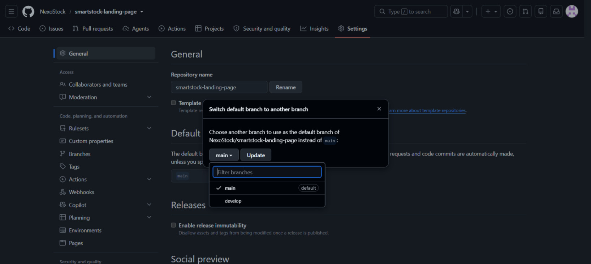

*Nota. Captura de la configuración del repositorio smartstock-landing-page en GitHub, donde se aprecian las ramas main (por defecto) y develop. Elaboración propia.*

#### Frontend Web Application

La Frontend Web Application se publica en GitHub Pages mediante GitHub Actions, a partir del repositorio `smartstock-frontend`. Los pasos de configuración son los siguientes:

1. En la configuración del repositorio, acceder a la sección **Pages** y seleccionar como fuente **GitHub Actions**.

2. Crear el workflow `deploy.yml` («Deploy to GitHub Pages»), que al integrar en la rama `main` ejecuta un job `build` (Node 22, `npm ci` y `ng build` con `--base-href /smartstock-frontend/`, además de copiar `index.html` como `404.html` para el enrutamiento) y un job `deploy`.

3. Configurar la URL base del RESTful API en `apiBaseUrl`, dentro de `src/environments/environment.ts`, según el ambiente. Mientras no exista el backend real, apunta a la Fake API.

4. Integrar la versión a publicar en `main` mediante una release branch, etiquetarla con Semantic Versioning y verificar la URL pública.

La Frontend Web Application se encuentra desplegada y accesible públicamente en el siguiente URL:`https://github.com/NexoStock/smartstock-frontend.git`

Como json-server no corre en GitHub Pages, la Fake API se publicó como Web Service de Node en Render (plan gratuito), desde la rama main del repositorio smartstock-frontend, con el comando de inicio node server/server.js --simulate y la variable NODE_VERSION=22. Su URL es `https://smartstock-fake-api-angular.onrender.com`

#### Web Services

Los Web Services (Spring Boot) se despliegan a partir del Sprint 3. Los pasos de construcción, despliegue, configuración de variables de entorno y de la conexión a la base de datos, y la publicación de la documentación OpenAPI mediante Swagger se documentan en la sección 5.2.3.7.

## 5.2. Landing Page, Services & Applications Implementation

En esta sección se explica y evidencia el proceso de implementación, pruebas, documentación y despliegue del Landing Page, los Web Services y la Frontend Web Application, organizado por sprints.

### 5.2.1. Sprint 1

#### 5.2.1.1. Sprint Planning 1

**Tabla 31**

*Sprint Planning 1*

| Campo | Detalle |
| --- | --- |
| Sprint # | 1 |
| Date | 2026-09-12 |
| Time | 4:00 PM |
| Location | Reunión virtual |
| Prepared By | Vizcarra Mamani, Candy Milagros |
| Attendees | Crispin Valdivia, Angel Gabriel; Lopez Rimachi, Sebastian Leonardo; Montañez Salinas, Lorena Ariana; Tuesta Girón, Kiara Lucia; Vizcarra Mamani, Candy Milagros |
| Sprint 0 – Review Summary | N/A (Primer Sprint del proyecto. Se establecieron las bases de la arquitectura, infraestructura en la nube y repositorios). |
| Sprint 0 – Retrospective Summary | N/A (Primer Sprint. El equipo acordó usar GitFlow y Conventional Commits rigurosamente desde el primer día). |
| Sprint 1 Goal | Our focus is on delivering a fast, static Landing Page (HTML/CSS/JS) with language support to attract clients and validate our value proposition. We believe it delivers a clear, accessible introduction to our product's value proposition to minimarket and bodega owners exploring inventory solutions. This will be confirmed when the Landing Page is deployed and fully navigable by users, in both supported languages. |
| Sprint 1 Velocity | 10 Story Points (Velocidad estimada para el primer ciclo del equipo). |
| Sum of Story Points | 10 |

*Nota. Elaboración propia*

#### 5.2.1.2. Aspect Leaders and Collaborators

El alcance del Sprint 1 corresponde al Landing Page y a la puesta en marcha del ciclo de vida del proyecto. Sobre esa base, el equipo identificó cinco aspectos y designó un líder por cada uno, buscando que cada integrante condujera el área en la que aportaba mayor conocimiento y colaborara en las restantes. La designación se refleja en la selección de tasks del Sprint Backlog y en la autoría de los commits de los repositorios.
Los aspectos considerados son: el Design System, que define la identidad visual compartida por los productos; la Estructura y contenido visual del sitio, que abarca el encabezado principal y su propuesta de valor; la Redacción y prueba social, que cubre los textos de los segmentos y los testimonios; la Accesibilidad e internacionalización, que cubre los atributos ARIA y los idiomas en_US y es_419; y la Configuración y despliegue, que abarca el control de versiones, el despliegue y la elaboración del informe.

**Tabla 32**

*Matriz de líderes (L) y colaboradores (C) por aspecto del Sprint 1 *

| Team Member (Last Name, First Name) | GitHub Username | Design System | Estructura y contenido visual | Redacción y prueba social | Accesibilidad e i18n | Configuración y despliegue |
| --- | --- | :---: | :---: | :---: | :---: | :---: |
| Crispin Valdivia, Angel Gabriel | @FaureGalliard | C | C | C | C | L |
| Lopez Rimachi, Sebastian Leonardo | @leonardoXd1323 | C | C | L | C | C |
| Montañez Salinas, Lorena Ariana | @Lore-MS | L | C | C | C | C |
| Tuesta Girón, Kiara Lucia | @kitu05g | C | C | C | L | C |
| Vizcarra Mamani, Candy Milagros | @candyvizz | C | L | C | C | C |

*Nota. Elaboració propia.*

#### 5.2.1.3. Sprint Backlog 1

El Sprint Backlog 1 se estructuró en torno a la construcción del sitio web estático (Landing Page) de SmartStock, encargado de comunicar la propuesta de valor del producto, los casos de uso diferenciados para bodegas de barrio y minimarkets, los planes y precios, la comparación frente a otras soluciones del mercado, y el flujo de contacto y registro de nuevos usuarios. Cada User Story del Epic EP08 se descompuso en tareas técnicas concretas, asignadas a los integrantes del subequipo de Landing Page (Angel Crispin y Kiara Tuesta) según su rol de diseño y desarrollo dentro del proyecto."

**Trello link:**  
`https://trello.com/invite/b/6aa988a0941a5fb8c814af43/ATTI5eecabb28fdc9c85d7ba8336b688a97353B8B08C/trello`

**Figura 201**

*Tablero del Sprint 1 en Trello*

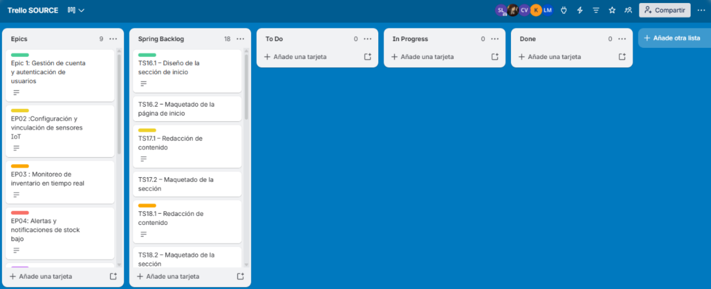

*Nota. Elaboración propia.*

**Tabla 33**

*Sprint Backlog 1: historias, tareas, estimación y responsable*

| Story Id | Story Title | Task Id | Task Title | Task Description | Estimation (h) | Assigned To | Status |
| --- | --- | --- | --- | --- | ---: | --- | --- |
| US16 | Información general de SmartStock | TS16.1 | Diseño de la sección de inicio (Hero) | Wireframe de la página de inicio con la propuesta de valor y el problema que resuelve SmartStock | 2 | Crispin Valdivia, Angel Gabriel (@FaureGalliard) | To-do |
| US16 | Información general de SmartStock | TS16.2 | Maquetado de la página de inicio | Implementación en HTML/CSS de la sección de inicio según el diseño aprobado | 3 | Tuesta Girón, Kiara Lucia (@kitu05g) | To-do |
| US17 | Casos de uso para bodegas de barrio | TS17.1 | Redacción de contenido — bodegas | Redactar los casos de uso enfocados en negocios pequeños (bodegas de barrio) | 1 | Montañez Salinas, Lorena Ariana (@Lore-MS) | To-do |
| US17 | Casos de uso para bodegas de barrio | TS17.2 | Maquetado de la sección — bodegas | Implementación en HTML/CSS de la sección de casos de uso para bodegas | 2 | Vizcarra Mamani, Candy Milagros (@candyvizz) | To-do |
| US18 | Casos de uso para minimarkets | TS18.1 | Redacción de contenido — minimarkets | Redactar los casos de uso enfocados en negocios de mayor volumen (minimarkets) | 1 | Montañez Salinas, Lorena Ariana (@Lore-MS) | To-do |
| US18 | Casos de uso para minimarkets | TS18.2 | Maquetado de la sección — minimarkets | Implementación en HTML/CSS de la sección de casos de uso para minimarkets | 2 | Vizcarra Mamani, Candy Milagros (@candyvizz) | To-do |
| US19 | Planes y precios | TS19.1 | Diseño de la sección de planes y precios | Wireframe de la tabla o cards de planes disponibles con sus características y costos | 2 | Crispin Valdivia, Angel Gabriel (@FaureGalliard) | To-do |
| US19 | Planes y precios | TS19.2 | Maquetado de la sección de planes y precios | Implementación en HTML/CSS de la sección de planes | 2 | Tuesta Girón, Kiara Lucia (@kitu05g) | To-do |
| US20 | Formulario de contacto para solicitar demostración | TS20.1 | Diseño del formulario de contacto | Wireframe del formulario (nombre, negocio, correo, tipo de negocio) con estados de error | 2 | Crispin Valdivia, Angel Gabriel (@FaureGalliard) | To-do |
| US20 | Formulario de contacto para solicitar demostración | TS20.2 | Implementación del formulario | Maquetado y validación de campos obligatorios del formulario | 3 | Tuesta Girón, Kiara Lucia (@kitu05g) | To-do |
| US20 | Formulario de contacto para solicitar demostración | TS20.3 | Envío de confirmación por correo | Configurar el envío del correo de confirmación al solicitar la demo | 2 | Lopez Rimachi, Sebastian Leonardo (@leonardoXd1323) | To-do |
| US21 | Preguntas frecuentes sobre instalación de sensores | TS21.1 | Redacción de FAQ | Redactar preguntas frecuentes sobre la instalación de los sensores IoT | 1 | Vizcarra Mamani, Candy Milagros (@candyvizz) | To-do |
| US21 | Preguntas frecuentes sobre instalación de sensores | TS21.2 | Maquetado de la sección de FAQ | Implementación en HTML/CSS de la sección de preguntas frecuentes | 1 | Tuesta Girón, Kiara Lucia (@kitu05g) | To-do |
| US22 | Testimonios de dueños de bodega | TS22.1 | Recopilación de testimonios | Redactar/recopilar testimonios representativos de bodegas y minimarkets | 1 | Vizcarra Mamani, Candy Milagros (@candyvizz) | To-do |
| US22 | Testimonios de dueños de bodega | TS22.2 | Maquetado de la sección de testimonios | Implementación en HTML/CSS de la sección de testimonios | 2 | Lopez Rimachi, Sebastian Leonardo (@leonardoXd1323) | To-do |
| US23 | Comparación frente a otras soluciones | TS23.1 | Elaboración de tabla comparativa | Construir la comparación de SmartStock frente a Trax Retail, Trigo Retail y Pensa Systems | 2 | Crispin Valdivia, Angel Gabriel (@FaureGalliard) | To-do |
| US23 | Comparación frente a otras soluciones | TS23.2 | Maquetado de la sección de comparación | Implementación en HTML/CSS de la sección de comparación de soluciones | 2 | Tuesta Girón, Kiara Lucia (@kitu05g) | To-do |
| US24 | Acceso a registro desde el sitio web | TS24.1 | Botón de registro persistente | Añadir el enlace/botón de registro visible en todas las secciones del sitio | 1 | Crispin Valdivia, Angel Gabriel (@FaureGalliard) | To-do |

*Nota. Elaboración propia.*

#### 5.2.1.4. Development Evidence for Sprint Review

Durante el Sprint 1 se implementó la primera versión del sitio web estático (Landing Page) de SmartStock, cubriendo las secciones de propuesta de valor, problemática, casos de uso por segmento, comparación frente a otras soluciones, planes y precios, testimonios, preguntas frecuentes y formulario de contacto.
A continuación, la Tabla 34 presenta los commits relacionados con la implementación, organizados por rama según GitFlow y redactados bajo la convención de Conventional Commits.

**Tabla 34**

*Commits del Sprint 1 en el repositorio smartstock-landing-page*

| Repository | Branch | Commit Id | Commit Message | Commit Message Body | Committed on |
| --- | --- | --- | --- | --- | --- |
| NexoStock/smartstock-landing-page | `feature/landing-page` | `ca232bc` | `feat(landing): add base styles` | White as the dominant background, navy for headings and actions. Only the tokens the page actually uses are declared. | 14/09/2026 |
| NexoStock/smartstock-landing-page | `feature/landing-page` | `19a6acd` | `feat(landing): add the home page sections` | Cover the user stories of the static web site: general information and the problem it solves, use cases for corner stores and minimarkets, comparison against other solutions, plans and pricing, testimonials, FAQ, demo request form and sign-up access from the header. | 14/09/2026 |
| NexoStock/smartstock-landing-page | `feature/landing-page` | `60dba06` | `feat(landing): add language switch, menu, faq and form validation` | English como idioma por defecto en el markup; el español viene de un diccionario. Los enlaces al aplicativo se construyen desde una sola constante de URL. | 14/09/2026 |
| NexoStock/smartstock-landing-page | `feature/landing-page` | `f8c269e` | `feat(landing): add terms and conditions linked from the footer` | Redactado siguiendo el ACM/IEEE Software Engineering Code of Ethics y el código de ética del Colegio de Ingenieros del Perú. | 14/09/2026 |
| NexoStock/smartstock-landing-page | `fix/mobile-navbar` | `8a71b7f` | `fix(landing): repair the navigation bar on narrow screens` | Debajo de 720px el botón de registro pasa al menú colapsable; se mantiene accesible desde toda sección junto con el selector de idioma. | 14/09/2026 |
| NexoStock/smartstock-landing-page | `feature/visual-refresh` | `4d500bf` | `feat(styles): refresh the visual system with the new brand palette` | Deepen the navy, brighten the mid blue and raise the corner radius to 12px. Add gradients to the primary button and to the hero background, elevation and a hover accent to the cards, and enlarge the brand mark in the header. | 17/09/2026 |
| NexoStock/smartstock-landing-page | `feature/visual-refresh` | `fc1ed0c` | `feat(landing): add the hero image and the two column layout` | Split the hero into copy and image so the visitor sees the segment the product is for before reading a line. The photograph shows a store owner using SmartStock next to stocked shelves, and it carries a descriptive alternative text that is translated with the rest of the page. | 17/09/2026 |
| NexoStock/smartstock-landing-page | `feature/visual-refresh` | `bdc9591` | `feat(landing): redesign the testimonials and refine the use case copy` | Give the testimonials their own grid with a rating, an initials avatar and a lead paragraph. Rewrite the use case bullets so they speak about turnover and the catalogue instead of quoting a fixed number of products. | 17/09/2026 |
| NexoStock/smartstock-landing-page | `feature/visual-refresh` | `39e8f6d` | `feat(a11y): translate the aria labels and pin english as the default locale` | The navigation and the language selector exposed their aria-label only in english, so a screen reader announced them in english while reading the rest of the page in spanish. They are now translated like any other copy. The initial locale no longer follows the browser language: the project statement requires english to be the default language of the product. | 17/09/2026 |
| NexoStock/smartstock-landing-page | `feature/visual-refresh` | `60f268b` | `fix(landing): restore the hero route and consolidate the stylesheet` | The hero call to action lost its data-app attribute in the redesign, so it pointed nowhere. The project statement requires every call to action to redirect the visitor to the corresponding view of the web application, and US24 states it as an acceptance criterion. Merge the second :root into the original one so the palette has a single source of truth, and give the gradient heading a solid fallback colour: color:transparent applies unconditionally while background-clip:text does not, which left the main heading invisible in forced-colors mode and when printing. | 17/09/2026 |

*Nota. Elaboración propia.*

#### 5.2.1.5. Execution Evidence for Sprint Review

Durante el Sprint 1 se implementó y desplegó la primera versión del Landing Page, que cubre las User Stories del sitio web estático especificadas en la sección 3.1. El sitio se encuentra accesible en:`https://nexostock.github.io/smartstock-landing-page/`

Landing Page Demonstration Video:`https://upcedupe-my.sharepoint.com/:v:/g/personal/u20241f205_upc_edu_pe/IQA-Q3weXz9fQKE42Q-KkgoIAadgYrZxWARopglSvgvHunk?e=hNwpTf&nav=eyJyZWZlcnJhbEluZm8iOnsicmVmZXJyYWxBcHAiOiJTdHJlYW1XZWJBcHAiLCJyZWZlcnJhbFZpZXciOiJTaGFyZURpYWxvZy1MaW5rIiwicmVmZXJyYWxBcHBQbGF0Zm9ybSI6IldlYiIsInJlZmVycmFsTW9kZSI6InZpZXcifX0%3D`

A continuación se presentan las principales vistas implementadas.

##### Encabezado principal y propuesta de valor (US16, US24)

El encabezado principal se organiza en dos columnas: a la izquierda la propuesta de valor, que presenta qué es SmartStock y qué problema resuelve, y a la derecha una fotografía de un propietario de tienda utilizando la plataforma junto a sus estantes abastecidos. La imagen permite que el visitante reconozca el segmento al que se dirige el producto antes de leer una sola línea, y cuenta con un texto alternativo descriptivo que se traduce junto con el resto de la página.
La barra superior mantiene visibles de forma permanente el selector de idioma y la acción de crear cuenta, en cumplimiento de la regla de negocio de la US24.
La figura 202 muestra el encabezado y la figura 203 la sección de problemas que lo sigue.

**Figura 202**

*Encabezado principal y propuesta de valor del Landing Page (US16, US24)*

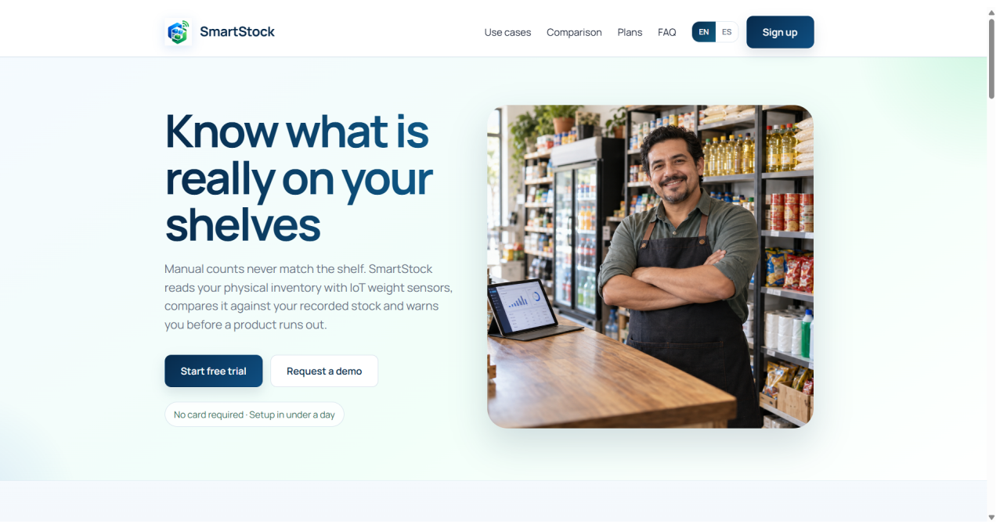

*Nota. Elaboración propia.*

**Figura 203**

*Sección de problemas del Landing Page (US16)*

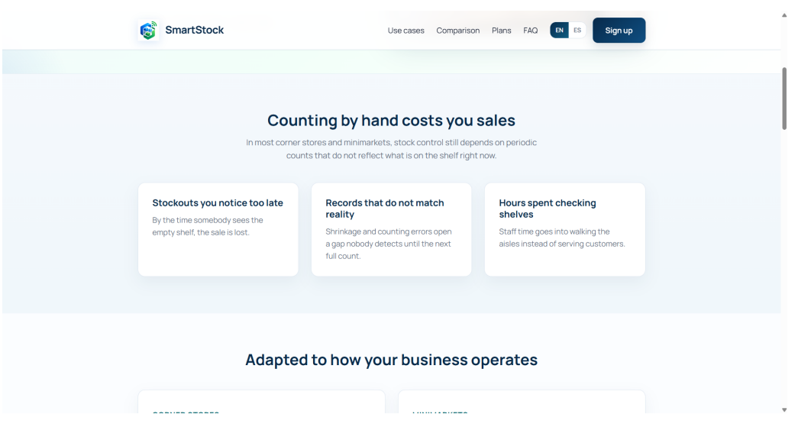

*Nota. Elaboración propia.*

##### Casos de uso por segmento objetivo (US17, US18)

La sección de casos de uso separa el contenido dirigido a bodegas de barrio del dirigido a minimarkets. Cada bloque enumera los beneficios propios del segmento y cierra con un call-to-action que redirige a la vista de registro de la Web Application transportando el segmento correspondiente. La captura se presenta con la experiencia conmutada a español latinoamericano, de modo que evidencie además el alcance de la traducción sobre el contenido de esta sección.

La figura 204 muestra esta sección.

**Figura 204**

*Sección de casos de uso por segmento objetivo del Landing Page (US17, US18)*

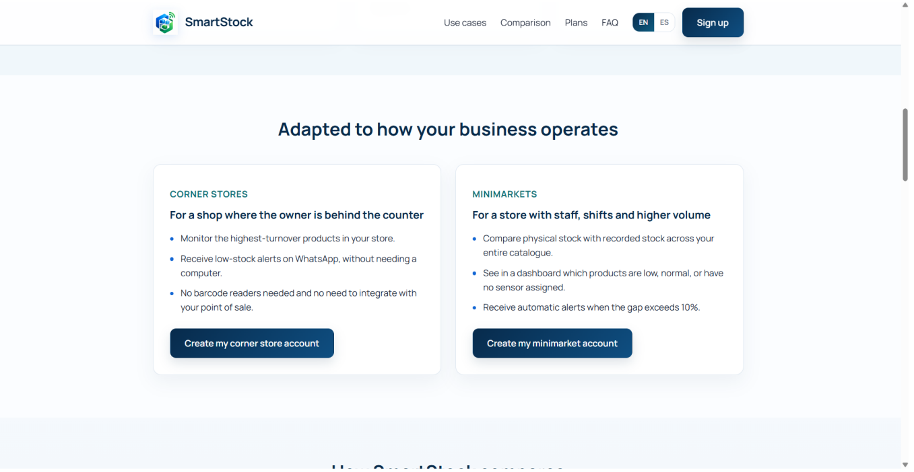

*Nota. Elaboración propia.*

##### Comparación frente a otras soluciones (US23)

La sección comparativa contrasta SmartStock con otras alternativas del mercado en capacidades como la lectura automática del stock físico, el funcionamiento sin integración con un punto de venta, el costo para una sola tienda, las alertas por WhatsApp y el tiempo de puesta en marcha. La figura 205 muestra esta sección.

**Figura 205**

*Sección comparativa frente a otras soluciones del Landing Page (US23)*

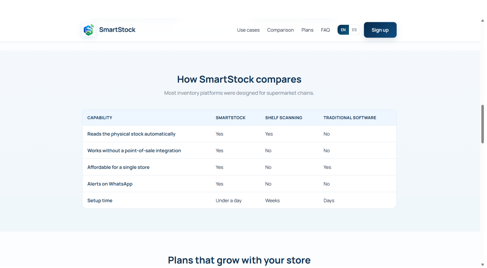

*Nota. Elaboración propia.*

##### Planes y precios (US19)

Los tres planes se presentan sobre el mismo conjunto de características, ordenados de menor a mayor capacidad, y el plan intermedio se destaca mediante un borde de mayor peso. Cada plan conduce al registro con el plan preseleccionado. Las tarjetas aplican el refresco visual del design system: radio de esquina de 14 píxeles, elevación tenue en reposo y un filete de acento que se revela al pasar el cursor.

La figura 206 muestra los tres planes.

**Figura 206**

*Sección de planes y precios del Landing Page (US19)*

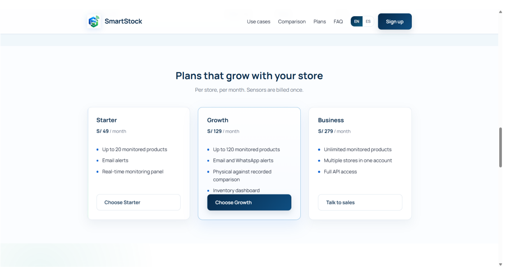

*Nota. Elaboración propia.*

##### Testimonios de clientes (US22)

La sección de testimonios presenta las opiniones recogidas durante las entrevistas, cada una acompañada de una valoración y de un avatar con las iniciales del entrevistado. La valoración se expone además mediante aria-label, de modo que un lector de pantalla anuncie la calificación en lugar de leer una sucesión de símbolos.

La figura 207 muestra la sección de testimonios.

**Figura 207**

*Sección de testimonios de clientes del Landing Page (US22)*

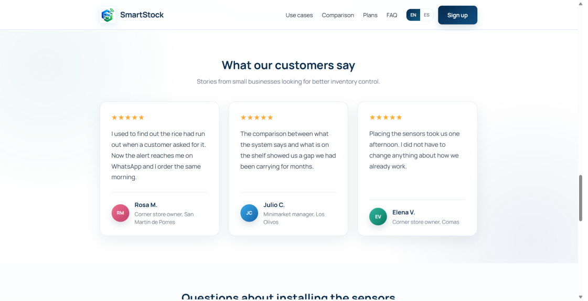

*Nota. Elaboración propia.*

##### Formulario de solicitud de demostración (US20)

El formulario valida los campos obligatorios al abandonar cada campo y expone los mensajes de error mediante role="alert", de modo que un lector de pantalla los anuncie. Los campos adoptan el radio de esquina y el color de borde definidos en la sección 4.1, y el botón de envío emplea el degradado de marca.

Las figuras 208 y 209 muestran el formulario y su pie de página.

**Figura 208**

*Formulario de solicitud de demostración del Landing Page (US20)*

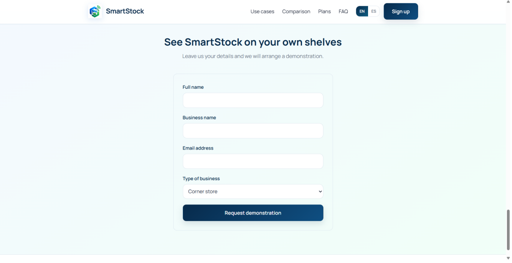

*Nota. Elaboración propia.*

**Figura 209**

*Campos del formulario y pie de página del Landing Page (US20)*

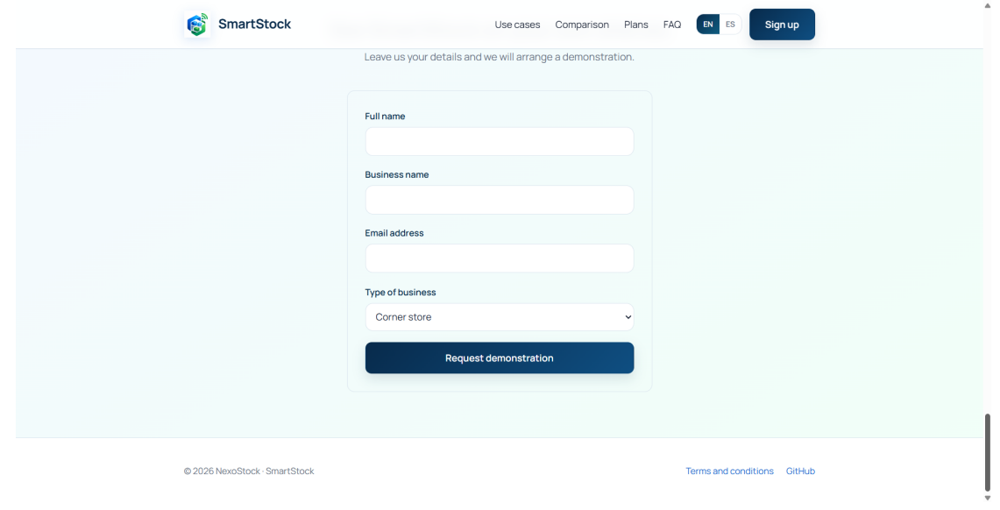

*Nota. Elaboración propia.*

##### Internacionalización de la experiencia (en_US / es_419)

El idioma por defecto del sitio es el inglés, conforme a lo establecido en el enunciado. El sitio no adopta el idioma del navegador en la primera visita, precisamente para que el idioma por defecto del producto sea siempre el inglés; a partir de ahí, la preferencia elegida por el visitante queda registrada en el navegador.

El selector de idioma de la barra superior conmuta toda la experiencia al español latinoamericano, incluyendo el título del documento, los textos de la interfaz, los mensajes de validación del formulario y los atributos aria-label de la navegación, del selector de idioma y de la imagen del encabezado principal. El atributo lang del documento se actualiza en cada conmutación, de modo que un lector de pantalla emplee la pronunciación correcta.

##### Diseño web adaptable (responsive web design)

La experiencia se adapta a las dimensiones del dispositivo cliente. En navegador móvil, las rejillas de tarjetas colapsan a una sola columna, la escala tipográfica de los titulares se reduce y la navegación se repliega tras un botón de menú.
La barra superior conserva en pantallas estrechas únicamente la marca, el selector de idioma y el botón de menú. La acción de crear cuenta se traslada al interior del menú desplegable, de modo que la barra no compita por el ancho disponible y se mantenga el cumplimiento de la regla de negocio de la US24, que establece que la opción de registro está disponible de forma permanente en todas las secciones del sitio web estático.

La figura 210 muestra el Landing Page en versión móvil.

**Figura 210**

*Landing Page en versión móvil*

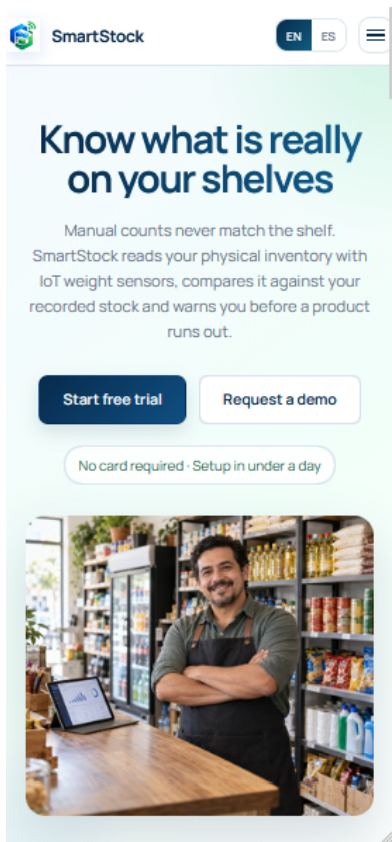

*Nota. Elaboración propia.*

#### 5.2.1.6. Services Documentation Evidence for Sprint Review

N/A. Durante el Sprint 1 el esfuerzo de desarrollo se enfocó exclusivamente en la creación del sitio web estático promocional (Landing Page), por lo que aún no se han implementado APIs RESTful ni Endpoints backend que requieran ser documentados a través de Swagger/OpenAPI. Esta documentación se estructurará a partir del Sprint 2.

#### 5.2.1.7. Software Deployment Evidence for Sprint Review

Durante el Sprint 1, el alcance de despliegue correspondió al Landing Page. El equipo creó el repositorio smartstock-landing-page dentro de la organización NexoStock, aplicó sobre él el flujo de trabajo GitFlow e integró la versión 1.0.0 a la rama main mediante una release branch. A continuación, habilitó GitHub Pages tomando como fuente dicha rama y el directorio raíz del repositorio.

La Tabla 35 resume el estado de despliegue de cada producto.

**Tabla 35**

*Evidencia de despliegue del Sprint 1*

| Producto | Repositorio | URL desplegado | Estado |
| --- | --- | --- | --- |
| Landing Page |`https://github.com/NexoStock/smartstock-landing-page`|`https://nexostock.github.io/smartstock-landing-page/`| Desplegado |
| Frontend Web Application | Pendiente de despliegue. | — | Fuera del alcance del Sprint 1 |
| Web Services | Pendiente de despliegue. | — | Fuera del alcance del Sprint 1 |

*Nota. Elaboración propia.*

La configuración aplicada en el repositorio se muestra a continuación. La fuente de publicación es la rama main y el directorio raíz, y GitHub confirma la publicación del sitio. En el selector de ramas se aprecian además las ramas main y develop, que evidencian la aplicación de GitFlow sobre el repositorio.
La configuración aplicada en el repositorio se muestra en la figura 211.

**Figura 211**

*Configuración de GitHub Pages del repositorio smartstock-landing-page con la rama main como fuente*

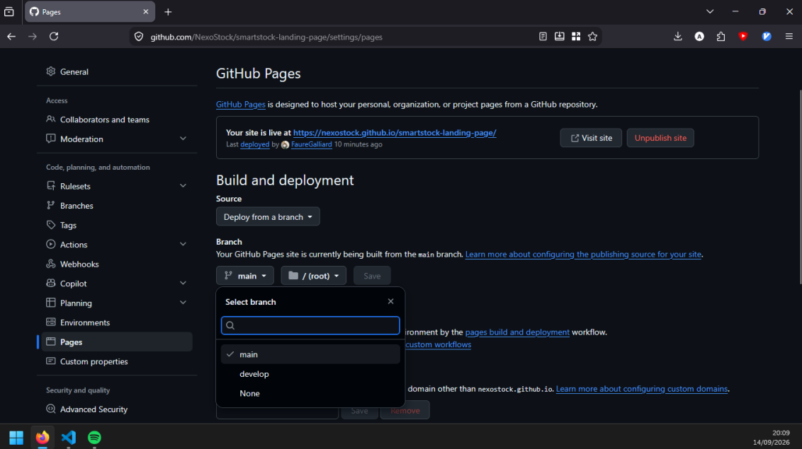

*Nota. Elaboración propia.*

Se verificó que el sitio publicado responde correctamente tanto en la página de inicio como en la página de términos y condiciones, y que la hoja de estilos y el archivo de comportamiento se sirven sin errores.

#### 5.2.1.8. Team Collaboration Insights during Sprint

Durante el Sprint 1, el equipo organizó la implementación del Landing Page según los aspectos definidos en la sección 5.2.1.2. Cada integrante trabajó sobre el aspecto que lideraba y registró su aporte mediante commits propios en el repositorio smartstock-landing-page, aplicando GitFlow y Conventional Commits.

El flujo de trabajo seguido fue el siguiente: la rama develop concentró el avance acumulado, cada conjunto de cambios se desarrolló en una rama feature/ que se integró a develop sin avance rápido (--no-ff), de modo que el historial conserve visible el punto de integración de cada aporte, y las versiones entregadas se publicaron desde main mediante ramas release/ etiquetadas con versionado semántico.

##### Analíticos de colaboración del repositorio del Landing Page

La vista de contribuyentes evidencia la participación de los cinco integrantes del equipo, con el detalle de commits y de líneas agregadas y eliminadas por cada uno.

La figura 212 muestra esta vista.

**Figura 212**

*Contributors del repositorio NexoStock/smartstock-landing-page*

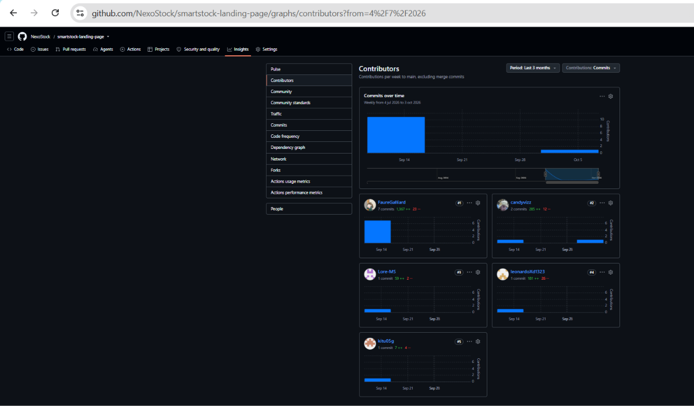

*Nota. Elaboración propia.*

##### Historial de ramas del repositorio

El grafo de red muestra la aplicación efectiva de GitFlow: las ramas de feature nacen de develop, se integran nuevamente a ella y la rama main recibe únicamente las versiones publicadas.

La figura 213 muestra el grafo de red.

**Figura 213**

*Network graph del repositorio NexoStock/smartstock-landing-page*

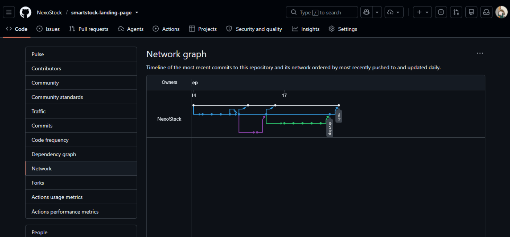 

*Nota. Elaboración propia.*

### 5.2.2. Sprint 2

#### 5.2.2.1. Sprint Planning 2

**Tabla 36**  
*Sprint Planning 2*

| Campo | Detalle |
| --- | --- |
| Sprint # | 2 |
| Date | 2026-10-01 |
| Time | 02:00 PM |
| Location | Reunión virtual |
| Prepared By | Montañez Salinas, Lorena Ariana |
| Attendees | Crispin Valdivia, Angel Gabriel; Lopez Rimachi, Sebastian Leonardo; Montañez Salinas, Lorena Ariana; Tuesta Girón, Kiara Lucia; Vizcarra Mamani, Candy Milagros |
| Sprint 1 – Review Summary | Durante el Sprint 1 se implementó y desplegó la primera versión del Landing Page (versión 1.0.0) en GitHub Pages, cubriendo las User Stories US16 a US24. Aunque las historias se implementaron, durante la revisión se identificaron deficiencias en algunas de ellas. Entre las principales correcciones pendientes están ajustar las URLs de despliegue registradas en la sección 5.2.1.7, que mostraban error al abrirse, y hacer que el Landing Page cambie la moneda mostrada al seleccionar el idioma inglés. Ambas correcciones se incorporan al Sprint 2 junto con la actualización del Landing Page, cuyo botón de registro pasa a redirigir a la aplicación web desplegada. |
| Sprint 1 – Retrospective Summary | Durante el Sprint 1 funcionó bien la aplicación de GitFlow, con ramas de feature integradas a develop y la versión 1.0.0 publicada desde main mediante una release branch, así como el uso de Conventional Commits en los mensajes de commit y la organización del trabajo en Trello. Como aspecto a mejorar, el equipo identificó la necesidad de verificar las URLs y el comportamiento multilenguaje del Landing Page antes de cada entrega. |
| Sprint 2 Goal | Our focus is on delivering the core web application of SmartStock: sales and purchases registration that moves stock, plus account access, product catalog, sensor linking, real-time stock monitoring and low-stock alerts. We believe it lets minimarket and bodega owners record what comes in and goes out of their inventory, verify it against the physical stock measured by IoT sensors, and anticipate restocking. This will be confirmed when each bounded context is navigable and its User Stories meet their acceptance criteria. |
| Sprint 2 Velocity | 84 Story Points (User Stories). Frente a los 20 puntos del Sprint 1 (US16 a US24), limitados al Landing Page estático, el Sprint 2 abarca la Frontend Web Application. El trabajo se reparte entre los cinco integrantes según el bounded context que lideran, con tareas de 3 a 6 horas, e incluye las historias de Compras y Ventas definidas como núcleo del producto. |
| Sum of Story Points | 84 (User Stories: 84; las Technical Stories TS01 a TS15 se incluyen solo como tareas de simulación (mock), sin Story Points) |

*Nota.* Elaboración propia

Para el Sprint 2, el equipo acordó los siguientes puntos:

(1) Definir primero las historias de Compras y Ventas, por ser el núcleo del producto, antes de construir sus pantallas.
(2) Identificar las historias como US (User Stories) y TS (Technical Stories) y las tareas como T-US## y T-TS##.
(3) Trabajar cada tarea en una rama corta feature/<contexto>-<tarea> creada desde develop e integrada mediante pull request con merge commit (--no-ff), sin commits directos en main ni en develop.
(4) No modificar archivos compartidos (rutas, estilos, menú, modelos) sin avisar al equipo.
(5) Usar datos simulados con json-server (Fake API) mientras el Web Service real no esté disponible.
El Sprint Goal se redactó en inglés siguiendo el formato de la plantilla, y la velocidad se calculó sobre las 23 User Stories que no pertenecen al Landing Page, que suman 84 Story Points. Las Technical Stories pasan al Sprint 3 junto con los Web Services reales.
(6) Actualizar el Landing Page para que el registro redirija a la Frontend Web Application desplegada, en lugar de apuntar a una dirección local. 

#### 5.2.2.2. Aspect Leaders and Collaborators

El alcance del Sprint 2 corresponde a la Frontend Web Application. Sobre esa base, el equipo identificó seis aspectos, correspondientes a los bounded contexts del producto, y designó un líder por cada uno, buscando que cada integrante condujera el área que había elegido y colaborara en las restantes. La designación se refleja en la selección de tasks del Sprint Backlog y en la autoría de los commits del repositorio.
Los aspectos considerados son: IAM, que cubre el registro, el inicio de sesión y la recuperación de contraseña; IoT Device, que cubre la vinculación de sensores, su estado de conexión y la recepción de lecturas; Alerts & Restocking, que cubre las notificaciones de stock bajo y las alertas de discrepancia; Product Catalog, que cubre el registro y la edición de productos y la configuración del umbral mínimo; Inventory Monitoring, que cubre el peso actual, el listado por nivel de stock, la comparación entre inventario físico y registrado, y el registro de ventas, compras y proveedores con sus movimientos de stock; y Analytics & Reporting, que cubre el dashboard y los reportes de consumo y movimientos.

**Tabla 37**  

*Matriz de líderes (L) y colaboradores (C) por aspecto del Sprint 2*

| Team Member (Last Name, First Name) | GitHub Username | IAM | IoT Device | Alerts & Restocking | Product Catalog | Inventory Monitoring | Analytics & Reporting |
| --- | --- | --- | --- | --- | --- | --- | --- |
| Crispin Valdivia, Angel Gabriel | @FaureGalliard | C | L | C | C | C | C |
| Lopez Rimachi, Sebastian Leonardo | @leonardoXd1323 | C | C | L | C | C | C |
| Montañez Salinas, Lorena Ariana | @Lore-MS | L | C | C | C | C | C |
| Tuesta Girón, Kiara Lucia | @kitu05g | C | C | C | C | L | L |
| Vizcarra Mamani, Candy Milagros | @candyvizz | C | C | C | L | C | C |

*Nota. Elaboración propia*

Según la matriz, Lorena lidera IAM; Ángel, IoT Device; Sebastián, Alerts & Restocking; Candy, Product Catalog; y Kiara, Inventory Monitoring y Analytics & Reporting. Además, las pantallas y servicios de ventas, compras y proveedores se desarrollaron en colaboración entre IAM, Product Catalog y Alerts & Restocking, como colaboradores del bounded context Inventory Monitoring: las ventas las implementó Lorena y las compras y proveedores, Candy.

#### 5.2.2.3. Sprint Backlog 2

El Sprint 2 contiene las 23 User Stories que no son del Landing Page (84 Story Points). Las Technical Stories TS01 a TS15 pasan al Sprint 3 con los Web Services reales; en este sprint solo se incluyen sus tareas de simulación (mock), marcadas "(mock)" y sin Story Points propios. El tablero está en Trello:`https://trello.com/invite/b/6ac18a7abca5e0a5a2507958/ATTI5da625d2f61dff20dbdf0a2396f6b06f27A47625/sprint-backlog-2-source`

La figura 214 muestra el board del Sprint 2.

**Figura 214**

*Board del Sprint 2 en Trello*

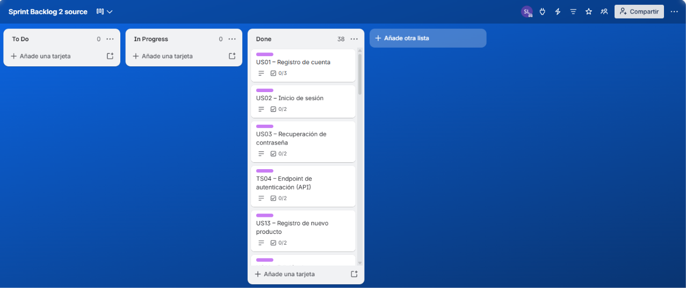

*Nota. Elaboración propia*

La carga de trabajo se distribuyó entre los cinco integrantes según el bounded context que lideran, como se muestra en la Tabla 37.

**Tabla 38**  

*Distribución de Story Points del Sprint 2 por integrante*

| Integrante | Contexto | User Stories | Story Points |
| --- | --- | --- | --- |
| Lorena | IAM y pantallas de Ventas | US01, US02, US03, US26, US27, US28 | 21 |
| Ángel | IoT Device (+ setup compartido y mock server) | US04, US06 | 8 |
| Sebastián | Alerts & Restocking | US09, US10, US12, US32 | 16 |
| Candy | Product Catalog, Proveedores y Compras | US05, US13, US14, US29, US30, US31 | 18 |
| Kiara | Inventory Monitoring y Analytics & Reporting | US07, US08, US11, US15, US25 | 21 |
| Total |  |  | 84 |

*Nota. Elaboración propia*

Las tareas se identifican como T-US##.# (historias de usuario), T-TS##.# (contratos de la Fake API, sin puntos) y T-SH.# (setup compartido de Ángel, sin historia). El detalle de cada tarea se presenta en la Tabla 38; todas finalizaron en estado Done.

**Tabla 39**  

*Sprint Backlog 2: historias, tareas, estimación y responsable*

| Sprint # | Story Id | Story Title | Task Id | Task Title | Task Description | Estimation (Hours) | Assigned To | Status |
| --- | --- | --- | --- | --- | --- | --- | --- | --- |
| 2 | Soporte | Setup compartido | T-SH.1 | Separar traducciones por contexto y ampliar el entorno | Una carpeta de traducciones por bounded context y endpoints del Sprint 2 en el environment. | 4 | Ángel | Done |
| 2 | Soporte | Setup compartido | T-SH.2 | Helpers y componentes compartidos | Helpers de error y rango de fechas; alert banner, summary card y page header; estilos compartidos. | 6 | Ángel | Done |
| 2 | Soporte | Setup compartido | T-SH.3 | Modelo de movimiento de stock | Entidad StockMovement (R17) usada por ventas, compras y reportes. | 4 | Ángel | Done |
| 2 | TS14 | Registro automático de movimientos (mock) | T-TS14.1 | Motor de movimientos y reglas de alerta del mock | Movimientos de stock, reglas de alerta R19–R21 y proyección de producto con estado del sensor. | 6 | Ángel | Done |
| 2 | TS01 | Recepción de lecturas (mock) | T-TS01.1 | Mock POST /sensores/{id}/lecturas | Servidor json-server con token, rutas automáticas y simulador IoT. | 5 | Ángel | Done |
| 2 | TS05 | Estado de sensor (mock) | T-TS05.1 | Mock GET /sensores/{id}/estado | Estado en línea/desconectado (R11) y endpoints de vinculación. | 4 | Ángel | Done |
| 2 | US04 | Vinculación de sensor IoT a un producto | T-US04.1 | Diseñar vista de vinculación | Sensores disponibles, flujo de vinculación y caso de sensor ya vinculado. | 5 | Ángel | Done |
| 2 | US04 | Vinculación de sensor IoT a un producto | T-US04.2 | Modelo, API y store de dispositivos | Entidades Sensor y LinkableProduct, DevicesApi y store (R9). | 6 | Ángel | Done |
| 2 | US04 | Vinculación de sensor IoT a un producto | T-US04.3 | Validar sensor ya en uso | Rechazar vinculación e indicar que el sensor ya está en uso. | 3 | Ángel | Done |
| 2 | US06 | Estado de conexión de sensores | T-US06.1 | Vista de listado de estado | Lista de sensores con estado en línea o desconectado. | 4 | Ángel | Done |
| 2 | US06 | Estado de conexión de sensores | T-US06.2 | Regla de 5 minutos | Desconectado si no hay lecturas en 5 minutos (R11). | 3 | Ángel | Done |
| 2 | US01 | Registro de cuenta | T-US01.1 | Formulario de registro | Datos del negocio y selector de tipo de negocio. | 5 | Lorena | Done |
| 2 | US01 | Registro de cuenta | T-US01.2 | Validaciones y correo repetido | Validar campos y mostrar error de correo ya registrado. | 4 | Lorena | Done |
| 2 | US01 | Registro de cuenta | T-US01.3 | Estado de registro exitoso | Mensaje de éxito y redirección. | 3 | Lorena | Done |
| 2 | US02 | Inicio de sesión | T-US02.1 | Vista de login | Formulario con mensaje de error genérico (R3). | 4 | Lorena | Done |
| 2 | US02 | Inicio de sesión | T-US02.2 | Modelo, API y store de IAM | UserSession, IamApi y store con signIn y signUp. | 6 | Lorena | Done |
| 2 | TS04 | Login (mock) | T-TS04.1 | Mock POST /auth/login | Endpoints de login, registro y recuperación en el mock. | 4 | Lorena | Done |
| 2 | US03 | Recuperación de contraseña | T-US03.1 | Formulario de recuperación | Solicitud con el mismo mensaje neutro para cualquier correo. | 4 | Lorena | Done |
| 2 | US03 | Recuperación de contraseña | T-US03.2 | Nueva contraseña y enlace vencido | Pantalla de nueva contraseña y caso de enlace expirado. | 4 | Lorena | Done |
| 2 | US26 | Registro de venta | T-US26.1 | Formulario de nueva venta | Productos, cantidades y total. | 6 | Lorena | Done |
| 2 | US26 | Registro de venta | T-US26.2 | Modelo y API de ventas | Sale, SaleItem, SaleProductOption y SalesApi. | 5 | Lorena | Done |
| 2 | US26 | Registro de venta | T-US26.3 | Store y validaciones de stock | Store de ventas; stock suficiente (R13) y producto sin precio (R14). | 5 | Lorena | Done |
| 2 | US27 | Historial de ventas | T-US27.1 | Listado de ventas | Lista con total del período. | 4 | Lorena | Done |
| 2 | US27 | Historial de ventas | T-US27.2 | Filtro por fechas y período vacío | Filtro por rango y estado vacío. | 3 | Lorena | Done |
| 2 | US28 | Detalle de una venta | T-US28.1 | Vista de detalle de venta | Detalle con los movimientos de stock generados. | 4 | Lorena | Done |
| 2 | TS07 | Registro de ventas (mock) | T-TS07.1 | Mock POST /ventas | Cada venta crea movimientos de salida (R17). | 4 | Lorena | Done |
| 2 | TS08 | Consulta de ventas (mock) | T-TS08.1 | Mock GET /ventas y /ventas/{id} | Listado y detalle de ventas. | 3 | Lorena | Done |
| 2 | US09 | Notificación por correo de stock bajo | T-US09.1 | Vista de configuración de notificaciones | Canal correo electrónico y textos en inglés y español. | 5 | Sebastián | Done |
| 2 | US09 | Notificación por correo de stock bajo | T-US09.2 | Store de alertas | Store con alertas y preferencias. | 4 | Sebastián | Done |
| 2 | US09 | Notificación por correo de stock bajo | T-US09.3 | Modelo y API de alertas | Alert, resource, assembler y AlertsApi. | 5 | Sebastián | Done |
| 2 | US10 | Notificación por WhatsApp de stock bajo | T-US10.1 | Canal WhatsApp en configuración | Preferencia de canal y número de WhatsApp. | 4 | Sebastián | Done |
| 2 | TS03 | Notificación de stock bajo (mock) | T-TS03.1 | Mock POST /notificaciones/stock-bajo | Endpoint de notificaciones en alerts.js. | 4 | Sebastián | Done |
| 2 | TS14 | Registro automático de movimientos (mock) | T-TS14.2 | Mock de alertas con movimientos | Alertas activas ligadas a los movimientos de stock. | 3 | Sebastián | Done |
| 2 | TS15 | Consulta de movimientos (mock) | T-TS15.1 | Mock GET /movimientos-stock | Listado de movimientos. | 3 | Sebastián | Done |
| 2 | US12 | Alerta por discrepancia de inventario | T-US12.2 | Lista de alertas activas | Alertas con discrepancia mayor al 10 %. | 5 | Sebastián | Done |
| 2 | US32 | Registro de compra desde una alerta de stock bajo | T-US32.1 | Botón de compra en la alerta | Acción desde la alerta de stock bajo. | 3 | Sebastián | Done |
| 2 | US32 | Registro de compra desde una alerta de stock bajo | T-US32.2 | Precarga de producto y proveedor | Enviar producto y proveedor al formulario de compra. | 4 | Sebastián | Done |
| 2 | US32 | Registro de compra desde una alerta de stock bajo | T-US32.3 | Marcar necesidad atendida | Actualizar el estado de la alerta tras registrar la compra. | 3 | Sebastián | Done |
| 2 | US13 | Registro de nuevo producto | T-US13.1 | Formulario de producto | Validaciones, precio de venta opcional y banner de error. | 5 | Candy | Done |
| 2 | US13 | Registro de nuevo producto | T-US13.2 | Modelo, API y store de catálogo | Product, CatalogApi y store (R5, R7). | 6 | Candy | Done |
| 2 | TS13 | Modelo de datos: productos (mock) | T-TS13.2 | Mock de productos (GET/POST/PUT /productos) | Validaciones R5 y R7 en el mock. | 4 | Candy | Done |
| 2 | US14 | Edición de producto | T-US14.1 | Formulario de edición | Precio de venta, costo de compra y proveedor habitual. | 4 | Candy | Done |
| 2 | US14 | Edición de producto | T-US14.2 | Stock de solo lectura | El stock solo cambia por movimientos (R17). | 3 | Candy | Done |
| 2 | US05 | Configuración de umbral mínimo de stock | T-US05.1 | Vista de umbral mínimo | Formulario por producto con sensor. | 4 | Candy | Done |
| 2 | US05 | Configuración de umbral mínimo de stock | T-US05.2 | Validar capacidad máxima | Rechazar umbral mayor a la capacidad (R7). | 3 | Candy | Done |
| 2 | US29 | Registro de proveedor | T-US29.1 | Formulario y listado de proveedores | Alta y lista de proveedores. | 5 | Candy | Done |
| 2 | US29 | Registro de proveedor | T-US29.2 | Proveedor duplicado | Error por proveedor repetido (R8). | 3 | Candy | Done |
| 2 | US30 | Registro y recepción de compra | T-US30.1 | Formulario de nueva compra | Productos, total y precarga desde reposición. | 6 | Candy | Done |
| 2 | US30 | Registro y recepción de compra | T-US30.2 | Modelo y API de compras | Purchase, PurchaseItem, Supplier y PurchasesApi. | 5 | Candy | Done |
| 2 | US30 | Registro y recepción de compra | T-US30.3 | Detalle y recepción | Recepción de mercadería que crea movimientos de entrada. | 6 | Candy | Done |
| 2 | US30 | Registro y recepción de compra | T-US30.4 | Store de compras | Compras, proveedores y recepción (R15, R16). | 4 | Candy | Done |
| 2 | US31 | Historial de compras | T-US31.1 | Listado de compras | Lista con filtro por fechas. | 4 | Candy | Done |
| 2 | US31 | Historial de compras | T-US31.2 | Estado vacío | Mensaje cuando no hay compras en el período. | 3 | Candy | Done |
| 2 | TS09 | Proveedores (mock) | T-TS09.1 | Mock POST/GET /proveedores | Alta y consulta de proveedores. | 3 | Candy | Done |
| 2 | TS10 | Registro de compras (mock) | T-TS10.1 | Mock POST /compras | Alta de compras. | 3 | Candy | Done |
| 2 | TS11 | Recepción de compras (mock) | T-TS11.1 | Mock PATCH /compras/{id}/recepcion | Recepción con movimientos de entrada. | 3 | Candy | Done |
| 2 | TS12 | Consulta de compras (mock) | T-TS12.1 | Mock GET /compras y /compras/{id} | Listado y detalle. | 3 | Candy | Done |
| 2 | US15 | Dashboard de inventario | T-US15.1 | Vista de dashboard | Tarjetas de resumen y Home de bodega. | 6 | Kiara | Done |
| 2 | US15 | Dashboard de inventario | T-US15.2 | Tarjetas de ventas y compras del día | Totales del día en el dashboard. | 4 | Kiara | Done |
| 2 | US15 | Dashboard de inventario | T-US15.3 | Modelo, API y store de analítica | DashboardSummary, Report y AnalyticsApi. | 5 | Kiara | Done |
| 2 | US15 | Dashboard de inventario | T-US15.4 | Traducciones y estados vacíos | Textos en inglés y español. | 3 | Kiara | Done |
| 2 | US15 | Dashboard de inventario | T-US15.5 | Mock GET /dashboard y /reportes | Reportes solo para minimarket. | 4 | Kiara | Done |
| 2 | US25 | Reportes de consumo y movimientos | T-US25.1 | Selector de período | Rango de fechas del reporte. | 3 | Kiara | Done |
| 2 | US25 | Reportes de consumo y movimientos | T-US25.2 | Reporte de consumo | Consumo por producto. | 5 | Kiara | Done |
| 2 | US25 | Reportes de consumo y movimientos | T-US25.3 | Movimientos con ventas y compras | Tabla de movimientos con ventas y compras. | 5 | Kiara | Done |
| 2 | US25 | Reportes de consumo y movimientos | T-US25.4 | Reporte sin datos | Estado vacío del período. | 3 | Kiara | Done |
| 2 | US11 | Comparación inventario físico vs. registrado | T-US11.1 | Vista de comparación | Peso del sensor frente al stock registrado. | 6 | Kiara | Done |
| 2 | US11 | Comparación inventario físico vs. registrado | T-US11.3 | Resaltar discrepancia | Diferencia mayor al 10 % resaltada. | 4 | Kiara | Done |
| 2 | US11 | Comparación inventario físico vs. registrado | T-US11.4 | Modelo, API y store de stock | Comparison, SensorReading y StockApi. | 5 | Kiara | Done |
| 2 | TS02 | Consulta de stock (mock) | T-TS02.1 | Mock GET /productos/{id}/stock | Stock y detalle de producto. | 3 | Kiara | Done |
| 2 | TS06 | Comparación de inventario (mock) | T-TS06.1 | Mock GET /inventario/comparacion/{productoId} | Comparación con ventas y compras. | 3 | Kiara | Done |
| 2 | US08 | Listado de productos por nivel de stock | T-US08.1 | Listado con búsqueda | Búsqueda y columna de sensor. | 4 | Kiara | Done |
| 2 | US08 | Listado de productos por nivel de stock | T-US08.2 | Filtro por nivel de stock | Bajo, normal o sin datos. | 3 | Kiara | Done |
| 2 | US08 | Listado de productos por nivel de stock | T-US08.3 | Columna de stock registrado | Stock actualizado por movimientos. | 3 | Kiara | Done |
| 2 | US07 | Visualización del peso actual de un producto | T-US07.1 | Detalle con peso actual | Peso del sensor y unidades equivalentes. | 4 | Kiara | Done |
| 2 | US07 | Visualización del peso actual de un producto | T-US07.2 | Últimas cinco lecturas | Historial corto de lecturas. | 3 | Kiara | Done |

*Nota. Elaboración propia*

#### 5.2.2.4. Development Evidence for Sprint Review

Durante el Sprint 2 se implementó la Frontend Web Application de SmartStock en el repositorio NexoStock/smartstock-frontend, con las vistas y servicios de IAM, IoT Device, Alerts & Restocking, Product Catalog, Inventory Monitoring (incluidas ventas, compras y proveedores) y Analytics & Reporting. Cada tarea del Sprint Backlog se desarrolló en una rama feature/<contexto>-<tarea> creada desde develop e integrada mediante pull request con merge commit.

A continuación se presenta la tabla de commits relacionados con la implementación, organizados por rama según el orden de integración del equipo y redactados bajo la convención de Conventional Commits, en inglés y en minúsculas, con el identificador de la tarea (por ejemplo T-US02.2) en el cuerpo del mensaje.

**Tabla 40**

*Commits del Sprint 2 en el repositorio smartstock-frontend*

| Repository | Branch | Commit Id | Commit Message | Commit Message Body | Committed on (Date) |
| --- | --- | --- | --- | --- | --- |
| NexoStock/smartstock-frontend | `feature/shared-sprint2-setup` | `0b89e88` | `chore(shared): split translations per bounded context` | Replace the single en/es files with one folder per bounded context so each owner edits only their own translations.  Empty placeholders are replaced by each owner in their first branch.  Shared files change: team notified. | 04/10/2026 |
| NexoStock/smartstock-frontend | `feature/shared-sprint2-setup` | `ec54965` | `chore(shared): add sprint 2 endpoints to environment` | Add notifications, comparison, dashboard and reports endpoints.  Shared files change: team notified. | 04/10/2026 |
| NexoStock/smartstock-frontend | `feature/shared-sprint2-setup` | `c0e5957` | `feat(shared): add api error and date range helpers` | Add apiError/apiCode and the DateRange value helpers used by sales, purchases and reports.  Shared files change: team notified. | 04/10/2026 |
| NexoStock/smartstock-frontend | `feature/shared-sprint2-setup` | `266332a` | `feat(shared): add alert banner, summary card and page header` | Add reusable presentation components used by the sprint 2 views.  Shared files change: team notified. | 04/10/2026 |
| NexoStock/smartstock-frontend | `feature/shared-sprint2-setup` | `5018a72` | `refactor(shared): extend date range filter and status tag` | Add the initial input to the date range filter and new status tones.  Add shared card, form and table styles.  Shared files change: team notified. | 04/10/2026 |
| NexoStock/smartstock-frontend | `feature/shared-sprint2-setup` | `ecc15c1` | `feat(inventory): add stock movement model` | Add the StockMovement entity, resource and assembler (R17: stock only moves through movements).  Used by sales, purchases and reports. | 04/10/2026 |
| NexoStock/smartstock-frontend | `feature/shared-mock-server` | `a24c988` | `chore(shared): add json-server mock backend skeleton` | Add server.js with bearer token check, hidden users and automatic route loading.  Add helpers, seed markers and in-memory db.  Add server and server:sim scripts.  Shared files change: team notified. | 04/10/2026 |
| NexoStock/smartstock-frontend | `feature/shared-mock-server` | `d32e0fb` | `feat(shared): add stock movement, alert rules and product view for the mock` | Add the stock movement engine (R17), alert rules (R19-R21) and the product projection with sensor state.  Refs: T-TS14.1 | 04/10/2026 |
| NexoStock/smartstock-frontend | `feature/shared-mock-server` | `63660b3` | `feat(devices): add sensor readings and status mock endpoints` | POST /sensores/:id/lecturas, GET /sensores/:id/estado, link and unlink endpoints plus the IoT simulator.  Refs: T-TS01.1, T-TS05.1 | 04/10/2026 |
| NexoStock/smartstock-frontend | `feature/shared-mock-server` | `412f90f` | `chore(shared): point the production build to the fake api on render` | The json-server Fake API runs as a Render web service and serves its routes at the root, so the base url has no /api suffix. | 04/10/2026 |
| NexoStock/smartstock-frontend | `feature/catalog-register-product` | `7d1b23c` | `feat(catalog): add product model and api layer` | Product entity (nullable sale price, sensor state, stock level), resource, assembler and CatalogApi with the threshold target.  Task: T-US13.2 | 04/10/2026 |
| NexoStock/smartstock-frontend | `feature/catalog-register-product` | `50e28f2` | `feat(catalog): add catalog store` | Signals store: fetchProducts, fetchProduct, create, update, categories and threshold target (R5, R7).  Task: T-US13.2 | 04/10/2026 |
| NexoStock/smartstock-frontend | `feature/catalog-register-product` | `4072ec8` | `feat(catalog): add catalog translations` | English and Spanish texts of the product forms and the threshold view.  Task: T-US13.1 | 04/10/2026 |
| NexoStock/smartstock-frontend | `feature/catalog-register-product` | `431b5b7` | `feat(catalog): add register product view` | Product form with validations, optional sale price and error banner (M29, M30).  Tasks: T-US13.1, T-US13.2 | 04/10/2026 |
| NexoStock/smartstock-frontend | `feature/catalog-register-product` | `e7953c0` | `feat(catalog): add catalog mock endpoints` | GET/POST/PUT /productos and PUT /sensores/:id/umbral with R5 and R7 validations.  Refs: T-TS13.2 | 04/10/2026 |
| NexoStock/smartstock-frontend | `feature/inventory-purchases` | `39d3953` | `feat(inventory): add purchase and supplier model and api layer` | Add Purchase, PurchaseItem, Supplier and PurchaseProductOption, resources, assemblers and PurchasesApi.  Task: T-US30.2 | 04/10/2026 |
| NexoStock/smartstock-frontend | `feature/inventory-purchases` | `34a0d6e` | `feat(inventory): add purchases store` | Signals store for purchases, suppliers and goods receipt (R15, R16).  Task: T-US30.4 | 04/10/2026 |
| NexoStock/smartstock-frontend | `feature/inventory-purchases` | `64b596b` | `feat(inventory): add purchases translations` | English and Spanish texts of purchases and suppliers.  Task: T-US29.1 | 04/10/2026 |
| NexoStock/smartstock-frontend | `feature/inventory-purchases` | `2859f47` | `feat(inventory): add supplier list view` | Supplier form and list with duplicate supplier error (R8) (M7, M7A, M8, M7B).  Tasks: T-US29.1, T-US29.2 | 04/10/2026 |
| NexoStock/smartstock-frontend | `feature/inventory-purchases` | `962589d` | `feat(inventory): add purchase list view` | Purchase list with date filter and empty state (M1, M2).  Tasks: T-US31.1, T-US31.2 | 04/10/2026 |
| NexoStock/smartstock-frontend | `feature/inventory-purchases` | `121ead9` | `feat(inventory): add new purchase view` | Purchase form with total, validations and prefill from a restocking need (M3, M4, M16).  Tasks: T-US30.1, T-US30.2, T-US30.4 | 04/10/2026 |
| NexoStock/smartstock-frontend | `feature/inventory-purchases` | `4a61812` | `feat(inventory): add purchase details view` | Purchase detail and goods receipt that creates IN movements (M5, M5A, M6, M6A).  Task: T-US30.3 | 04/10/2026 |
| NexoStock/smartstock-frontend | `feature/inventory-purchases` | `2823ad9` | `feat(inventory): add purchases and suppliers mock endpoints` | POST/GET /compras, PATCH /compras/:id/recepcion, POST/GET /proveedores.  Refs: T-TS09.1, T-TS10.1, T-TS11.1, T-TS12.1 | 04/10/2026 |
| NexoStock/smartstock-frontend | `feature/catalog-edit-product` | `d30c159` | `feat(catalog): add edit product view` | Edit product data while keeping registered stock read-only (M19, R17).  Tasks: T-US14.1, T-US14.2 | 04/10/2026 |
| NexoStock/smartstock-frontend | `feature/catalog-edit-product` | `887fbd1` | `feat(catalog): add edit product view` | Edit form with sale price, purchase cost and usual supplier; stock is read-only (R17) (M19).  Tasks: T-US14.1, T-US14.2 | 04/10/2026 |
| NexoStock/smartstock-frontend | `feature/catalog-min-threshold` | `37a6a9b` | `feat(catalog): add minimum threshold view` | Threshold form bounded by the maximum capacity (R7) with the exceeds banner (M34, M35).  Tasks: T-US05.1, T-US05.2 | 04/10/2026 |
| NexoStock/smartstock-frontend | `feature/devices-sensor-linking` | `9f76d3b` | `feat(devices): add sensor domain model and api layer` | Add Sensor and LinkableProduct entities, resources, assembler and DevicesApi.  Task: T-US04.2 | 04/10/2026 |
| NexoStock/smartstock-frontend | `feature/devices-sensor-linking` | `55968ae` | `feat(devices): add devices store` | Signals store with fetchSensors, fetchLinkable and link (R9: one sensor, one product).  Task: T-US04.2 | 04/10/2026 |
| NexoStock/smartstock-frontend | `feature/devices-sensor-linking` | `e61b9ee` | `feat(devices): add devices translations` | English and Spanish texts of the IoT Device views.  Task: T-US04.1 | 04/10/2026 |
| NexoStock/smartstock-frontend | `feature/devices-sensor-linking` | `01c3191` | `feat(devices): add sensor linking view` | Available sensors and link flow, with the already linked sensor case (M32, M33).  Tasks: T-US04.1, T-US04.2, T-US04.3 | 04/10/2026 |
| NexoStock/smartstock-frontend | `feature/devices-sensor-status` | `93c2859` | `feat(devices): add sensor status list view` | List sensors with online/disconnected state; offline after 5 minutes without readings (R11).  Tasks: T-US06.1, T-US06.2 | 04/10/2026 |
| NexoStock/smartstock-frontend | `feature/analytics-dashboard` | `e63c75f` | `feat(analytics): add dashboard and report model and api layer` | Add DashboardSummary and Report entities, resources, assembler and AnalyticsApi.  Task: T-US15.3 | 05/10/2026 |
| NexoStock/smartstock-frontend | `feature/analytics-dashboard` | `e386af8` | `feat(analytics): add analytics store` | Signals store for the dashboard summary and the reports.  Task: T-US15.3 | 05/10/2026 |
| NexoStock/smartstock-frontend | `feature/analytics-dashboard` | `0adeea7` | `feat(analytics): add analytics translations` | English and Spanish texts of the dashboard and reports.  Task: T-US15.1 | 05/10/2026 |
| NexoStock/smartstock-frontend | `feature/analytics-dashboard` | `b118d27` | `feat(analytics): add dashboard view` | Summary cards including sales and purchases of the day; Home for bodega accounts (M17).  Tasks: T-US15.1, T-US15.2, T-US15.4 | 05/10/2026 |
| NexoStock/smartstock-frontend | `feature/analytics-dashboard` | `ae88276` | `feat(analytics): add dashboard and reports mock endpoints` | GET /dashboard and GET /reportes (minimarket only for reports).  Refs: T-US15.5 | 05/10/2026 |
| NexoStock/smartstock-frontend | `feature/analytics-dashboard` | `dcc60ff` | `feat(analytics): add dashboard and reports mock endpoints` | — | 05/10/2026 |
| NexoStock/smartstock-frontend | `feature/inventory-comparison` | `cf9f4db` | `feat(inventory): add stock comparison model and api layer` | Add Comparison and SensorReading entities, resources, assembler and StockApi.  Task: T-US11.4 | 05/10/2026 |
| NexoStock/smartstock-frontend | `feature/inventory-comparison` | `aa1541c` | `feat(inventory): add stock store` | Signals store for the comparison and the product stock detail.  Task: T-US11.4 | 05/10/2026 |
| NexoStock/smartstock-frontend | `feature/inventory-comparison` | `d40b60d` | `feat(inventory): add stock translations` | English and Spanish texts of the comparison, product list and product details.  Task: T-US11.1 | 05/10/2026 |
| NexoStock/smartstock-frontend | `feature/inventory-comparison` | `862f8ad` | `feat(inventory): add stock comparison view` | Sensor vs registered stock with discrepancy over 10 percent highlighted (M39).  Tasks: T-US11.1, T-US11.3 | 05/10/2026 |
| NexoStock/smartstock-frontend | `feature/inventory-comparison` | `19a724f` | `feat(inventory): add stock and comparison mock endpoints` | GET /productos/:id/stock, /productos/:id/detalle and /inventario/comparacion.  Refs: T-TS02.1, T-TS06.1 | 05/10/2026 |
| NexoStock/smartstock-frontend | `feature/inventory-comparison` | `1508e84` | `fix(inventory): fix api url template literals` | — | 05/10/2026 |
| NexoStock/smartstock-frontend | `feature/iam-login` | `ff50cdc` | `feat(iam): add user session model and auth api` | Add UserSession entity, auth resources, assembler and IamApi.  Task: T-US02.2 | 06/10/2026 |
| NexoStock/smartstock-frontend | `feature/iam-login` | `ba4716e` | `feat(iam): add iam store` | Signals store with signIn, signUp and requestPasswordReset (R3 generic credential error).  Task: T-US02.2 | 06/10/2026 |
| NexoStock/smartstock-frontend | `feature/iam-login` | `33eefba` | `feat(iam): add iam translations` | English and Spanish texts of the IAM views.  Task: T-US02.1 | 06/10/2026 |
| NexoStock/smartstock-frontend | `feature/iam-login` | `cb1d457` | `feat(iam): add login view` | Sign-in form with generic error message and redirect by business type (M20, M21).  Tasks: T-US02.1, T-US02.2 | 06/10/2026 |
| NexoStock/smartstock-frontend | `feature/iam-login` | `9705081` | `feat(iam): add auth mock endpoints` | POST /auth/login, /auth/register and /auth/forgot-password for the json-server mock.  Refs: T-TS04.1 | 06/10/2026 |
| NexoStock/smartstock-frontend | `feature/iam-register` | `45bf2d8` | `feat(iam): add registration view` | Registration form with business type toggle, taken email error and success state (M22, M23, M24).  Tasks: T-US01.1, T-US01.2, T-US01.3 | 06/10/2026 |
| NexoStock/smartstock-frontend | `feature/iam-password-recovery` | `1a4eeba` | `feat(iam): add password recovery view` | Reset request form with the same neutral message for any email (M25, M26).  Tasks: T-US03.1, T-US03.2 | 06/10/2026 |
| NexoStock/smartstock-frontend | `feature/analytics-reports` | `315626d` | `feat(analytics): add reports view` | Period selector, consumption and movements report with sales and purchases (M18).  Tasks: T-US25.1, T-US25.2, T-US25.3, T-US25.4 | 06/10/2026 |
| NexoStock/smartstock-frontend | `feature/alerts-email` | `a9e75e3` | `feat(alerts): add alert model and api layer` | Task: T-US09.3 | 06/10/2026 |
| NexoStock/smartstock-frontend | `feature/alerts-email` | `80aa572` | `feat(alerts): add alerts store` | Task: T-US09.2 | 06/10/2026 |
| NexoStock/smartstock-frontend | `feature/alerts-email` | `0bf8397` | `feat(alerts): add alerts translations` | Task: T-US09.1 | 06/10/2026 |
| NexoStock/smartstock-frontend | `feature/alerts-email` | `fce9c4f` | `feat(alerts): add notification settings view` | Tasks: T-US09.1, T-US10.1 | 06/10/2026 |
| NexoStock/smartstock-frontend | `feature/alerts-email` | `f3c9179` | `feat(alerts): add alerts and notifications mock endpoints` | Refs: T-TS03.1, T-TS14.2, T-TS15.1 | 06/10/2026 |
| NexoStock/smartstock-frontend | `feature/inventory-sales` | `7166452` | `feat(inventory): add sale model and api layer` | Add Sale, SaleItem and SaleProductOption (anti-corruption snapshot of the catalog), resources, assembler and SalesApi.  Task: T-US26.2 | 06/10/2026 |
| NexoStock/smartstock-frontend | `feature/inventory-sales` | `119ac81` | `feat(inventory): add sales store` | Signals store for sales list, detail and creation.  Task: T-US26.3 | 06/10/2026 |
| NexoStock/smartstock-frontend | `feature/inventory-sales` | `edfb39c` | `feat(inventory): add sales translations` | English and Spanish texts of the sales views.  Task: T-US26.1 | 06/10/2026 |
| NexoStock/smartstock-frontend | `feature/inventory-sales` | `138695e` | `feat(inventory): add sales list view` | Sales list with date filter, period total and empty period (M9, M10).  Tasks: T-US27.1, T-US27.2 | 06/10/2026 |
| NexoStock/smartstock-frontend | `feature/inventory-sales` | `ec4c9c7` | `feat(inventory): add new sale view` | Sale form with total, stock validation (R13) and no-price product block (R14) (M11, M12, M13).  Tasks: T-US26.1, T-US26.2, T-US26.3 | 06/10/2026 |
| NexoStock/smartstock-frontend | `feature/inventory-sales` | `2789e36` | `feat(inventory): add sale details view` | Sale detail with the generated stock movements (M14).  Task: T-US28.1 | 06/10/2026 |
| NexoStock/smartstock-frontend | `feature/inventory-sales` | `3308f37` | `feat(inventory): add sales mock endpoints` | POST /ventas, GET /ventas and GET /ventas/:id; each sale creates OUT movements (R17).  Refs: T-TS07.1, T-TS08.1 | 06/10/2026 |
| NexoStock/smartstock-frontend | `feature/inventory-stock-weight` | `0ed261b` | `feat(inventory): add product details view with current weight` | Current sensor weight, units and the last five readings (M28).  Tasks: T-US07.1, T-US07.2 | 06/10/2026 |
| NexoStock/smartstock-frontend | `feature/alerts-active-list` | `f1cf0fe` | `feat(alerts): add active alerts list view` | Tasks: T-US12.2, T-US32.1, T-US32.2, T-US32.3 | 06/10/2026 |
| NexoStock/smartstock-frontend | `feature/inventory-product-list` | `2016bb2` | `feat(inventory): add product list view with stock levels` | Search, stock level filter, sensor column and registered stock column (M27).  Tasks: T-US08.1, T-US08.2, T-US08.3 | 06/10/2026 |
| NexoStock/smartstock-frontend | `chore/gitignore-ide` | `e6b3df5` | `chore(shared): ignore ide files` | Task: T-SH.1 | 06/10/2026 |
| NexoStock/smartstock-frontend | `release/1.0.0` | `c0191a3` | `chore(release): point api to production fake api` | Task: T-SH.1 | 06/10/2026 |
| NexoStock/smartstock-frontend | `release/1.0.0` | `0814346` | `chore(release): use relative translations path for github pages` | Task: T-SH.1 | 06/10/2026 |
| NexoStock/smartstock-frontend | `release/1.0.0` | `0fb2331` | `chore(release): add github pages workflow` | Task: T-SH.1 | 06/10/2026 |
| NexoStock/smartstock-frontend | `release/1.0.0` | `735e144` | `chore(release): set version 1.0.0` | Task: T-SH.1 | 06/10/2026 |
| NexoStock/smartstock-landing-page | `feature/signup-frontend-link` | `45c0ab9` | `feat(landing): redirect sign up to deployed frontend` | — | 06/10/2026 |

*Nota. Elaboración propia*

La tabla sigue el orden de integración del equipo: primero feature/shared-sprint2-setup y feature/shared-mock-server, luego los contextos, y al final la rama chore/gitignore-ide y la rama release/1.0.0 con las que se cerró el sprint. En el repositorio del frontend son 21 ramas y 71 commits  (se excluyen los commits de merge generados por GitHub al integrar cada pull request, así como el commit inicial de la base del frontend). Los pull requests del sprint van del #1 al #22.

En el repositorio NexoStock/smartstock-landing-page se registró además un commit en la rama feature/signup-frontend-link, que actualiza la variable APP_URL de script.js para que el botón de registro redirija a `https://nexostock.github.io/smartstock-frontend`. La rama se integró a develop mediante el PR #1 y develop se integró a main mediante el PR #2, con lo que el Landing Page actualizado quedó publicado. 

#### 5.2.2.5. Execution Evidence for Sprint Review

En este sprint el frontend alcanzó las vistas de los seis contextos funcionando con datos simulados por la Fake API: registro e inicio de sesión, ventas, productos, proveedores y compras, sensores, alertas, stock, dashboard y reportes. La aplicación está desplegada y accesible en https://nexostock.github.io/smartstock-frontend/ (sección 5.2.2.7), con soporte para inglés y español. Cada captura se rotula con la historia que cubre. El video que muestra la visualización y la navegación logradas en el sprint, al cual se puede acceder desde el siguiente link:
`https://upcedupe-my.sharepoint.com/:v:/g/personal/u202421125_upc_edu_pe/IQAKt8LsBsB6TYBsqSsYvpp4ATF62ASTTiT9MA_hCLKuZrk?e=U5KqGD&nav=eyJyZWZlcnJhbEluZm8iOnsicmVmZXJyYWxBcHAiOiJTdHJlYW1XZWJBcHAiLCJyZWZlcnJhbFZpZXciOiJTaGFyZURpYWxvZy1MaW5rIiwicmVmZXJyYWxBcHBQbGF0Zm9ybSI6IldlYiIsInJlZmVycmFsTW9kZSI6InZpZXcifX0%3D`

**Tabla 41**  
*Evidencia de ejecución por contexto e historia de usuario del Sprint 2*

| Contexto | Historia | Ruta | La captura debe mostrar | Figura |
| --- | --- | --- | --- | --- |
| IAM | US01 Registro de cuenta | /sign-up | formulario con tipo de negocio y el error de correo en uso | 162 |
| IAM | US02 Inicio de sesión | /sign-in | login y el mensaje de credenciales incorrectas | 163 |
| IAM | US03 Recuperación de contraseña | /forgot-password | solicitud del enlace y confirmación de envío | 164 |
| Ventas | US26, US27 y US28 | /sales, /sales/new, /sales/:id | venta registrada, rechazo por stock insuficiente, historial por fechas y detalle | 165 |
| IoT Device | US04 Vinculación de sensor | /sensors/link | elección de sensor y producto, y error de sensor en uso | 166 |
| IoT Device | US06 y US07 Estado de conexión | /sensors | sensores en línea y desconectados | 167 |
| Alerts & Restocking | US09 y US10 Notificaciones | /settings | canales de correo y WhatsApp configurados | 168 |
| Alerts & Restocking | US12 y US32 Alertas y compra desde alerta | /alerts | alerta de stock bajo o discrepancia y el botón que abre el registro de compra | 169 |
| Product Catalog | US13, US14 y US05 Productos | /products/new, /products/:id/edit, /sensors/:id/threshold | registro, edición y umbral mínimo con su error de validación | 170 |
| Proveedores y Compras | US29, US30 y US31 | /purchases, /purchases/new, /purchases/suppliers, /purchases/:id | proveedor creado, compra pendiente, compra recibida e historial por fechas | 171 |
| Inventory Monitoring | US07, US08 y US11 | /products, /products/:id, /comparison | niveles de stock, detalle con peso actual y comparación físico vs. registrado | 172 |
| Analytics & Reporting | US15 y US25 | /dashboard, /reports | tarjetas del día con ventas y compras, y reporte por período | 173 |

*Nota. Elaboración propia*

**Figura 215**

*Registro de cuenta con selección de tipo de negocio y error de correo en uso (US01)*

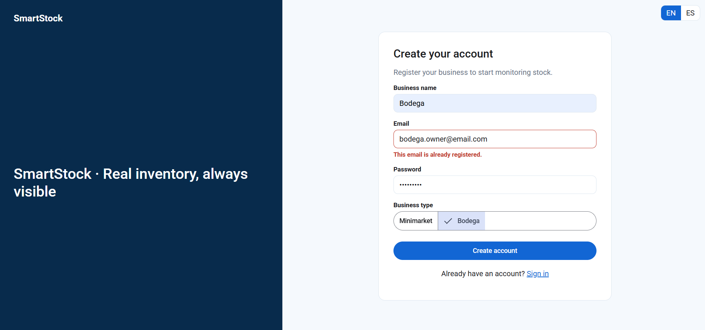

*Nota. Elaboración propia.*

**Figura 216**

*Inicio de sesión con mensaje de credenciales incorrectas (US02)*

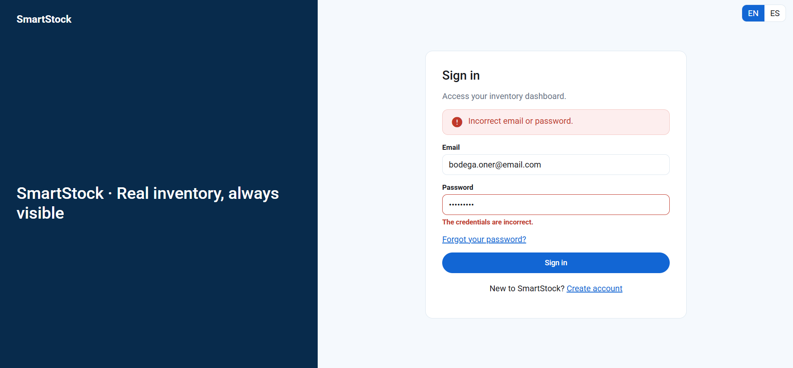

*Nota. Elaboración propia.*

**Figura 217**

*Recuperación de contraseña: solicitud del enlace y confirmación de envío (US03)*

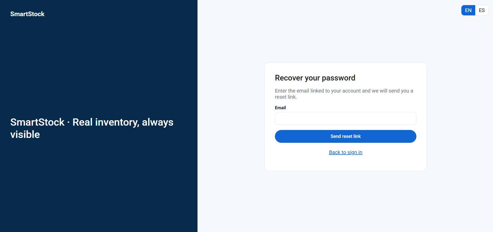

*Nota. Elaboración propia.*

**Figura 218**

*Ventas: (a) venta registrada, (b) rechazo por stock insuficiente, (c) historial por fechas y (d) detalle con movimiento de salida (US26, US27, US28)*

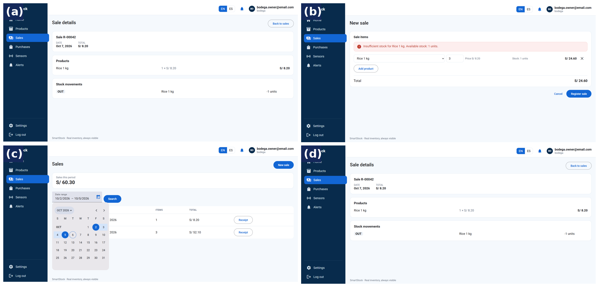

*Nota. Elaboración propia.*

**Figura 219**

*Vinculación de sensor a un producto y error de sensor en uso (US04)*

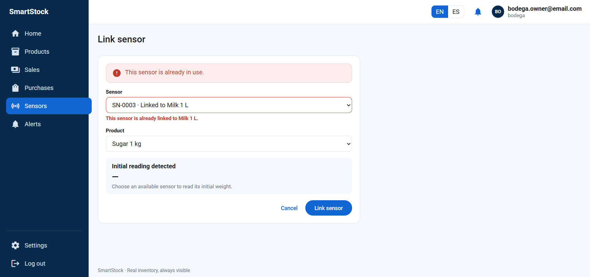

*Nota. Elaboración propia.*

**Figura 220**

*Estado de conexión de sensores en línea y desconectados (US06)*

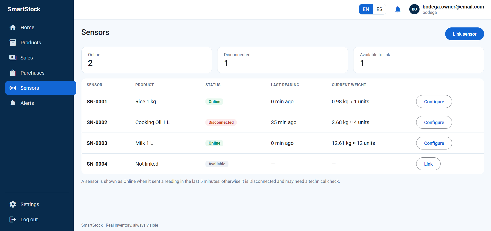

*Nota. Elaboración propia.*

**Figura 221**

*Configuración de notificaciones por correo y WhatsApp (US09, US10)*

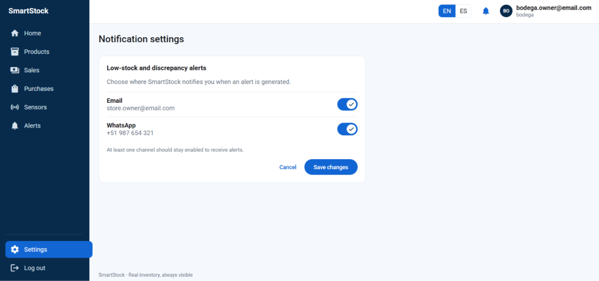

*Nota. Elaboración propia.*

**Figura 222**

*Alertas activas y botón de compra desde una alerta de stock bajo (US12, US32)*

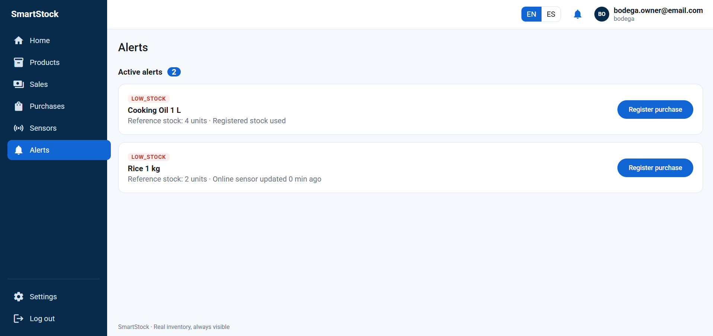

*Nota. Elaboración propia.*

**Figura 223**

*Catálogo: (a) registro de producto, (b) edición con stock de solo lectura y (c) umbral mínimo con error de capacidad máxima (US13, US14, US05)*

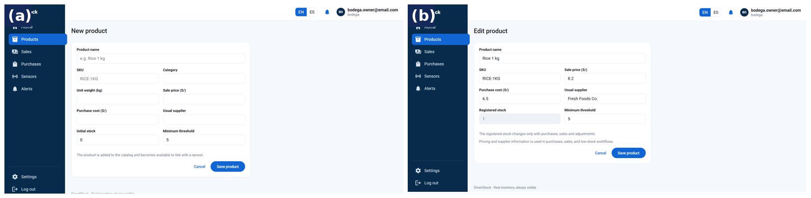

*Nota. Elaboración propia.*

**Figura 224**

*Proveedores y compras: (a) proveedor creado, (b) compra pendiente, (c) compra recibida y (d) historial por fechas (US29, US30, US31)*

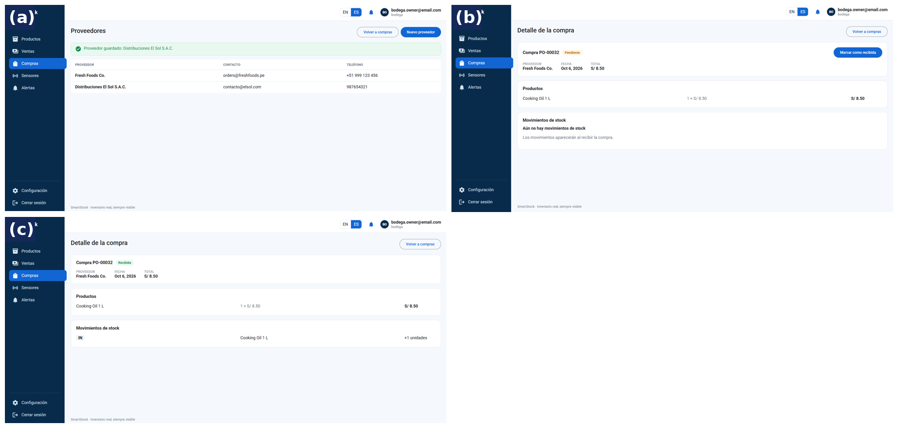

*Nota. Elaboración propia.*

**Figura 225**

*Monitoreo de inventario: (a) productos por nivel de stock, (b) detalle con peso actual y (c) comparación físico vs. registrado (US07, US08, US11)*

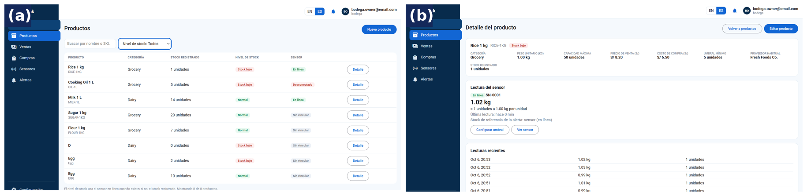

*Nota. Elaboración propia.*

**Figura 226**

*Dashboard con ventas y compras del día, y reporte por período (US15, US25)*

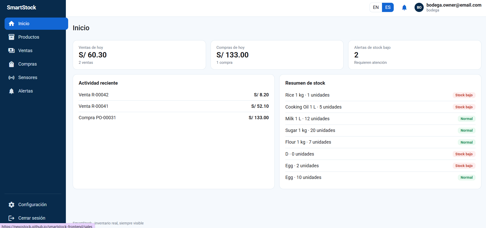

*Nota. Elaboración propia.*

#### 5.2.2.6. Services Documentation Evidence for Sprint Review

En el Sprint 2 el equipo documentó con OpenAPI los contratos de los endpoints que las pantallas consumen a través de la Fake API: los de las Technical Stories TS01 a TS15 y los de autenticación que usan las pantallas de registro y recuperación. Los Web Services reales (Spring Boot) se implementarán en el Sprint 3 con el mismo contrato; por eso aún no existe el repositorio de Web Services ni hay commits de documentación en este sprint. La especificación se redactó en formato OpenAPI 3.0.3 utilizando Swagger Editor y se visualiza mediante Swagger UI (Figuras 186 y 187). Los contratos se documentan con el prefijo /api del backend real; la Fake API desplegada los expone en la raíz, sin ese prefijo (por ejemplo, POST /auth/login). Los códigos de error siguen el formato { code, ...detalle } que devuelve la Fake API.

**Tabla 42**  
*Documentación de los endpoints de la Fake API / Web Services del Sprint 2*

| Endpoint | Método | Acción | Parámetros | Ejemplo de request | Response y explicación | TS |
| --- | --- | --- | --- | --- | --- | --- |
| `/api/auth/register` | POST | Registra una cuenta | — | `{ "businessName": "Bodega Luna", "email": "ana@bodega.pe", "password": "•••", "businessType": "bodega" }` | 201 con la sesión { token, email, businessName, businessType }; 400 INCOMPLETE si faltan datos; 409 EMAIL_TAKEN si el correo ya está registrado | TS04 |
| `/api/auth/login` | POST | Valida credenciales | — | `{ "email": "ana@bodega.pe", "password": "•••" }` | 200 con la sesión; 401 INVALID_CREDENTIALS sin indicar qué dato falló (R3) | TS04 |
| `/api/auth/forgot-password` | POST | Solicita el enlace de recuperación | — | `{ "email": "ana@bodega.pe" }` | 200 con { sent: true, email, expiresInHours: 24 }; la respuesta es la misma si el correo no existe (R4) | TS04 |
| `/api/sensores/{id}/lecturas` | POST | Recibe una lectura de peso del sensor | id (ruta) | `{ "peso": 12.4 }` | 201 con { id }; 404 SENSOR_NOT_FOUND; 400 INVALID_WEIGHT | TS01 |
| `/api/sensores/{id}/estado` | GET | Retorna el estado de conexión del sensor | id (ruta) | — | 200 con { estado, ultimaLecturaAt, pesoKg }; desconectado tras 5 minutos sin lecturas (R11); 404 NOT_FOUND | TS05 |
| `/api/sensores` | GET | Lista los sensores con su producto vinculado | — | — | 200 con la lista de sensores | TS05 |
| `/api/sensores/vincular` | POST | Vincula un sensor a un producto | — | `{ "sensorId": 1, "productoId": 3 }` | 200 con el sensor vinculado; 409 SENSOR_IN_USE si el sensor ya está vinculado; 409 PRODUCT_HAS_SENSOR (R9) | TS05 |
| `/api/sensores/{id}/umbral` | PUT | Configura el umbral mínimo de stock | id (ruta) | `{ "umbralMinimo": 5 }` | 200 con el producto; 422 THRESHOLD_INVALID o THRESHOLD_EXCEEDS_CAPACITY (R7); 404 NOT_FOUND | TS13 |
| `/api/productos` | GET | Lista los productos | — | — | 200 con la lista, con stock registrado y sensor vinculado | TS13 |
| `/api/productos` | POST | Registra un producto | — | `{ "nombre": "Rice 1 kg", "categoria": "Grocery", "pesoUnitario": 1, "precioVenta": 4.5, "costoCompra": 3.2, "umbralMinimo": 5, "capacidadMaxima": 100 }` | 201 con el producto creado (stock inicial 0); 400 INVALID_PRODUCT con el detalle de errores por campo (R5, R7) | TS13 |
| `/api/productos/{id}` | GET / PUT | Consulta y edita un producto | id (ruta) | PUT: precio de venta, costo de compra y proveedor habitual | 200 con el producto; el stock no se edita (R17); 400 INVALID_PRODUCT; 404 NOT_FOUND | TS13 |
| `/api/productos/{id}/stock` | GET | Retorna el stock actual del producto | id (ruta) | — | 200 con peso y cantidad; 404 NOT_FOUND | TS02 |
| `/api/productos/{id}/detalle` | GET | Retorna el detalle con peso actual y últimas lecturas | id (ruta) | — | 200 con el producto y las últimas cinco lecturas; 404 NOT_FOUND | TS02 |
| `/api/inventario/comparacion/{productoId}` | GET | Compara el inventario físico con el registrado | productoId (ruta) | — | 200 con ambos valores, la diferencia y su porcentaje; 404 NOT_FOUND | TS06 |
| `/api/ventas` | POST | Registra una venta | — | `{ "items": [{ "productoId": 3, "cantidad": 2, "precioUnitario": 4.5 }] }` | 201 con { id }; 400 NO_ITEMS o INVALID_QUANTITY; 422 INSUFFICIENT_STOCK (producto y stock disponible) o NO_SALE_PRICE (R13, R14); crea movimientos de salida (R17) | TS07 |
| `/api/ventas` | GET | Lista las ventas | desde, hasta (fecha) | — | 200 con { ventas, total } del rango | TS08 |
| `/api/ventas/{id}` | GET | Detalle de una venta | id (ruta) | — | 200 con ítems, total y movimientos de stock; 404 NOT_FOUND | TS08 |
| `/api/proveedores` | POST | Registra un proveedor | — | `{ "nombre": "Distribuidora Sol", "telefono": "987654321" }` | 201 con el proveedor; 400 INCOMPLETE; 409 DUPLICATE_SUPPLIER (R8) | TS09 |
| `/api/proveedores` | GET | Lista los proveedores | — | — | 200 con la lista de proveedores | TS09 |
| `/api/compras` | POST | Registra una compra pendiente | — | `{ "proveedorId": 1, "items": [{ "productoId": 3, "cantidad": 24, "costoUnitario": 2.5 }] }` | 201 con la orden en estado pendiente, sin cambiar el stock; 400 NO_ITEMS o INVALID_QUANTITY; 404 SUPPLIER_NOT_FOUND o PRODUCT_NOT_FOUND | TS10 |
| `/api/compras/{id}/recepcion` | PATCH | Recibe la compra y suma el stock | id (ruta) | — | 200 con la compra recibida; crea movimientos de entrada (R15, R16); 409 ALREADY_RECEIVED; 404 NOT_FOUND | TS11 |
| `/api/compras` | GET | Lista las compras | desde, hasta (fecha) | — | 200 con la lista y el total del rango | TS12 |
| `/api/compras/{id}` | GET | Detalle de una compra | id (ruta) | — | 200 con ítems y estado; 404 NOT_FOUND | TS12 |
| `/api/movimientos-stock` | GET | Lista los movimientos de stock | desde, hasta (fecha) | — | 200 con movimientos (tipo, origen, cantidad) | TS15 |
| `/api/notificaciones/stock-bajo` | POST | Dispara el envío de una alerta de stock bajo | — | `{ "productoId": 3 }` | 202 con { sent: true, at }; 404 ALERT_NOT_FOUND | TS03 |
| `/api/canales-notificacion` | PUT | Guarda los canales de notificación | — | `[{ "id": 1, "activo": true }, { "id": 2, "activo": false }]` | 200 con los canales; 422 AT_LEAST_ONE_CHANNEL | TS03 |
| `/api/alertas` | GET | Lista las alertas activas | — | — | 200 con las alertas (stock bajo y discrepancia mayor al 10 %) | TS14 |
| `/api/dashboard` | GET | Resumen del dashboard | — | — | 200 con tarjetas de ventas y compras del día, alertas y productos | TS14 |
| `/api/reportes` | GET | Reporte de consumo y movimientos | desde, hasta (fecha) | — | 200 con el reporte del período (solo minimarket) | TS15 |

*Nota. Los códigos de respuesta y de error fueron contrastados con el código de la Fake API (server/routes). Elaboración propia*

La Tabla 43 resume la relación entre cada contexto, los recursos implementados y la Technical Story asociada.

**Tabla 43**  

*Relación de endpoints implementados por contexto*

| Contexto | Recurso (endpoint base) | Acciones implementadas | TS relacionadas |
| --- | --- | --- | --- |
| IAM | `/api/auth/login, /register, /forgot-password` | POST | TS04 |
| IoT Device | `/api/sensores, /api/sensores/{id}/lecturas, /estado, /vincular` | GET, POST | TS01, TS05 |
| Product Catalog | `/api/productos, /api/productos/{id}, /api/sensores/{id}/umbral` | GET, POST, PUT | TS13 |
| Inventory Monitoring | `/api/productos/{id}/stock, /detalle, /api/inventario/comparacion/{productoId}` | GET | TS02, TS06 |
| Inventory – Ventas | `/api/ventas, /api/ventas/{id}` | GET, POST | TS07, TS08 |
| Inventory – Compras | `/api/proveedores, /api/compras, /api/compras/{id}, /api/compras/{id}/recepcion` | GET, POST, PATCH | TS09, TS10, TS11, TS12 |
| Inventory – Movimientos | `/api/movimientos-stock` | GET | TS15 |
| Alerts & Restocking | `/api/alertas, /api/notificaciones/stock-bajo, /api/canales-notificacion` | GET, POST, PUT | TS03, TS14 |
| Analytics & Reporting | `/api/dashboard, /api/reportes` | GET | TS14, TS15 |

*Nota. Elaboración propia*

**Figura 227**

*Especificación OpenAPI de la Fake API en Swagger Editor*

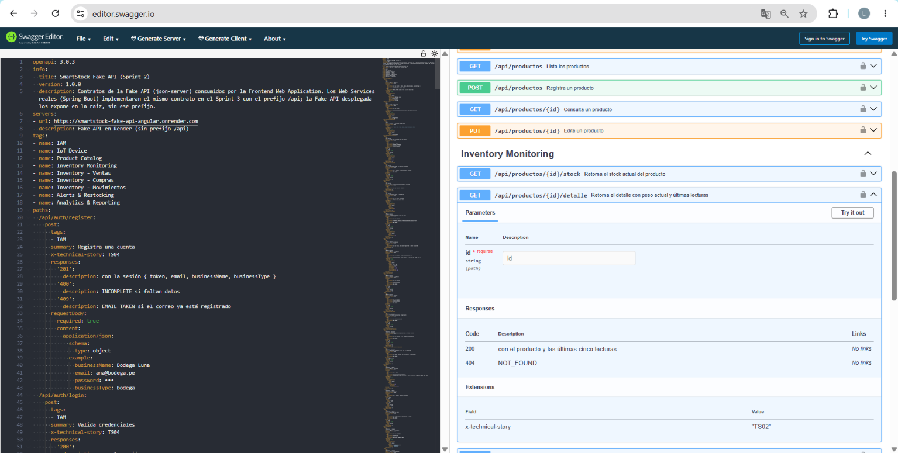

*Nota. Elaboración propia*

**Figura 228**

*Documentación de los endpoints en Swagger UI*

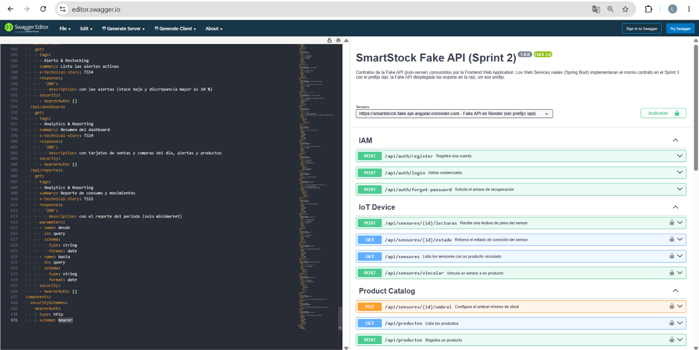

*Nota. Elaboración propia*

#### 5.2.2.7. Software Deployment Evidence for Sprint Review

Durante el Sprint 2 el alcance de despliegue correspondió a la primera versión de la Frontend Web Application, publicada en GitHub Pages desde la rama main, a la que se integró mediante la rama release/1.0.0 (PR #21) y quedó etiquetada como v1.0.0. El Landing Page, publicado en el Sprint 1, se actualizó para que su botón de registro redirija a la aplicación desplegada (PR #1 y PR #2 del repositorio del Landing Page). Los Web Services no forman parte de este sprint. 

**Tabla 44**  
*Evidencia de despliegue del Sprint 2*

| Producto | Repositorio | URL desplegada | Versión | Estado |
| --- | --- | --- | --- | --- |
| Landing Page |`https://github.com/NexoStock/smartstock-landing-page`|`https://nexostock.github.io/smartstock-landing-page/`| v1.1.0 | Desplegado en el Sprint 1; actualizado en el Sprint 2 (registro hacia el frontend) |
| Frontend Web Application |`https://github.com/NexoStock/smartstock-frontend`|`https://nexostock.github.io/smartstock-frontend/`| v1.0.0 | Primera versión desplegada |
| Fake API (json-server) |`https://github.com/NexoStock/smartstock-frontend/tree/main/server`|`https://smartstock-fake-api-angular.onrender.com`| v1.0.0 | Desplegada |
| Web Services | [aún no creado; Spring Boot] | — | — | Previsto para el Sprint 3 |

*Nota. Elaboración propia*

Las actividades de despliegue fueron: (1) habilitar GitHub Pages con Source: GitHub Actions; (2) crear el workflow deploy.yml («Deploy to GitHub Pages»), que al integrar en main ejecuta un job build (Node 22, npm ci y ng build con --base-href /smartstock-frontend/, copia de index.html como 404.html para el enrutamiento) y un job deploy; (3) preparar la rama release/1.0.0 con cuatro commits de la tarea T-SH.1: versión 1.0.0 en package.json, el workflow, la ruta relativa de las traducciones (i18n/<contexto>/) para que funcionen bajo la ruta base de GitHub Pages, y la URL de la Fake API en environment.ts; (4) actualizar el Landing Page: en el repositorio del Landing Page se cambió APP_URL de `http://localhost:4200`a`https://nexostock.github.io/smartstock-frontend`y se integró a main mediante los PR #1 y #2; y (5) verificar la URL pública. 

Como json-server no corre en GitHub Pages, la Fake API se publicó como Web Service de Node en Render (plan gratuito): repositorio NexoStock/smartstock-frontend, rama main, comando de inicio node server/server.js --simulate y variable NODE_VERSION=22. Implementa los contratos documentados en 5.2.2.6 y, al ser plan gratuito, se suspende tras unos 15 minutos sin uso: la primera petición tarda cerca de un minuto y sus datos en memoria se reinician. Cuando exista el backend, solo cambia apiBaseUrl en src/environments/environment.ts.

El despliegue se verificó abriendo el Landing Page y comprobando que el botón de registro abre la pantalla /sign-up del frontend desplegado, y luego abriendo la URL pública del frontend, iniciando sesión  con un usuario de prueba, navegando entre los contextos en inglés y español, recargando la página (lo que prueba el 404.html) y confirmando que las peticiones van a la Fake API.

**Figura 229**

*Configuración de GitHub Pages con GitHub Actions como fuente*

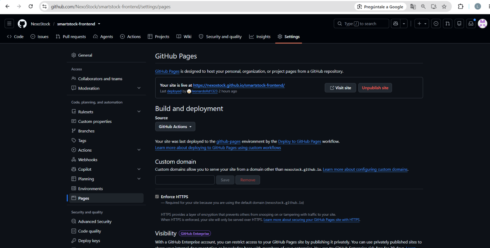

*Nota. Pages del repositorio NexoStock/smartstock-frontend; la aplicación se publica con el workflow deploy.yml al integrar en main. Elaboración propia*

**Figura 230**

*Ejecución del workflow «Deploy to GitHub Pages» con los jobs build y deploy exitosos*

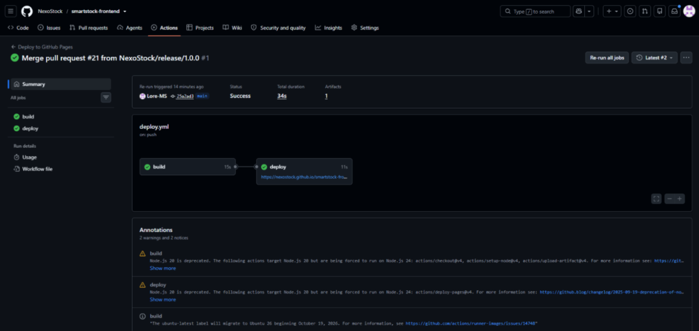

*Nota. Ejecución disparada por el merge del PR #21 en main. En la primera corrida, deploy fue rechazado por las reglas del entorno github-pages (no permitían main); tras permitirla, la reejecución terminó con éxito. Elaboración propia*

**Figura 231**

*Fake API desplegada en Render (Live, rama main)*

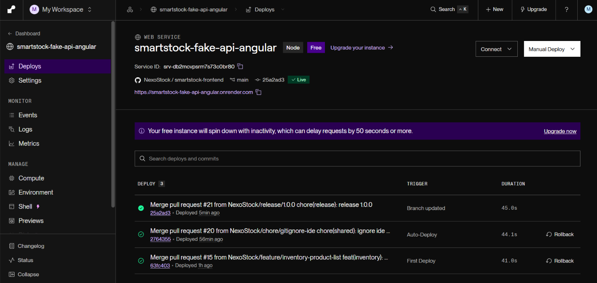

*Nota. Web Service de Node, plan Free, repositorio NexoStock/smartstock-frontend, rama main, URL `https://smartstock-fake-api-angular.onrender.com`. Elaboración propia*

**Figura 232**

*Etiqueta v1.0.0 del repositorio*

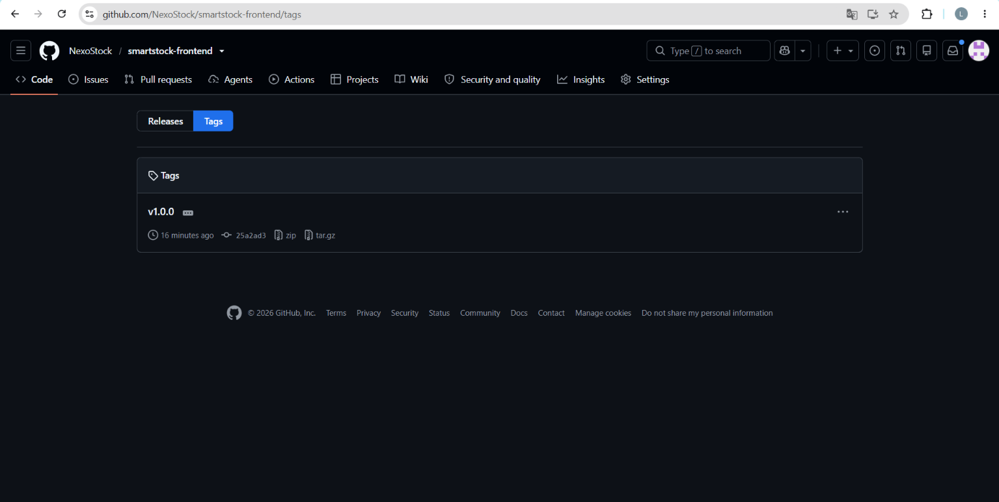

*Nota. Elaboración propia*

**Figura 233*

*Frontend Web Application funcionando en su URL pública*

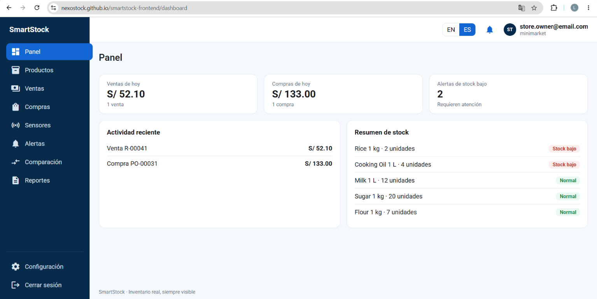

*Nota. (a) Dashboard con datos de la Fake API en inglés; (b) el mismo dashboard en español. Elaboración propia*

#### 5.2.2.8. Team Collaboration Insights during Sprint

Durante el Sprint 2, el equipo organizó la implementación según los aspectos definidos en la sección 5.2.2.2. Cada integrante trabajó sobre el contexto que lideraba y registró su aporte mediante commits propios en el repositorio NexoStock/smartstock-frontend, aplicando GitFlow y Conventional Commits. El flujo de trabajo seguido se resume en la Tabla 45.

**Tabla 45**  

*Flujo de ramas de GitFlow seguido en el Sprint 2*

| Rama | Nace de | Se integra en | Regla |
| --- | --- | --- | --- |
| main | — | — | Recibe únicamente las versiones publicadas; solo se modifica mediante pull request. |
| develop | — | — | Concentra el avance acumulado del sprint; solo se modifica mediante pull request. |
| `feature/<contexto>-<tarea>` | develop | develop | Una rama corta por tarea del Sprint Backlog; se integra mediante pull request revisado por otro integrante, con merge commit (`--no-ff`). |
| `release/<x.y.z>` | develop | main y de vuelta a develop | Prepara la versión a entregar; al integrarse en main se etiqueta con versionado semántico (vX.Y.Z). |

*Nota. Elaboración propia*

Los mensajes de commit siguen Conventional Commits (feat, fix, docs, refactor, test, chore), en inglés, con el contexto como alcance, por ejemplo feat(iam): add login view. El identificador de la tarea se registra en el cuerpo del mensaje.

##### Analíticos de colaboración de los repositorios

La vista de contribuyentes de GitHub y la vista Pulse muestran la participación de los cinco integrantes del equipo en el repositorio, con commits distribuidos entre los contextos que cada uno lideró (Figuras 181 y 182).

**Figura 234**

*Contributors del repositorio NexoStock/smartstock-frontend*

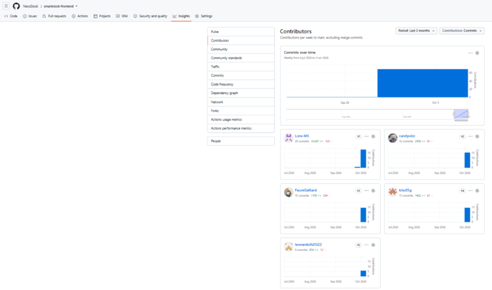

*Nota. Elaboración propia*

**Figura 235**

*Pulse del repositorio NexoStock/smartstock-frontend*

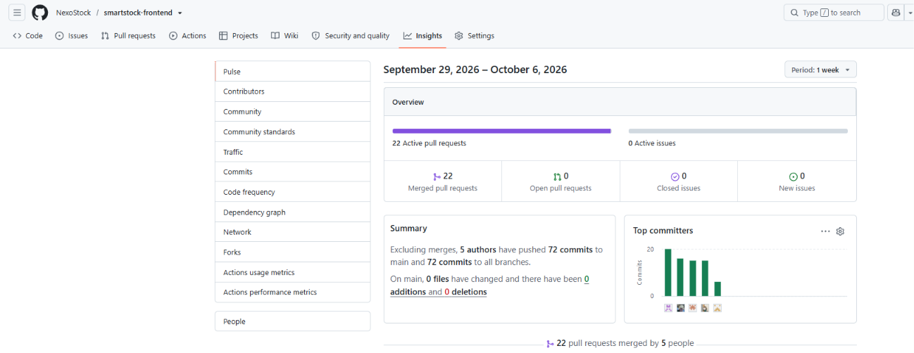

*Nota. Elaboración propia*

##### Historial de ramas de los repositorios

El grafo de red muestra la aplicación efectiva de GitFlow: las ramas de feature nacen de develop y se integran nuevamente a ella mediante merge commits, y la rama main recibe únicamente la versión publicada a través de release/1.0.0.

**Figura 236**

*Network graph del repositorio NexoStock/smartstock-frontend*

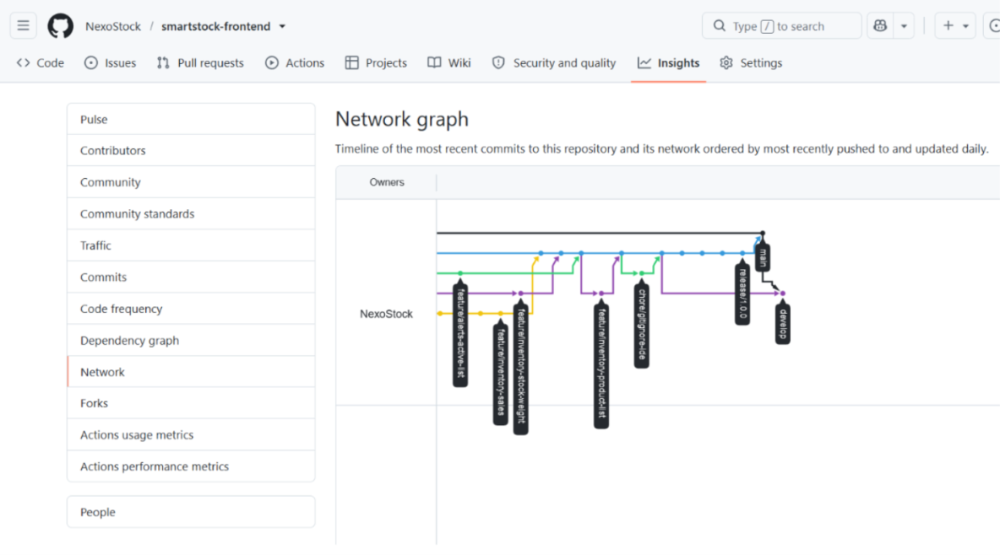

*Nota. Elaboración propia*

### 5.2.3. Sprint 3

#### 5.2.3.1. Sprint Planning 3

En el Sprint Planning 3 el equipo definió como meta entregar la primera versión desplegada de los Web Services de SmartStock (Spring Boot, Spring Data JPA y MySQL), para que la Frontend Web Application desarrollada en Angular funcione con datos reales y persistentes en lugar de la Fake API. El sprint abarca las Technical Stories TS01 a TS15 (EP09), que en el Sprint 2 se trabajaron como tareas de simulación (mock) y ahora se implementan con Web Services reales. El sprint incluye además la autenticación: registro de negocio, inicio de sesión y token JWT del contexto IAM. La planificación se realizó el 2026-11-02 a las 2:00 PM, en reunión virtual. 

**Tabla 46**  

*Sprint Planning 3*

| Campo | Detalle |
| --- | --- |
| Sprint # | 3 |
| Date | 2026-11-04 |
| Time | 08:00 PM |
| Location | Reunión virtual |
| Prepared By | Vizcarra Mamani, Candy Milagros |
| Attendees | Crispin Valdivia, Angel Gabriel; Lopez Rimachi, Sebastian Leonardo; Montañez Salinas, Lorena Ariana; Tuesta Girón, Kiara Lucia; Vizcarra Mamani, Candy Milagros |
| Sprint 2 – Review Summary | En el Sprint 2 se implementó y desplegó en GitHub Pages la primera versión de la Frontend Web Application (v1.0.0), con las 23 User Stories de IAM, IoT Device, Alerts & Restocking, Product Catalog, Inventory Monitoring y Analytics & Reporting, consumiendo una Fake API (json-server) desplegada en Render. Como la Fake API guarda los datos en memoria y se reinicia tras un periodo sin uso, quedó pendiente reemplazarla por Web Services reales con base de datos persistente, manteniendo el mismo contrato de endpoints. |
| Sprint 2 – Retrospective Summary | Funcionó bien trabajar cada tarea en una rama corta con pull request revisado por otro integrante y mantener los contratos de la API documentados antes de construir las pantallas. Como aspectos a mejorar, el equipo acordó definir desde el inicio las reglas de negocio críticas (stock que solo cambia mediante movimientos, ventas atómicas, alertas sin duplicados) y probarlas contra MySQL real, y no dejar el despliegue para el final del sprint. |
| Sprint 3 Goal | Our focus is on delivering the first version of the SmartStock Web Services, with persistent data, authentication and the business rules of stock, sales, purchases, sensors and alerts. We believe it delivers reliable inventory records that are no longer lost to minimarket and bodega owners, whose web application and IoT sensors now work against a real backend. This will be confirmed when the Web Services are deployed with their OpenAPI documentation and the web application registers a sale that updates the stock and raises a low-stock alert. |
| Sprint 3 Velocity | 164 horas estimadas. El Sprint 3 está formado por Technical Stories (TS01 a TS15) y tareas técnicas de soporte (TS-SH), integración (TS-INT), revisión (TS-REV) y documentación (TS-DOC); el Product Backlog no asigna Story Points a las Technical Stories, por lo que la capacidad se planificó en horas por integrante. |
| Sum of Story Points | 0 Story Points de User Stories; 15 Technical Stories y 40 tareas con una estimación total de 164 horas |

*Nota. Elaboración propia*

Para el Sprint 3 el equipo acordó: (1) cada integrante construye el backend del bounded context que ya construyó en el frontend; (2) los contextos se comunican mediante fachadas ACL y eventos de Spring, y Analytics & Reporting consulta los datos de los demás contextos mediante un modelo de lectura; (3) la seguridad se integra en dos niveles: la base inicial usa una configuración temporal abierta con un negocio fijo, y el filtro JWT reemplaza esa configuración al cerrar el sprint; y (4) cada corrección queda registrada con su evidencia. 

**Tabla 47**

*Autocrítica y mejoras acordadas para AV2*

| **ID** | **Entrega** | **Autocrítica** | **Mejora acordada** | **Evidencia** |
|---|---|---|---|---|
| M01 | TB1 | El docente observó el uso de hipervínculos. | El índice se presenta sin enlaces; el resto de las direcciones son enlaces que se prueban uno por uno en el PDF final. | Índice y secciones 5.2.3.3, 5.2.3.6, 5.2.3.7 y 5.4 |
| M02 | TB1 | La rúbrica de mejora continua señaló persistencia de errores y ausencia de algunos artefactos identificados con anterioridad. | Contrastar cada sección con el enunciado antes de la entrega y cerrar todo texto "Pendiente". | Secciones 5.1 y 5.2.3 |
| M03 | TB1 | La rúbrica de comunicación señaló errores de ortografía o gramática. | Revisar ortografía antes de entregar; un segundo integrante lee cada capítulo. | Todo el informe |
| M04 | TB1 | Las secciones 5.1.1, 5.1.2 y 5.1.4 conservan textos "Pendiente" y un proveedor de despliegue distinto al realmente usado. | Completar repositorios, entorno de desarrollo y despliegue con lo realmente implementado. | Secciones 5.1.1, 5.1.2 y 5.1.4 |
| M05 | TB1 | Los diagramas C4 hablan de módulos "previstos" para el Sprint 3. | Cambiar a "implementado" y verificar contra el código. | Secciones 4.6.3 y 4.6.4 |

*Nota. Elaboración propia*

#### 5.2.3.2. Aspect Leaders and Collaborators

Los aspectos de este sprint corresponden a los bounded contexts del backend, implementados como módulos de un monolito Spring Boot: IAM (registro, inicio de sesión, token JWT y recuperación de contraseña), IoT Device (sensores y lecturas), Alerts & Restocking (alertas, notificaciones por correo y WhatsApp, y Ventas), Product Catalog (productos, proveedores y compras), Inventory Monitoring (movimientos y stock) y Analytics & Reporting (dashboard y reportes). Cada aspecto tiene un líder (L) y los demás colaboran (C) revisando pull requests y probando la integración. Esta distribución se refleja en la selección de tasks de la sección 5.2.3.3 y en la autoría de los commits del repositorio. 

**Tabla 48**  

*Matriz de liderazgo y colaboración (LACX) del Sprint 3*

| **Team Member (Last Name, First Name)** | **GitHub Username** | **IAM** | **IoT Device** | **Alerts & Restocking** | **Product Catalog** | **Inventory Monitoring** | **Analytics & Reporting** |
| --------------------------------------- | ------------------- | ------- | -------------- | ----------------------- | ------------------- | ------------------------ | ------------------------- |
| Crispin Valdivia, Angel Gabriel | @FaureGalliard | C | L | C | C | C | C |
| Lopez Rimachi, Sebastian Leonardo | @leonardoXd1323 | C | C | L | C | C | C |
| Montañez Salinas, Lorena Ariana | @Lore-MS | L | C | C | C | C | C |
| Tuesta Girón, Kiara Lucia | @kitu05g | C | C | C | C | L | L |
| Vizcarra Mamani, Candy Milagros | @candyvizz | C | C | C | L | C | C |

*Nota. Elaboración propia*

#### 5.2.3.3. Sprint Backlog 3

El objetivo del Sprint 3 es entregar la primera versión desplegada de los Web Services de SmartStock, para que la aplicación Angular funcione con datos reales y persistentes. El sprint contiene las 15 Technical Stories (TS01 a TS15), que suman 45 Story Points, y 40 tareas con 164 horas en total. Las tareas de soporte (setup, documentación, integración, revisión cruzada y pruebas) no tienen Story Points propios. La autenticación (T-TS04.1 a T-TS04.4) se implementa en este sprint: el despliegue inicial usó una seguridad temporal abierta y el filtro JWT la reemplazó al cierre. El tablero del sprint está en Trello (figura 236) y su dirección pública, escrita como texto simple, es: 
URL pública del tablero de Trello:`https://trello.com/b/m2D1USjs/sprint-backlog-3-source`

**Figura 237**

*Tablero de Trello del Sprint Backlog 3*

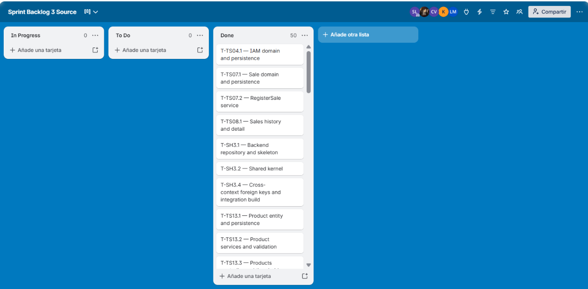

*Nota. Elaboración propia*

Las tareas se identifican como T-TS##.# (Technical Stories), T-SH3.# (setup compartido), T-DOC3.# (documentación), T-INT3.# (integración) y T-REV3.# (revisión cruzada).

**Tabla 49**  

*Sprint Backlog 3*

| **Sprint #** | **Story Id** | **Story Title** | **Task Id** | **Task Title** | **Task Description** | **Estimation (Hours)** | **Assigned To** | **Status** |
|---|---|---|---|---|---|---:|---|---|
| 3 | TS01 | Dispositivos IoT | T-TS01.1 | Sensors and readings | Clave de dispositivo (hash), POST /api/device-readings/{codigo}, duplicados y fuera de orden. | 8 | Crispin Valdivia, Angel Gabriel (@FaureGalliard) | Done |
| 3 | TS02 | Consulta de stock | T-TS02.1 | Stock queries | Stock actual, detalle con sensor. | 4 | Tuesta Girón, Kiara Lucia (@kitu05g) | Done |
| 3 | TS02 | Consulta de stock | T-TS02.2 | Comparison and movements | Comparación y /api/movimientos-stock (filtro de fechas). | 6 | Tuesta Girón, Kiara Lucia (@kitu05g) | Done |
| 3 | TS03 | Alertas de stock bajo | T-TS03.1 | Alert rules R19–R21 | Alertas con activeKey única, evento después de commit, destinatario por negocio (IamContextFacade). | 6 | Lopez Rimachi, Sebastian Leonardo (@leonardoXd1323) | Done |
| 3 | TS03 | Alertas de stock bajo | T-TS03.2 | Notification channels | Cola con reclamo atómico PENDING→PROCESSING→SENT/FAILED. | 4 | Lopez Rimachi, Sebastian Leonardo (@leonardoXd1323) | Done |
| 3 | TS03 | Alertas de stock bajo | T-TS03.3 | Email and WhatsApp senders | SMTP y Twilio por variables de entorno. | 3 | Lopez Rimachi, Sebastian Leonardo (@leonardoXd1323) | Done |
| 3 | TS03 | Alertas de stock bajo | T-TS03.4 | Retry and queries | RetryNotificationCommand, UpdateChannels y las queries restantes. | 2 | Lopez Rimachi, Sebastian Leonardo (@leonardoXd1323) | Done |
| 3 | TS04 | Autenticación | T-TS04.1 | IAM domain and persistence | Business (teléfono opcional), Account, EmailAddress, repositorios, IamContextFacade. | 5 | Montañez Salinas, Lorena Ariana (@Lore-MS) | Done |
| 3 | TS04 | Autenticación | T-TS04.2 | Register, login and JWT service | BCrypt, JwtTokenService, registro con 409 en duplicado. | 5 | Montañez Salinas, Lorena Ariana (@Lore-MS) | Done |
| 3 | TS04 | Autenticación | T-TS04.3 | JWT filter and integration | El commit del filtro lo integró Candy en feature/iam-security. | 5 | Montañez Salinas, Lorena Ariana (@Lore-MS) | Done |
| 3 | TS04 | Autenticación | T-TS04.4 | Forgot and reset password | Token de un solo uso, hash y respuesta que no revela el correo. | 4 | Montañez Salinas, Lorena Ariana (@Lore-MS) | Done |
| 3 | TS05 | Dispositivos IoT | T-TS05.1 | Sensor status | Listado y estado provisional. | 3 | Crispin Valdivia, Angel Gabriel (@FaureGalliard) | Done |
| 3 | TS05 | Dispositivos IoT | T-TS05.2 | Link sensor to product | Vincular sensor y producto. | 3 | Crispin Valdivia, Angel Gabriel (@FaureGalliard) | Done |
| 3 | TS06 | Ventas | T-TS06.1 | Sales domain and persistence | Sale, SaleItem, requestKey única, repositorio. | 4 | Lopez Rimachi, Sebastian Leonardo (@leonardoXd1323) | Done |
| 3 | TS07 | Ventas | T-TS07.1 | RegisterSale | Precio del catálogo, venta + baja de stock en una transacción, idempotencia, rollback. | 6 | Lopez Rimachi, Sebastian Leonardo (@leonardoXd1323) | Done |
| 3 | TS08 | Ventas | T-TS08.1 | Sales queries and controller | GET /api/ventas y /api/ventas/{code}; Idempotency-Key; por negocio. | 3 | Lopez Rimachi, Sebastian Leonardo (@leonardoXd1323) | Done |
| 3 | TS09 | Proveedores y compras | T-TS09.1 | Suppliers | Proveedores (/api/proveedores). | 5 | Vizcarra Mamani, Candy Milagros (@candyvizz) | Done |
| 3 | TS10 | Proveedores y compras | T-TS10.1 | Purchases and receipt | Compras con InventoryContextFacade.addStockForPurchase, recepción repetida y rollback. | 6 | Vizcarra Mamani, Candy Milagros (@candyvizz) | Done |
| 3 | TS12 | Proveedores y compras | T-TS12.1 | Purchase queries and release | Consultas de compras (listado y detalle por id). | 3 | Vizcarra Mamani, Candy Milagros (@candyvizz) | Done |
| 3 | TS13 | Catálogo de productos | T-TS13.1 | Product domain and persistence | Product (validate-before-mutate), value objects, converters, repository, ProductCreatedEvent, ThresholdChangedEvent. | 4 | Vizcarra Mamani, Candy Milagros (@candyvizz) | Done |
| 3 | TS13 | Catálogo de productos | T-TS13.2 | Product services and controller | Command/query services con rollback, assemblers, /api/productos con OpenAPI. | 4 | Vizcarra Mamani, Candy Milagros (@candyvizz) | Done |
| 3 | TS14 | Movimientos de stock | T-TS14.1 | Stock movement engine | MovementCommandService con bloqueo de fila, StockChangedEvent, InventoryContextFacade. | 8 | Tuesta Girón, Kiara Lucia (@kitu05g) | Done |
| 3 | TS15 | Analytics | T-TS15.1 | Dashboard and reports | /api/dashboard y /api/reportes con fórmula, período y caso sin datos. | 6 | Tuesta Girón, Kiara Lucia (@kitu05g) | Done |
| 3 | TS-DOC | Soporte técnico | T-DOC3.1 | Review of section 5.1.1 | Revisar el borrador de Candy y aportar su evidencia. | 2 | Tuesta Girón, Kiara Lucia (@kitu05g) | Done |
| 3 | TS-DOC | Soporte técnico | T-DOC3.2 | Execution evidence 5.2.3.5 | Capturas de la Web App con la API y enlace al video. | 3 | Lopez Rimachi, Sebastian Leonardo (@leonardoXd1323) | Done |
| 3 | TS-DOC | Soporte técnico | T-DOC3.3 | Swagger captures Catalog and Purchasing | Capturas y documentación de endpoints (5.2.3.6). | 2 | Vizcarra Mamani, Candy Milagros (@candyvizz) | Done |
| 3 | TS-DOC | Soporte técnico | T-DOC3.4 | Swagger captures Alerts and Sales | Capturas y documentación (5.2.3.6). | 3 | Lopez Rimachi, Sebastian Leonardo (@leonardoXd1323) | Done |
| 3 | TS-DOC | Soporte técnico | T-DOC3.5 | Swagger captures Inventory and Analytics | Capturas y documentación (5.2.3.6). | 3 | Tuesta Girón, Kiara Lucia (@kitu05g) | Done |
| 3 | TS-DOC | Soporte técnico | T-DOC3.6 | Trello cards | Cargar las cards con responsable, contexto, nivel, estado y evidencia real. | 2 | Lopez Rimachi, Sebastian Leonardo (@leonardoXd1323) | Done |
| 3 | TS-DOC | Soporte técnico | T-DOC3.7 | Sprint Backlog table | Intro + captura del tablero + URL público + tabla en texto. | 2 | Montañez Salinas, Lorena Ariana (@Lore-MS) | Done |
| 3 | TS-DOC | Soporte técnico | T-DOC3.8 | Trello board | Crear tablero, invitar a todas. | 2 | Montañez Salinas, Lorena Ariana (@Lore-MS) | Done |
| 3 | TS-DOC | Soporte técnico | T-DOC3.9 | Deployment evidence | Capturas y redacción de 5.2.3.7 de los 3 productos. | 4 | Crispin Valdivia, Angel Gabriel (@FaureGalliard) | Done |
| 3 | TS-DOC | Soporte técnico | T-DOC3.10 | Section 5.1.1 (draft) | Redactar 5.1.1 con evidencias; Kiara revisa. | 3 | Vizcarra Mamani, Candy Milagros (@candyvizz) | Done |
| 3 | TS-INT | Integración | T-INT3.1 | Login to sale integration tests | Registro → login → producto → stock → venta → alerta; 401/403; aislamiento por negocio. | 4 | Montañez Salinas, Lorena Ariana (@Lore-MS) | Done |
| 3 | TS-REV | Revisión cruzada | T-REV3.1 | Review PRs of level 1 | Revisar PR de Alertas y Ventas con la regla espejo y @Operation. | 2 | Vizcarra Mamani, Candy Milagros (@candyvizz) | Done |
| 3 | TS-REV | Revisión cruzada | T-REV3.2 | Review IAM PR | Revisar PR de IAM. | 2 | Vizcarra Mamani, Candy Milagros (@candyvizz) | Done |
| 3 | TS-SH | Soporte técnico | T-SH3.1 | Backend repository and base | Repo smartstock-backend, ramas, Initializr, pom (Java 27, Boot 4.1.1), shared, Result, i18n, perfiles local/prod. | 6 | Vizcarra Mamani, Candy Milagros (@candyvizz) | Done |
| 3 | TS-SH | Soporte técnico | T-SH3.2 | Dockerfile and CI | Dockerfile Java 27, perfil prod, CI con Java 27. | 5 | Crispin Valdivia, Angel Gabriel (@FaureGalliard) | Done |
| 3 | TS-SH | Soporte técnico | T-SH3.3 | Deploy Web Services and MySQL | Render (Docker) + Railway, variables, CORS, health; nivel 1 parcial; versiones v1.0.0, v1.1.0 y v1.1.1. | 8 | Crispin Valdivia, Angel Gabriel (@FaureGalliard) | Done |
| 3 | TS-SH | Soporte técnico | T-SH3.4 | Business rule tests | JUnit del motor de stock y reglas; ventas concurrentes contra MySQL. | 4 | Tuesta Girón, Kiara Lucia (@kitu05g) | Done |

*Nota. Elaboración propia. Estados: To Do · In Progress · Review · Done; al cierre del sprint todas las tareas están en Done. Horas por integrante: Angel 31, Candy 37, Kiara 33, Leo 36, Lore 27; total: 164.*

#### 5.2.3.4. Development Evidence for Sprint Review

En este sprint la implementación se concentró en el repositorio de Web Services (Spring Boot, Spring Data JPA y MySQL), organizado en un paquete por bounded context con las capas domain, infrastructure, application e interfaces. Cada integrante trabajó en una rama feature/<contexto>-<tarea> creada desde develop, y los cambios se integraron mediante pull request con merge commit. Los mensajes siguen Conventional Commits, en inglés y en minúsculas. El contexto IAM, a cargo de Lorena, se desarrolló en tres ramas: feature/iam-auth (dominio, persistencia, servicios y controlador, en cuatro commits, uno por capa), feature/iam-security (filtro JWT y aislamiento por negocio) y feature/iam-password-reset (recuperación de contraseña, en cinco commits). La tabla reúne los commits más representativos de cada integrante. 

**Tabla 50**

*Commits relacionados con la implementación del Sprint 3*

| **Repository** | **Branch** | **Commit Id** | **Commit Message** | **Commit Message Body** | **Committed on (Date)** |
|---|---|---|---|---|---|
| NexoStock/smartstock-backend | feature/shared-base | `4e5b6c1` | feat(shared-catalog): add backend foundation and product catalog | — | 06/11/2026 |
| NexoStock/smartstock-backend | feature/purchasing | `6347961` | wip(purchasing): save purchasing implementation | — | 06/11/2026 |
| NexoStock/smartstock-backend | feature/iam-auth | `0824e63` | feat(iam): add domain model for accounts and businesses | — | 06/11/2026 |
| NexoStock/smartstock-backend | feature/iam-auth | `1ded298` | feat(iam): add persistence, hashing and jwt infrastructure | — | 07/11/2026 |
| NexoStock/smartstock-backend | feature/iam-auth | `0dae512` | feat(iam): add account command and query services | — | 07/11/2026 |
| NexoStock/smartstock-backend | feature/iam-auth | `390a007` | feat(iam): add authentication controller and context facade | — | 07/11/2026 |
| NexoStock/smartstock-backend | feature/inventory-stock-management | `3146465` | feat(inventory): implement MovementCommandServiceImpl with transaction management | — | 07/11/2026 |
| NexoStock/smartstock-backend | feature/inventory-stock-management | `5987b71` | feat(inventory): add InventoryContextFacade for Sales and Purchasing ACL | — | 07/11/2026 |
| NexoStock/smartstock-backend | feature/devices-sensors | `3239248` | feat(devices): add device key generation and hashing | — | 08/11/2026 |
| NexoStock/smartstock-backend | feature/devices-sensors | `713b73d` | feat(devices): add sensors controller | — | 08/11/2026 |
| NexoStock/smartstock-backend | feature/devices-sensors | `7db30c4` | feat(devices): add device readings endpoint with X-Device-Key | — | 08/11/2026 |
| NexoStock/smartstock-backend | feature/docker-ci | `1f208e7` | build(docker): add multi-stage Dockerfile with Java 27 | — | 08/11/2026 |
| NexoStock/smartstock-backend | feature/docker-ci | `565b4cf` | ci: add GitHub Actions workflow with Java 27 | — | 08/11/2026 |
| NexoStock/smartstock-backend | feature/iam-security | `1ddba6c` | feat(iam): enforce JWT authentication and tenant isolation | — | 09/11/2026 |
| NexoStock/smartstock-backend | feature/alerts-rules | `fa2c564` | feat(alerts): evaluate low stock and handle inventory events | — | 10/11/2026 |
| NexoStock/smartstock-backend | feature/alerts-rules | `624fc3b` | feat(sales): add sale registration with inventory integration | — | 10/11/2026 |
| NexoStock/smartstock-backend | feature/alerts-rules | `45aaa1f` | feat(sales): expose registration and business-scoped history API | — | 10/11/2026 |
| NexoStock/smartstock-backend | feature/external-services | `9103a07` | feat(alerts): add notification channels senders and retries | — | 10/11/2026 |
| NexoStock/smartstock-backend | feature/iam-password-reset | `eecd25c` | feat(iam): add password reset token and commands | Task: T-TS04.4 | 10/11/2026 |
| NexoStock/smartstock-backend | feature/iam-password-reset | `bd70cbc` | feat(iam): add password reset token repository and hashing | Task: T-TS04.4 | 10/11/2026 |
| NexoStock/smartstock-backend | feature/iam-password-reset | `af54675` | feat(iam): add password reset command handlers | Task: T-TS04.4 | 10/11/2026 |
| NexoStock/smartstock-backend | feature/iam-password-reset | `2745781` | feat(iam): add forgot and reset password endpoints | Task: T-TS04.4 | 10/11/2026 |
| NexoStock/smartstock-backend | feature/iam-password-reset | `233226e` | fix(security): permit swagger ui and api docs | Task: T-TS04.4 | 10/11/2026 |
| NexoStock/smartstock-backend | feature/analytics-dashboard | `7bc6a61` | feat(analytics): expose dashboard and reports endpoints | — | 13/11/2026 |
| NexoStock/smartstock-backend | feature/analytics-dashboard | `98913aa` | feat(analytics): expose inventory comparison and movements endpoints | — | 13/11/2026 |

*Nota. Elaboración propia. Solo los commits de la tarea T-TS04.4 incluyen la tarea en el cuerpo del mensaje.*

#### 5.2.3.5. Execution Evidence for Sprint Review

En el Sprint 3 la Frontend Web Application Angular quedó conectada a los Web Services reales: las vistas de IAM, IoT Device, Alerts & Restocking, Product Catalog, Inventory Monitoring (incluidas ventas, compras y proveedores) y Analytics & Reporting funcionan con datos persistentes en MySQL en lugar de la Fake API. El cambio se concentró en la dirección base del servicio (apiBaseUrl) y en el inicio de sesión: ahora la aplicación usa el token JWT y cada negocio solo ve sus propios datos. Cada captura se rotula con la historia que cubre. El video que muestra la navegación lograda en el sprint se llama upc-pre202620-1asi0729-7729-nexostock-product-navigation-sprint-3.mp4 y su dirección, escrita como texto simple, es:`https://upcedupe-my.sharepoint.com/:v:/g/personal/u20241f946_upc_edu_pe/IQBdzCqqjN2bRZw1igPd50NKAWzK-qGA2o6WDNVhILYWqao?e=ZpZHyF&nav=eyJyZWZlcnJhbEluZm8iOnsicmVmZXJyYWxBcHAiOiJTdHJlYW1XZWJBcHAiLCJyZWZlcnJhbFZpZXciOiJTaGFyZURpYWxvZy1MaW5rIiwicmVmZXJyYWxBcHBQbGF0Zm9ybSI6IldlYiIsInJlZmVycmFsTW9kZSI6InZpZXcifX0%3D`

**Tabla 51**

*Evidencia de ejecución por contexto e historia de usuario del Sprint 3*

| **Contexto** | **Historia** | **Ruta** | **La captura debe mostrar** | **Figura** |
|---|---|---|---|---:|
| IAM | US01, US02 y US03 (registro, inicio de sesión y credenciales inválidas) | `/sign-up`, `/sign-in` | Registro de negocio, inicio de sesión con token y error por credenciales inválidas | 237 |
| Ventas | US26, US27 y US28 | `/sales`, `/sales/new`, `/sales/:id` | Venta registrada, rechazo por stock insuficiente, historial por fechas y detalle | 238 |
| IoT Device | US04 (vinculación de sensor) | `/sensors/link` | Selección de sensor y producto, y error de sensor en uso | 239 |
| IoT Device | US06 y US07 (estado y peso actual) | `/sensors` | Sensores en línea y desconectados, y peso actual | 240 |
| Alerts & Restocking | US09 y US10 (notificaciones) | `/settings` | Canales de correo y WhatsApp configurados | 241 |
| Alerts & Restocking | US12 y US32 (alertas y compra desde la alerta) | `/alerts` | Alerta de stock bajo o discrepancia y botón que abre el registro de compra | 242 |
| Product Catalog | US13, US14 y US05 (productos y umbral mínimo) | `/products/new`, `/products/:id/edit` y `/sensors/:id/threshold` | Registro, edición y umbral mínimo con error de validación | 243 |
| Proveedores y Compras | US29, US30 y US31 | `/purchases/suppliers`, `/purchases/new`, `/purchases` y `/purchases/:id` | Proveedor creado, compra pendiente, compra recibida e historial por fechas | 244 |
| Inventory Monitoring | US08 y US11 | `/products` y `/comparison` | Niveles de stock y comparación físico vs. registrado (solo minimarket) | 245 |
| IoT Device y Alerts & Restocking | Prueba de integración (R20) | `/sensors` y `/alerts` | Lectura de 2.0 kg del sensor, estado en línea y discrepancia con su alerta, en Swagger y en la aplicación | 246 |
| Analytics & Reporting | US15 y US25 | `/dashboard`, `/reports` | Tarjetas del día con ventas y compras, y reporte por período | 247 |

*Nota. Elaboración propia*

**Figura 238**

*Autenticación en la aplicación: (a) registro de negocio, (b) inicio de sesión y (c) error por credenciales inválidas (US01, US02 y US03)*

(completar - LORENA: capturas de /sign-up y /sign-in en la app Angular)

*Nota.* Elaboración propia

**Figura 239**

*Pantalla de Ventas: (a) venta registrada, (b) rechazo por stock insuficiente, (c) historial por fechas y (d) detalle (US26, US27 y US28)*

(completar - LEO)

*Nota.* Elaboración propia

**Figura 240**

*Vinculación de sensor a un producto y error de sensor en uso (US04)*

(completar - ANGEL)

*Nota.* Elaboración propia

**Figura 241**

*Estado de conexión de sensores en línea y desconectados, y peso actual (US06 y US07)*

(completar - ANGEL)

*Nota.* Elaboración propia

**Figura 242**

*Configuración de notificaciones por correo y WhatsApp (US09 y US10)*

(completar - LEO)

*Nota.* Elaboración propia

**Figura 243**

*Alertas activas y botón de compra desde una alerta de stock bajo (US12 y US32)*

(completar - LEO)

*Nota.* Elaboración propia

**Figura 244**

*Catálogo de productos: (a) registro, (b) edición y (c) umbral mínimo con su error de validación (US13, US14 y US05)*

(completar - CANDY)

*Nota.* Elaboración propia

**Figura 245**

*Proveedores y compras: (a) proveedor creado, (b) formulario de nueva compra, (c) compra recibida y (d) historial por fechas con una compra pendiente (US29, US30 y US31)*

(completar - CANDY)

*Nota.* Elaboración propia

**Figura 246**

*Inventory Monitoring: (a) lista de productos con su nivel de stock y (b) comparación entre el stock físico y el registrado (US08 y US11)*

(completar - KIARA)

*Nota.* Elaboración propia

**Figura 247**

*Prueba de integración: lectura de 2.0 kg en el sensor, estado en línea y discrepancia con su alerta (R20), en Swagger y en la aplicación, con fecha de la prueba*

(completar - ANGEL: lectura en Swagger y estado en línea)

(completar - LEO: alerta de discrepancia en la app. La imagen del archivo es una alerta LOW_STOCK, no una discrepancia R20, así que no sirve aquí.)

*Nota.* Elaboración propia

**Figura 248**

*Dashboard con ventas y compras del día, y reporte por período (US15 y US25)*

(completar - KIARA)

*Nota.* Elaboración propia

#### 5.2.3.6. Services Documentation Evidence for Sprint Review

En el Sprint 3 el equipo documentó con OpenAPI los endpoints de los Web Services de SmartStock, que se visualizan mediante Swagger UI (springdoc), con las anotaciones @Operation y @ApiResponses en cada controlador. Las rutas protegidas exigen el token JWT en la cabecera Authorization y cada negocio solo accede a sus propios datos. Los errores se devuelven con un código y un mensaje en inglés o en español, según el encabezado Accept-Language, sin mostrar el stack trace. En el contexto IAM se probaron los casos de registro (201 y 409) y de inicio de sesión (200 y 400) con datos de muestra.
Repositorio de Web Services: github.com/NexoStock/smartstock-backend
Documentación desplegada (Swagger UI):`https://smartstock-backend-production-36b6ce8c.up.railway.app/swagger-ui/index.html`
Documentación local (Swagger UI): localhost:8080/swagger-ui.html
Commits de documentación: ver Tabla 50 (sección 5.2.3.4)

**Tabla 52**

*Documentación de los endpoints de los Web Services del Sprint 3*

| **Endpoint** | **Método** | **Acción** | **Parámetros** | **Ejemplo de request** | **Response y explicación** | **Historia** |
|---|---|---|---|---|---|---|
| `/api/auth/register` | POST | Registra un negocio y su cuenta | Cuerpo: businessName, businessType, phone (opcional), email, password | `{"businessName": "Bodega Ana", "businessType": "BODEGA", "phone": "999111222", "email": "ana@bodega.pe", "password": "•••"}` | 201 con el token y los datos del negocio; 409 si el correo ya está registrado; 400 si faltan datos o son inválidos. | US01 |
| `/api/auth/login` | POST | Valida credenciales y emite el token JWT | Cuerpo: email y password | `{"email": "ana@bodega.pe", "password": "•••"}` | 200 con el token JWT (8 horas de vigencia), correo y negocio; 400 si el cuerpo es inválido o las credenciales no coinciden (código INVALID_CREDENTIALS). | US02 y US03 |
| `/api/auth/forgot-password` | POST | Solicita el restablecimiento de contraseña | Cuerpo: email | `{"email": "ana@bodega.pe"}` | 200 con un mensaje genérico, exista o no el correo, para no revelar qué cuentas están registradas; 400 si el correo no es válido. El token se guarda con hash y dura 1 hora. | TS04 |
| `/api/auth/reset-password` | POST | Cambia la contraseña con el token de un solo uso | Cuerpo: token y newPassword (de 8 a 72 caracteres) | `{"token": "•••", "newPassword": "•••"}` | 200 con un mensaje de confirmación; 400 si el token es inválido, venció o ya se usó (INVALID_OR_EXPIRED_TOKEN), o si la contraseña no cumple el largo. | TS04 |
| `/api/*` (rutas protegidas) | Todos | Exigen el token JWT | Cabecera: Authorization: Bearer token | `Authorization: Bearer •••` | 401 si falta el token o es inválido o venció. Cada negocio solo ve sus datos: si pide un recurso de otro negocio recibe 404. | TS04 |
| `/api/device-readings/{deviceCode}` | POST | Recibe una lectura de peso del sensor | Ruta: deviceCode; cabecera: X-Device-Key; cuerpo: peso | `{"peso": 12.4}` | 201 si la lectura se guarda; 400 si el peso es inválido o la fecha es futura; 401 si falta o es incorrecta la clave X-Device-Key; 409 si la lectura está duplicada o fuera de orden. | TS01 |
| `/api/sensores` | POST | Registra un sensor | Cuerpo: código del sensor | `{"codigo": "SENSOR-001"}` | 201 con el sensor y su clave de dispositivo; 400 si el código es inválido; 409 si el código ya está registrado. | TS05 |
| `/api/sensores` | GET | Lista los sensores del negocio con su estado | — | — | 200 con la lista de sensores y su estado de conexión. | US06 |
| `/api/sensores/{id}` | GET | Consulta un sensor | Ruta: id | — | 200 con el sensor; 404 si no existe. | US06 y US07 |
| `/api/sensores/{id}/lecturas` | GET | Consulta las últimas lecturas del sensor, de la más reciente a la más antigua | Ruta: id | — | 200 con las últimas 10 lecturas; 404 si el sensor no existe. | US07 |
| `/api/sensores/vincular` | POST | Vincula un sensor con un producto | Cuerpo: sensorId y productoId | `{"sensorId": 1, "productoId": 1}` | 200 si queda vinculado; 404 si el sensor o el producto no existen; 409 si alguno ya está vinculado. | US04 |
| `/api/sensores/{id}/desvincular` | POST | Desvincula el sensor de su producto | Ruta: id | — | 200 si queda desvinculado; 404 si no existe; 409 si no estaba vinculado. | US04 |
| `/api/sensores/{id}/rotar-clave` | POST | Genera una nueva clave del dispositivo | Ruta: id | — | 200 con la nueva clave; 404 si el sensor no existe. | TS01 |
| `/api/sensores/{id}` | DELETE | Elimina un sensor | Ruta: id | — | 204 si se elimina; 404 si no existe. | TS05 |
| `/api/productos` | POST | Registra un producto; el stock inicial se registra como movimiento | Cuerpo: nombre, sku, categoria, pesoUnitario, precioVenta, costoCompra, proveedorHabitual, stockRegistrado, umbralMinimo y capacidadMaxima | `{"nombre": "Arroz Costeño 5 kg", "sku": "ARR-005", "categoria": "Abarrotes", "pesoUnitario": 5, "precioVenta": 24.9, "costoCompra": 21.5, "proveedorHabitual": "Distribuidora Lima", "stockRegistrado": 40, "umbralMinimo": 10, "capacidadMaxima": 100}` | 201 con el producto; 400 si hay campos inválidos; 409 si el SKU ya existe; 422 si se rompe una regla de negocio (por ejemplo, umbral mayor que la capacidad máxima). | TS13 y US13 |
| `/api/productos` | GET | Lista los productos del negocio | — | — | 200 con la lista de productos y su nivel de stock; lista vacía si no hay productos. | TS13 y US08 |
| `/api/productos/{id}` | GET | Consulta un producto | Ruta: id | — | 200 con el producto; 404 si no existe. | TS13 |
| `/api/productos/{id}` | PUT | Actualiza un producto (el stock solo cambia mediante ajustes) | Ruta: id; cuerpo: igual que en el registro | El mismo cuerpo del registro con los campos cambiados | 200 con el producto actualizado; 400, 404, 409 o 422 según el error. | US14 |
| `/api/productos/{id}/umbral` | PUT | Cambia el umbral mínimo de stock | Ruta: id; cuerpo: umbralMinimo | `{"umbralMinimo": 15}` | 200 si se actualiza; 404 si no existe; 422 si el valor es inválido. | US05 |
| `/api/productos/{id}` | DELETE | Retira un producto | Ruta: id | — | 204 si se retira; 404 si no existe; 422 si no se puede retirar. | TS13 |
| `/api/productos/{id}/ajustes` | POST | Fija el stock contable del producto y registra un movimiento auditado | Ruta: id; cuerpo: stockRegistrado (nuevo stock contable) y motivo | `{"stockRegistrado": 35, "motivo": "Conteo fisico"}` | 200 con el stock ajustado; 400 si los datos son inválidos; 404 si el producto no existe; 422 si no hay nada que cambiar. | TS14 |
| `/api/productos/{id}/movimientos` | GET | Consulta el historial de movimientos de un producto | Ruta: id | — | 200 con el historial; 404 si el producto no existe. | TS14 |
| `/api/productos/{id}/detalle` | GET | Consulta el detalle del sensor de un producto | Ruta: id | — | 200 con el detalle; 404 si el producto no existe. | TS02 |
| `/api/inventario/comparacion` | GET | Compara el peso físico con la cantidad registrada | — | — | 200 con la comparación de cada producto; 401 si falta el token. | US11 |
| `/api/movimientos-stock` | GET | Lista los movimientos de stock por rango de fechas | Consulta: desde y hasta (aaaa-mm-dd) | `/api/movimientos-stock?desde=2026-11-01&hasta=2026-11-30` | 200 con los movimientos; 400 si el rango de fechas es inválido. | TS15 |
| `/api/dashboard` | GET | Consulta el dashboard del negocio | — | — | 200 con las tarjetas del día (ventas y compras); 401 si falta el token. | US15 |
| `/api/reportes` | GET | Consulta el reporte de un período | Consulta: desde y hasta | `/api/reportes?desde=2026-11-01&hasta=2026-11-30` | 200 con el reporte; 400 si el rango de fechas es inválido. | US25 |
| `/api/ventas` | POST | Registra una venta y descuenta el stock en una sola transacción | Cuerpo: items (productoId, cantidad, precioUnitario) | `{"items": [{"productoId": 9, "cantidad": 4, "precioUnitario": 5}]}` | 201 con la venta; 400 si la solicitud es inválida; 404 si el producto no existe; 422 si se rompe una regla de negocio (por ejemplo, stock insuficiente). Si hay un error no se cambia nada. | TS07 y US26 |
| `/api/ventas` | GET | Lista las ventas por rango de fechas | Consulta: desde y hasta (aaaa-mm-dd) | `/api/ventas?desde=2026-11-13&hasta=2026-11-13` | 200 con las ventas; 400 si el rango de fechas es inválido. | TS08 y US27 |
| `/api/ventas/{codigo}` | GET | Consulta el detalle de una venta | Ruta: codigo | `/api/ventas/V-170f3d4d` | 200 con la venta y sus ítems; 404 si no existe. | TS08 y US28 |
| `/api/alertas` | GET | Lista las alertas del negocio | — | — | 200 con las alertas (tipo, estado, producto y stock); 401 si falta el token. | TS03, US12 y US32 |
| `/api/notificaciones` | GET | Lista las notificaciones | — | — | 200 con las notificaciones y su estado; 401 si falta el token. | TS03 |
| `/api/notificaciones/{id}/reintentar` | POST | Vuelve a encolar una notificación fallida | Ruta: id | — | 202 si queda en cola; 404 si no existe; 422 si la notificación no está fallida. | TS03 |
| `/api/canales-notificacion` | GET | Lista los canales de notificación del negocio | — | — | 200 con los canales; 404 si no hay contacto del negocio. | US09 |
| `/api/canales-notificacion` | PUT | Activa o desactiva canales | Cuerpo: lista con id y active | `[{"id": 6, "active": true}]` | 200 si se actualizan; 400 si la solicitud es inválida; 404 si el canal no existe; 422 si no queda ningún canal activo. | US10 |
| `/api/proveedores` | POST | Registra un proveedor | Cuerpo: nombre, ruc, correo, telefono y direccion | `{"nombre": "Distribuidora Lima SAC", "ruc": "20123456789", "correo": "ventas@proveedor.com", "telefono": "987654321", "direccion": "Av. Principal 123, Lima"}` | 201 con el proveedor; 400 si hay datos inválidos; 409 si ya existe. | TS09 y US29 |
| `/api/proveedores` | GET | Lista los proveedores | — | — | 200 con la lista de proveedores. | TS09 |
| `/api/proveedores/{id}` | GET, PUT y DELETE | Consulta, actualiza y desactiva un proveedor | Ruta: id | (PUT) el mismo cuerpo del registro de proveedor | 200 en los tres casos; 400 o 409 en la actualización según el error; 404 si no existe. | TS09 |
| `/api/compras` | POST | Registra una compra pendiente con sus productos | Cuerpo: proveedorId y productos (productoId, cantidad, precioUnitario) | `{"proveedorId": 1, "productos": [{"productoId": 1, "cantidad": 10, "precioUnitario": 12.5}]}` | 201 con la compra; 400 si hay datos inválidos; 404 si el proveedor o un producto no existe; 409 si hay conflicto. | TS10 y US30 |
| `/api/compras` | GET | Lista las compras | — | — | 200 con las compras. | TS12 y US31 |
| `/api/compras/{id}` | GET | Consulta una compra | Ruta: id | — | 200 con la compra; 404 si no existe. | TS12 |
| `/api/compras/{id}/recibir` | POST | Recibe la compra y suma el stock en una sola transacción | Ruta: id | — | 200 con la compra recibida; 404 si no existe; 422 si ya fue recibida o no puede recibirse. | TS11 |
| `/api/compras/{id}/cancelar` | POST | Cancela una compra pendiente | Ruta: id | — | 200 con la compra cancelada; 404 si no existe; 422 si no se puede cancelar. | TS10 |

*Nota. Elaboración propia. Los códigos de respuesta provienen de las anotaciones @ApiResponse de cada controlador y se confirmaron en Swagger.*

**Figura 249**

*Swagger de IAM (entorno local): registro exitoso, correo duplicado, inicio de sesión correcto y credenciales inválidas (US01, US02 y US03)*

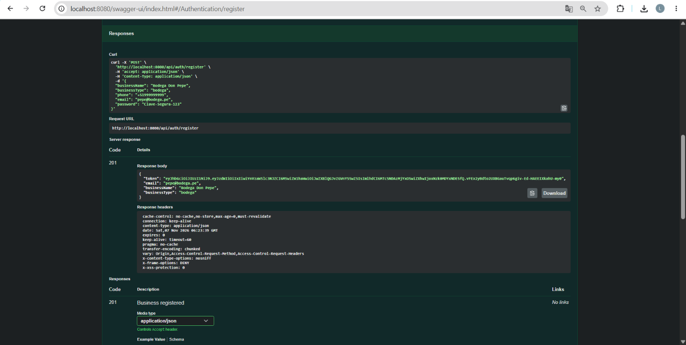
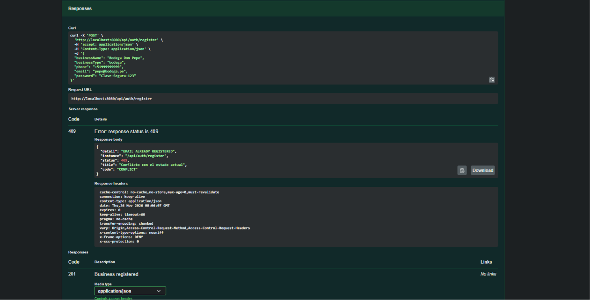
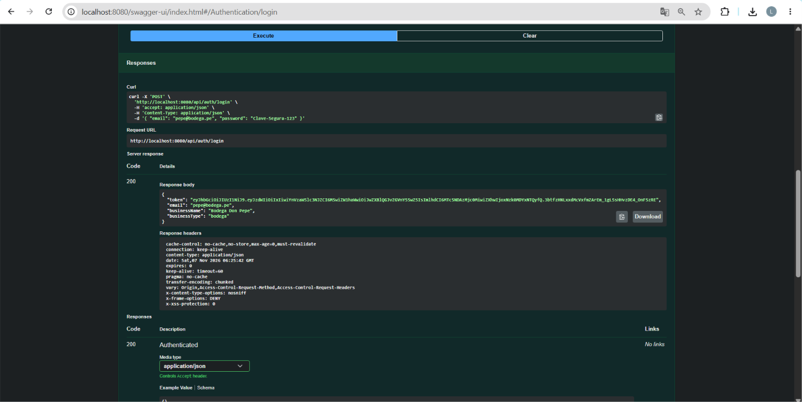
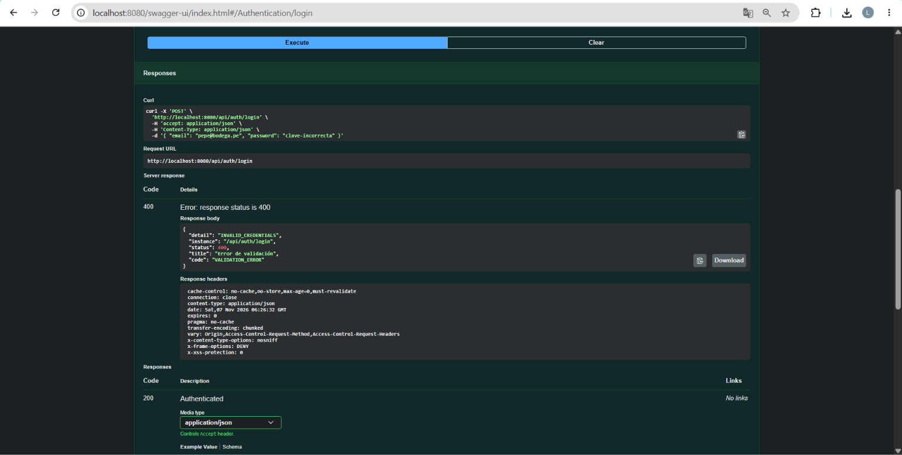

*Nota. Elaboración propia*

**Figura 250**

*Swagger de sensores: registro, listado, detalle, lecturas, vinculación, desvinculación, rotación de clave y eliminación (TS05, US04, US06 y US07)*

(completar - ANGEL)

*Nota.* Elaboración propia

**Figura 251**

*POST /api/device-readings/{deviceCode} con la cabecera X-Device-Key en Swagger (TS01)*

(completar - ANGEL)

*Nota.* Elaboración propia

**Figura 252**

*Swagger de productos: registro, listado, detalle, actualización, umbral mínimo y eliminación (TS13, US05, US13 y US14)*

(completar - CANDY)

*Nota.* Elaboración propia

**Figura 253**

*Swagger de stock: ajuste e historial de movimientos de un producto (TS14)*

(completar - KIARA)

*Nota.* Elaboración propia

**Figura 254**

*Swagger de monitoreo de inventario: comparación físico vs. registrado, detalle de stock y movimientos por fechas (TS02, US11 y TS15)*

(completar - KIARA)

*Nota.* Elaboración propia

**Figura 255**

*GET /api/dashboard y GET /api/reportes en Swagger (US15 y US25)*

(completar - KIARA)

*Nota.* Elaboración propia

**Figura 256**

*Swagger de ventas: registro, historial por fechas y detalle (TS07, TS08 y US26 a US28)*

(completar - LEO)

*Nota.* Elaboración propia

**Figura 257**

*GET /api/alertas en Swagger (TS03, US12 y US32)*

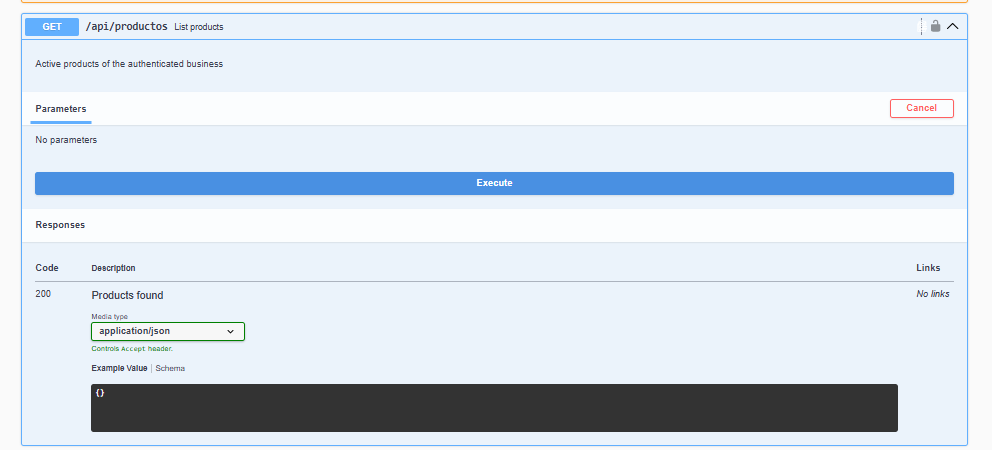

*Nota. Elaboración propia*

**Figura 258**

*Swagger de notificaciones: listado y reintento de una notificación fallida (TS03)*

(completar - LEO)

*Nota.* Elaboración propia

**Figura 259**

*Swagger de canales de notificación: consulta y activación o desactivación (US09 y US10)*

(completar - LEO)

*Nota.* Elaboración propia

**Figura 260**

*Swagger de proveedores: registro, listado, detalle, actualización y desactivación (TS09 y US29)*

(completar - CANDY)

*Nota.* Elaboración propia

**Figura 261**

*Swagger de compras: registro, listado, detalle, recepción y cancelación (TS10, TS11, TS12, US30 y US31)*

(completar - CANDY)

*Nota.* Elaboración propia

#### 5.2.3.7. Software Deployment Evidence for Sprint Review

Durante el Sprint 3 el alcance de despliegue incluyó los Web Services, la base de datos y la conexión de la Frontend Web Application con la API real. Los Web Services (Spring Boot, Java 27) se empaquetaron con un Dockerfile multi-stage y se desplegaron en Railway con el perfil `prod`, que recibe su configuración por variables de entorno. La base de datos MySQL se alojó en (completar - ANGEL: Railway o Aiven) y su esquema, de 16 tablas, se creó mediante (completar - ANGEL: cómo se crearon las tablas, porque el perfil prod usa `ddl-auto=validate` y no las crea solo). La Frontend Web Application y el Landing Page continúan publicados en GitHub Pages; el frontend se actualizó para consumir la API desplegada cambiando la dirección base del servicio (`apiBaseUrl`). Las actividades de despliegue fueron:

1. Empaquetar los Web Services con Docker y publicarlos en Railway, disponibles en `https://smartstock-backend-production-36b6ce8c.up.railway.app`, con la documentación de Swagger UI en la ruta `/swagger-ui/index.html`.
2. Alojar la base de datos MySQL en (completar - ANGEL) y crear sus 16 tablas.
3. Configurar en Railway las variables de entorno del perfil `prod` (base de datos, clave JWT, orígenes permitidos de CORS, correo y WhatsApp), sin publicar sus valores.
4. Verificar el servicio con el health check `/actuator/health` y con la ejecución del flujo de integración continua en GitHub Actions (compilación, pruebas con MySQL y construcción de la imagen Docker).
5. Actualizar la Frontend Web Application para que consuma la API desplegada y publicarla en GitHub Pages, disponible en (completar - ANGEL: dirección del frontend, como texto simple).

**Tabla 53**

*Evidencia de despliegue del Sprint 3*

| **Producto** | **Repositorio** | **URL desplegada** | **Versión** | **Estado** |
|---|---|---|---|---|
| Web Services (Spring Boot) | NexoStock/smartstock-backend | `https://smartstock-backend-production-36b6ce8c.up.railway.app` (documentación: `/swagger-ui/index.html`) | v1.1.1 | Desplegado (Railway) |
| Base de datos MySQL | NexoStock/smartstock-backend | (completar - ANGEL: servicio y plataforma, sin host ni credenciales) | (completar - ANGEL: versión de MySQL) | (completar - ANGEL: Running) |
| Frontend Web Application | NexoStock/smartstock-frontend | (completar - ANGEL: dirección en GitHub Pages) | (completar - ANGEL) | Desplegado (GitHub Pages) |

*Nota.* Elaboración propia

**Figura 262**

*Backend API de SmartStock desplegado en Railway*

(completar - ANGEL)

*Nota.* Elaboración propia

**Figura 263**

*Servicio de base de datos MySQL creado (sin mostrar host ni credenciales)*

(completar - ANGEL)

*Nota.* Elaboración propia

**Figura 264**

*Tablas del esquema de SmartStock creadas en la base de datos*

(completar - ANGEL)

*Nota.* Elaboración propia

**Figura 265**

*Verificación del despliegue: respuesta de `/actuator/health` y documentación en `/swagger-ui/index.html`*

(completar - ANGEL)

*Nota.* Elaboración propia

**Figura 266**

*Ejecución del workflow de integración continua en GitHub Actions: compilación, pruebas y construcción de la imagen Docker*

(completar - ANGEL)

*Nota.* Elaboración propia

#### 5.2.3.8. Team Collaboration Insights during Sprint

En el Sprint 3 los cinco integrantes aportaron commits en el repositorio de Web Services, cada uno en el *bounded context* que lidera según la Tabla 48: Angel en IoT Device y el despliegue, Leo en Alerts & Restocking y Ventas, Lorena en IAM (registro, inicio de sesión, token JWT y recuperación de contraseña), Kiara en Inventory Monitoring y Analytics & Reporting, y Candy en Product Catalog, Compras y la integración de los pull requests. El trabajo siguió GitFlow con una rama corta por tarea. El contexto IAM se integró en tres partes mediante los pull requests #4 (autenticación), #7 (filtro JWT y aislamiento por negocio) y #15 (recuperación de contraseña). El repositorio cerró el sprint con las versiones v1.0.0 y v1.1.0, y con el hotfix v1.1.1 que corrige el Dockerfile.

**Tabla 54**  
*Flujo de ramas de GitFlow seguido en el Sprint 3*

| Rama | Nace de | Se integra en | Regla |
|---|---|---|---|
| `main` | — | — | Recibe únicamente las versiones publicadas; solo se modifica mediante pull request. |
| `develop` | — | — | Concentra el avance acumulado del sprint; solo se modifica mediante pull request. |
| `feature/<contexto>-<tarea>` | `develop` | `develop` | Una rama corta por tarea; se integra mediante pull request con merge commit. |
| `fix/<descripción>` | `develop` | `develop` | Corrige un defecto detectado durante el sprint; se integra mediante pull request con merge commit. |
| `release/<x.y.z>` | `develop` | `main` y de vuelta a `develop` | Prepara la versión a entregar; se etiqueta `vX.Y.Z` (`v1.0.0` y `v1.1.0`). |
| `hotfix/<x.y.z>` | `main` | `main` y de vuelta a `develop` | Corrige un defecto de la versión publicada; se etiqueta `vX.Y.Z` (`v1.1.1`). |

*Nota. Elaboración propia*

**Figura 267**  
*Contributors del repositorio de Web Services*

*Nota. Elaboración propia*

**Figura 268**  
*Pulse del repositorio de Web Services*

*Nota. Elaboración propia*

**Figura 269**  
*Network graph del repositorio de Web Services*

*Nota. Elaboración propia*

### 5.2.4. Sprint 4

#### 5.2.4.1. Sprint Planning 4

#### 5.2.4.2. Aspect Leaders and Collaborators

#### 5.2.4.3. Sprint Backlog 4

#### 5.2.4.4. Development Evidence for Sprint Review

#### 5.2.4.5. Execution Evidence for Sprint Review

#### 5.2.4.6. Services Documentation Evidence for Sprint Review

#### 5.2.4.7. Software Deployment Evidence for Sprint Review

#### 5.2.4.8. Team Collaboration Insights during Sprint

## 5.3. Validation Interviews

### 5.3.1. Diseño de Entrevistas

Las entrevistas de validación evaluarán la comprensión y la facilidad de uso del Landing Page y de la Web Application de SmartStock con propietarios y administradores de minimarkets y bodegas de barrio. El equipo realizará entre tres y cinco entrevistas por segmento, buscando contactar nuevamente a los participantes de TB1. A diferencia de las entrevistas iniciales (2.2.1), que buscaban conocer al usuario y su problema, estas sesiones buscan observar cómo el usuario reacciona ante el producto y qué partes no comprende.

Las entrevistas se realizaron sobre las versiones desplegadas del producto. El Landing Page se encuentra en https://nexostock.github.io/smartstock-landing-page/ y la Web Application en https://nexostock.github.io/smartstock-frontend/.

Para agilizar las sesiones, se aplicará una demostración guiada e interactiva: la persona entrevistadora presenta y opera el Landing Page y la Web Application, y el participante interactúa indicando qué opción elegiría, qué dato ingresaría y qué espera que ocurra en cada pantalla. Si el participante desea manejar la aplicación, se le cede el control. Las preguntas de opinión se realizan al final. Cada sesión dura aproximadamente 5 a 6 minutos y se edita en un fragmento de 3 a 5 minutos por entrevista, que se integra en el video único de entrevistas de validación.

**Elementos de la sesión de validación**

El Landing Page se evalúa para comprobar la comprensión de la propuesta de valor, los planes, las preguntas frecuentes y el acceso al registro o contacto. Su dirección, escrita como texto simple, es: (completar - LORENA: dirección del Landing Page de SmartStock, del repositorio de NexoStock).

La Web Application se evalúa con los cuatro user flows de cada segmento, que se describen más abajo. Su dirección, escrita como texto simple, es: (completar - LORENA: dirección de la Web Application de SmartStock, del repositorio de NexoStock).

**Preparación de la sesión**

Antes de cada entrevista, la persona entrevistadora comprobará el funcionamiento del Landing Page y de la Web Application. Se prepararán los datos de prueba necesarios: una cuenta ya registrada, un producto de ejemplo, un sensor disponible y una alerta de stock bajo. Se utilizarán datos ficticios para evitar registrar información sensible. Se aplicará únicamente la guía correspondiente al segmento del participante.

**Estructura de la sesión**

La sesión tiene cuatro fases:

1. **Inicio y datos del participante (1 minuto):** bienvenida, autorización para grabar, nombre y apellido, edad, distrito y función en el negocio.
2. **Demostración del Landing Page (1 minuto):** la persona entrevistadora presenta tres secciones y el participante indica su reacción.
3. **Demostración de la Web Application (3 minutos):** la persona entrevistadora presenta cuatro user flows y el participante indica qué opción elegiría y qué espera que ocurra.
4. **Preguntas finales y cierre (1 a 2 minutos):** cuatro preguntas sobre la experiencia, comentario final y agradecimiento.

El texto exacto de las fases de inicio y cierre es común para ambos segmentos y se encuentra en el guion de presentación del equipo, para que todas las personas entrevistadoras usen las mismas palabras.

**Primer Segmento Objetivo (Propietarios y administradores de minimarkets)**

*Demostración del Landing Page*

Se mostrará primero el Landing Page y se indicará: «Le voy a mostrar nuestra página como si estuviera buscando una herramienta para su minimarket. Cuénteme qué le llama la atención o qué no entiende.» Se presentan tres secciones:

1. **Propuesta de valor:** la persona entrevistadora muestra el inicio de la página y los beneficios. El participante indica qué entiende que ofrece SmartStock.
2. **Planes:** la persona entrevistadora muestra los planes Crecimiento y Business. El participante indica qué diferencia ve entre ambos y cuál elegiría.
3. **Acceso al registro:** la persona entrevistadora muestra la parte superior de la página. El participante indica dónde cree que debería ingresar para comenzar.

*User flows de la Web Application*

Se indicará: «Ahora le mostraré la aplicación. Iré presentando una pantalla a la vez y le pediré que me diga qué opción elegiría y qué espera que pase. Si prefiere manejarla usted, con gusto.» Se presentan cuatro user flows:

1. **Registro de productos.** La persona entrevistadora muestra el formulario de un producto de prueba. El participante indica qué nivel de existencias fijaría para recibir una alerta de stock bajo (la persona entrevistadora lo ingresa). Se observa si entiende el campo del umbral de stock.
2. **Consulta y vinculación de sensores.** La persona entrevistadora muestra la lista de sensores y el estado de uno disponible. El participante indica qué entiende del estado del sensor y cuál vincularía al producto. Se observa si interpreta el estado y reconoce cómo vincularlo.
3. **Registro de ventas.** La persona entrevistadora muestra la pantalla de ventas. El participante indica qué opción tocaría para registrar la venta de un producto y qué espera que ocurra con las existencias (la persona entrevistadora la registra). Se observa si identifica la opción correcta y comprende el cambio en las existencias.
4. **Reposición desde una alerta.** La persona entrevistadora muestra una alerta de stock bajo. El participante indica qué significa la alerta y qué opción elegiría para reponer el producto (la persona entrevistadora inicia la compra). Se observa si entiende la alerta y encuentra cómo iniciar la compra.

*Preguntas finales*

Al terminar la demostración, se indicará: «Gracias. Ahora quisiéramos conocer su opinión sobre la experiencia.»

1. ¿Qué entiende que ofrece SmartStock y qué información le resultó confusa o considera que falta?
2. ¿Qué parte de la aplicación le resultó más clara y cuál le generó más dudas?
3. ¿Confiaría en las alertas para decidir cuándo reponer un producto? ¿Por qué?
4. ¿Qué precio mensual consideraría razonable por esta solución y por qué?

**Segundo Segmento Objetivo (Propietarios y administradores de bodegas de barrio)**

*Demostración del Landing Page*

Se mostrará primero el Landing Page y se indicará: «Le voy a mostrar nuestra página como si estuviera buscando una herramienta para su bodega. Cuénteme qué le llama la atención o qué no entiende.» Se presentan tres secciones:

1. **Propuesta de valor y casos de uso para bodegas:** la persona entrevistadora muestra el inicio de la página y los casos de uso. El participante indica para qué cree que podría utilizar SmartStock en su bodega.
2. **Plan Inicial y preguntas frecuentes sobre sensores:** la persona entrevistadora muestra el plan Inicial y las preguntas frecuentes sobre la instalación de sensores. El participante indica qué entiende que incluye el plan y qué dudas tiene sobre los sensores.
3. **Acceso al registro:** la persona entrevistadora muestra la parte superior de la página. El participante indica dónde cree que debería ingresar para comenzar.

*User flows de la Web Application*

Se indicará: «Ahora le mostraré la aplicación. Iré presentando una pantalla a la vez y le pediré que me diga qué opción elegiría y qué espera que pase. Si prefiere manejarla usted, con gusto.» Se presentan cuatro user flows:

1. **Registro de productos.** La persona entrevistadora muestra el formulario de un producto de prueba. El participante indica qué nivel de existencias fijaría para recibir una alerta de stock bajo (la persona entrevistadora lo ingresa). Se observa si entiende el campo del umbral de stock.
2. **Consulta y vinculación de sensores.** La persona entrevistadora muestra la lista de sensores y el estado de uno disponible. El participante indica qué entiende del estado del sensor y cuál vincularía al producto. Se observa si interpreta el estado y reconoce cómo vincularlo.
3. **Registro de una venta simple.** La persona entrevistadora muestra la pantalla de ventas. El participante indica qué opción tocaría para registrar una venta y cuántas unidades espera que queden (la persona entrevistadora la registra). Se observa si identifica la opción con pocos pasos y entiende las unidades restantes.
4. **Consulta de alertas y reposición.** La persona entrevistadora muestra una alerta de stock bajo. El participante indica qué haría al recibirla y qué opción elegiría para reponer el producto (la persona entrevistadora inicia la compra). Se observa qué decisión toma ante la alerta y si encuentra cómo iniciar la compra.

*Preguntas finales*

Al terminar la demostración, se indicará: «Gracias. Ahora quisiéramos conocer su opinión sobre la experiencia.»

1. ¿Qué entiende que ofrece SmartStock en su bodega y qué dudas le quedan sobre los sensores?
2. ¿Qué parte de la aplicación le resultó más clara y cuál le generó más dudas?
3. ¿Qué entendió de la alerta de stock bajo y qué decisión tomaría al verla?
4. Viendo el plan Inicial, ¿qué precio mensual consideraría razonable por esta solución y por qué?

**Indicaciones de observación (comunes para ambos segmentos)**

Antes de ejecutar cada acción en la aplicación, la persona entrevistadora esperará a que el participante indique qué opción elegiría, sin señalar botones. Si el participante no sabe cómo continuar, se le ayudará y se registrará. Si desea manejar la aplicación, se le cederá el control y se dejará constancia de esta modalidad. Para el video, de cada entrevista se conservará un fragmento de 3 a 5 minutos con el título del entrevistado, su segmento y la fecha. Las reacciones, las dificultades y la ayuda brindada serán la base de la evaluación según heurísticas (5.3.3).

### 5.3.2. Registro de Entrevistas

**Video de entrevistas de validación**

https://upcedupe-my.sharepoint.com/:v:/g/personal/u20241f205_upc_edu_pe/IQBFC7khe0dTSaFFsb7f2-qXAfUSmPvc1f4ZhV_XQ6qEaHw?e=zJeXXn&nav=eyJyZWZlcnJhbEluZm8iOnsicmVmZXJyYWxBcHAiOiJTdHJlYW1XZWJBcHAiLCJyZWZlcnJhbFZpZXciOiJTaGFyZURpYWxvZy1MaW5rIiwicmVmZXJyYWxBcHBQbGF0Zm9ybSI6IldlYiIsInJlZmVycmFsTW9kZSI6InZpZXcifX0%3D

La Figura 270 muestra el video y los tiempos de cada entrevista son:

- Entrevista 01: 00:05 - 07:42
- Entrevista 02: 07:47 - 14:23
- Entrevista 03: 14:28 - 20:36
- Entrevista 04: 20:41 - 27:08
- Entrevista 05: 27:13 - 39:48

**Figura 270**

*Video de entrevistas de validación a propietarios y administradores de minimarkets y bodegas de barrio*

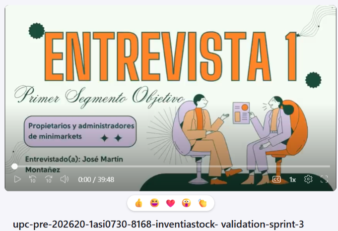

*Nota. Elaboración propia*

### Primer Segmento Objetivo (Propietarios y administradores de minimarkets)

**Tabla 55**

*Registro de la entrevista 1 a propietarios y administradores de minimarkets*

| Campo | Información |
|---|---|
| Screenshot | 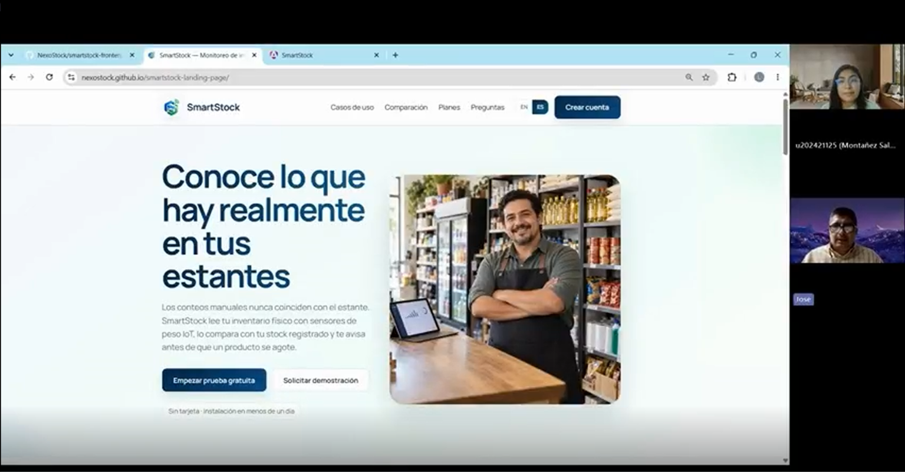 |
| Inicia | 00:05 |
| Duración | 07:37 |
| Nombre completo | José Martín Montañez |
| Edad | 52 años |
| Distrito | Pueblo Libre |
| Resumen | José identificó SmartStock como una solución para controlar el inventario, gestionar reposiciones y recibir alertas. Eligió el plan Business y propuso recibir avisos desde diez unidades, considerando la rotación de cada producto. Reconoció las opciones para crear una cuenta, registrar ventas y nuevas compras, pero manifestó dificultad para comprender los estados de los sensores. Consideró útiles las alertas para contactar a sus proveedores y señaló que las revisaría al iniciar y terminar el día. Como mejora principal, sugirió incorporar la lectura de códigos de barras en ventas y compras para evitar digitar numerosos productos. No precisó una tarifa mensual concreta. |

*Nota. Elaboración propia*

**Tabla 56**

*Registro de la entrevista 2 a propietarios y administradores de minimarkets*

| Campo | Información |
|---|---|
| Screenshot | 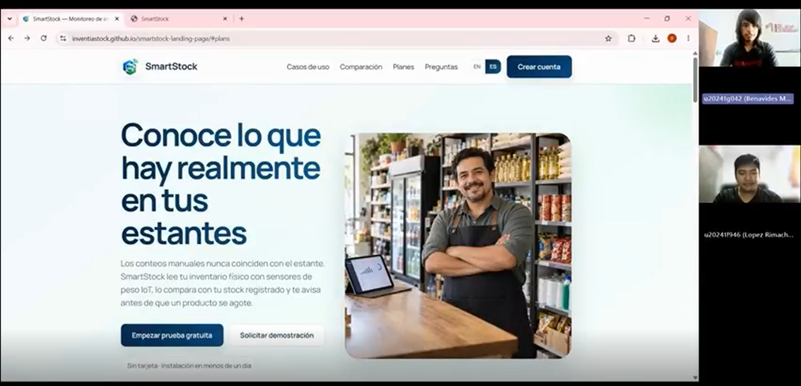 |
| Inicia | 07:47 |
| Duración | 06:36 |
| Nombre completo | Cristopher Benavides |
| Edad | 23 años |
| Distrito | Jesús María |
| Resumen | Cristopher identificó SmartStock como una herramienta para actualizar el stock mediante las entradas y salidas de productos. Eligió el plan Crecimiento y propuso recibir alertas desde cuatro unidades. Consideró el panel la pantalla más clara y destacó el cambio de idioma y las notificaciones. Inicialmente tuvo dificultad para seguir la demostración de compras y, al preguntarle cómo registrar una venta, señaló la opción Comprobante, lo que sugiere revisar la claridad de esa acción. Indicó que confiaría en las alertas para decidir cuándo reponer y consideró razonable un precio mensual cercano a S/100. |

*Nota. Elaboración propia*

**Tabla 57**

*Registro de la entrevista 3 a propietarios y administradores de minimarkets*

| Campo | Información |
|---|---|
| Screenshot |  |
| Inicia | 14:28 |
| Duración | 06:08 |
| Nombre completo | Yngrid Ruiz |
| Edad | 23 años |
| Distrito | Pueblo Libre |
| Resumen | Yngrid identificó SmartStock como una solución para registrar y controlar el inventario de su minimarket. Tras la demostración guiada, consideró que la aplicación era completa y señaló el registro de inventario como la función más clara. No manifestó dudas sobre las secciones presentadas y afirmó que confiaría en las alertas para decidir cuándo reponer, porque los productos estarían registrados en la aplicación. Consideró razonable un precio mensual de S/50 y no añadió otras observaciones. |

*Nota. Elaboración propia*

### Segundo Segmento Objetivo (Propietarios y administradores de bodegas de barrio)

**Tabla 58**

*Registro de la entrevista 1 a propietarios y administradores de bodegas de barrio*

| Campo | Información |
|---|---|
| Screenshot |  |
| Inicia | 20:41 |
| Duración | 06:27 |
| Nombre completo | Lincoln Bruno |
| Edad | 49 años |
| Distrito | Comas |
| Resumen | Lincoln identificó SmartStock como una herramienta para controlar el stock de su tienda y almacén. Eligió el plan Inicial para conocer su funcionamiento y evaluar posteriormente otros planes según el movimiento del negocio. Propuso recibir alertas desde cinco unidades y señaló que estas le permitirían realizar pedidos para reponer productos. Esperaba acceder directamente desde una alerta al registro de compras. Aunque consideró que la aplicación era clara en general, solicitó una mejor explicación sobre el funcionamiento de los sensores. Al preguntarle cómo registrar una venta, señaló la opción Comprobante, por lo que conviene revisar la claridad de esa acción. |

*Nota. Elaboración propia*

**Tabla 59**

*Registro de la entrevista 2 a propietarios y administradores de bodegas de barrio*

| Campo | Información |
|---|---|
| Screenshot | 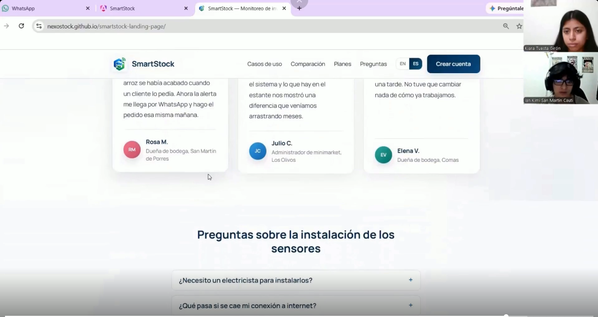 |
| Inicia | 27:13 |
| Duración | 12:35 |
| Nombre completo | Ian Kimi San Martin Cauti |
| Edad | 20 años |
| Distrito | Santiago de Surco |
| Resumen | Ian, administrador de una bodega, identificó SmartStock como una herramienta para organizar el inventario, controlar las existencias y reconocer cuándo reponer mercadería. Explicó que, durante los periodos de numerosas ventas, resulta difícil revisar manualmente qué productos se están agotando y cuáles tienen mayor disponibilidad. Consideró el plan Inicial adecuado para un negocio pequeño y manifestó dudas sobre el funcionamiento de los sensores, los posibles costos adicionales y los requisitos para implementarlos. Para crear una cuenta, señaló que buscaría un botón denominado «Registrarse» o «Comenzar» en la página principal. |

*Nota. Elaboración propia*

### Análisis de entrevistas de validación

Se analizaron las respuestas de cinco participantes: tres del segmento de propietarios y administradores de minimarkets y dos del segmento de propietarios y administradores de bodegas de barrio. Las sesiones permitieron recoger opiniones sobre la comprensión de SmartStock, la navegación de la aplicación, las alertas y las mejoras esperadas.

Para este análisis se utilizó la transcripción completa de cuatro entrevistas y la transcripción parcial de la entrevista de Ian San Martin. Los resultados de este último se limitan a las respuestas disponibles hasta el minuto 30:00 del video. Los porcentajes describen únicamente a los participantes analizados y no representan a la totalidad de negocios de cada segmento.

#### Primer segmento objetivo: propietarios y administradores de minimarkets

Participaron José Montañez, Cristopher Benavides y Yngrid Ruiz, con edades declaradas de 51, 23 y 23 años, respectivamente. El 66,7 % de los participantes tiene 23 años. José y Cristopher señalaron residir en Jesús María, mientras que el distrito de Yngrid no se especificó en la entrevista disponible.

Los tres participantes relacionaron SmartStock con el control del inventario. José destacó su utilidad para gestionar las existencias, las reposiciones y las alertas; Cristopher reconoció el registro de entradas y salidas de productos; y Yngrid identificó la solución como una herramienta para registrar y administrar el inventario. Asimismo, los tres expresaron confianza en las alertas para decidir cuándo reponer productos.

Se identificaron dificultades específicas durante la demostración. José manifestó que no comprendía el significado de los estados de los sensores y propuso incorporar la lectura de códigos de barras para agilizar las ventas y compras. Cristopher indicó que necesitaba mayor claridad en el recorrido de compras porque no había observado con precisión dónde se hacía clic. Además, al preguntarle cómo registrar una venta, señaló la opción «Comprobante», lo que sugiere revisar la claridad de esa acción. Yngrid consideró claro el registro de inventario y no manifestó dudas al finalizar la sesión.

**Hallazgos identificados en las entrevistas de validación de minimarkets**

**Tabla 60**

*Hallazgos de las entrevistas de validación a propietarios y administradores de minimarkets*

| Aspecto evaluado | Hallazgo identificado | Frecuencia |
|---|---|---|
| Comprensión de la propuesta | Relacionaron SmartStock con el registro o control del inventario. | 3 de 3 (100 %) |
| Confianza en las alertas | Expresaron que confiarían en las alertas para decidir cuándo reponer productos. | 3 de 3 (100 %) |
| Comprensión de los sensores | José manifestó explícitamente que no comprendía los estados mostrados. | 1 de 3 (33,3 %) |
| Claridad del recorrido de compras | Cristopher solicitó mayor claridad sobre los pasos mostrados durante la demostración. | 1 de 3 (33,3 %) |
| Agilidad del registro | José propuso incorporar códigos de barras para reducir la digitación de productos. | 1 de 3 (33,3 %) |
| Ausencia de dudas declaradas | Yngrid manifestó que no tenía dudas al finalizar la sesión. | 1 de 3 (33,3 %) |
| Referencia de precio mensual | Cristopher propuso aproximadamente S/ 100 y Yngrid, S/ 50. | 2 de 3 (66,7 %) |

**Nota.** Elaboración propia a partir de las respuestas de validación. Las frecuencias registran menciones explícitas; la ausencia de una mención no implica una opinión contraria. La respuesta de José sobre el precio no permitió identificar con claridad una tarifa mensual comparable.

En conclusión, los resultados de este segmento muestran una comprensión compartida de la finalidad de SmartStock y una valoración favorable de las alertas de reposición. No obstante, la aceptación general no elimina las dificultades específicas encontradas. Se recomienda explicar los estados de los sensores con lenguaje sencillo, mostrar de forma más clara la secuencia de compras y evaluar la incorporación de códigos de barras. Las referencias de precio presentan diferencias, por lo que no permiten establecer una tarifa única aceptada por el segmento.

#### Segundo segmento objetivo: propietarios y administradores de bodegas de barrio

Se analizaron las entrevistas de Lincoln Bruno, de 49 años y residente en Comas, e Ian Kimi San Martin Cauti, de 20 años y residente en Santiago de Surco. La entrevista de Lincoln cuenta con transcripción completa y la de Ian dispone de una transcripción parcial.

Ambos participantes identificaron beneficios relacionados con el control de productos y la reposición. Lincoln vinculó la solución con la gestión del almacén y del stock de su tienda. Ian destacó la posibilidad de organizar el inventario, reconocer qué productos se están agotando y saber cuándo reponer mercadería. Explicó que, durante los periodos de numerosas ventas, resulta difícil revisar manualmente las existencias.

Los dos participantes solicitaron información adicional sobre los sensores. Lincoln expresó que necesitaba comprender mejor su funcionamiento y cómo apoyarían el control de estantes con numerosos productos. Ian planteó dudas sobre su funcionamiento, los posibles costos adicionales y los requisitos necesarios para implementarlos. Estas respuestas muestran la necesidad de explicar tanto el uso de los dispositivos como las condiciones para incorporarlos al negocio.

Respecto a la adopción, Lincoln prefirió comenzar con el plan Inicial para aprender a utilizar la herramienta y evaluar posteriormente otros planes. Ian también consideró que el plan Inicial podía ser adecuado para una bodega pequeña. Lincoln, además, manifestó que esperaba pasar desde las alertas hacia la compra de los productos faltantes.

**Hallazgos identificados en las entrevistas de validación de bodegas de barrio**

**Tabla 61**

*Hallazgos de las entrevistas de validación a propietarios y administradores de bodegas de barrio*

| Aspecto evaluado | Hallazgo identificado | Alcance de la evidencia |
|---|---|---|
| Comprensión de la propuesta | Ambos relacionaron SmartStock con el control de productos, almacén o stock. | 2 de 2 (100 %) |
| Comprensión de los sensores | Ambos solicitaron explicaciones adicionales sobre su funcionamiento o implementación. | 2 de 2 (100 %) |
| Reposición de productos | Lincoln indicó que realizaría pedidos al recibir una alerta de stock bajo. | Respuesta verificada en Lincoln; sin respuesta disponible de Ian a esa pregunta. |
| Continuidad entre alertas y compras | Lincoln manifestó que esperaba pasar desde las alertas hacia la compra de los productos faltantes. | Hallazgo individual de Lincoln. |
| Adopción gradual | Lincoln prefirió comenzar con el plan inicial para aprender y evaluar posteriormente otros planes. | Hallazgo individual de Lincoln. |
| Reducción del trabajo manual | Ian destacó el beneficio de controlar productos sin revisar todo manualmente. | Hallazgo individual de Ian. |
| Instalación y costo de sensores | Ian solicitó información sobre su colocación y costo de implementación. | Hallazgo individual de Ian. |

*Nota. Elaboración propia* Los porcentajes se utilizan únicamente en aspectos con respuestas disponibles de ambos participantes. No se atribuyen a Ian opiniones sobre pantallas o preguntas que no aparecen en su transcripción parcial.

En conclusión, los participantes de este segmento reconocieron la utilidad de SmartStock para controlar existencias y apoyar la reposición. La principal necesidad compartida fue comprender el funcionamiento de los sensores, mencionada por el 100 % de los participantes analizados. Se recomienda incorporar explicaciones visuales sobre su instalación, ejemplos de uso y una presentación clara de sus costos. Asimismo, conviene facilitar el paso desde una alerta hacia el registro de una compra y acompañar a los usuarios durante su aprendizaje inicial.

### Conclusión general

Las entrevistas muestran que los cinco participantes comprendieron la finalidad de SmartStock como herramienta para controlar el inventario. En los minimarkets destacó la confianza declarada en las alertas de reposición, mientras que en las bodegas se identificó una necesidad compartida de información adicional sobre los sensores y su implementación.

Las mejoras prioritarias son explicar los estados y el funcionamiento de los dispositivos, hacer más comprensible el recorrido de compras y facilitar la identificación del registro de ventas. La propuesta de incorporar códigos de barras constituye una oportunidad adicional para reducir la digitación de productos.

Estos hallazgos sirven como insumo para la evaluación de usabilidad y las propuestas de mejora de la interfaz. Las opiniones favorables expresadas durante una demostración guiada no permiten afirmar, por sí solas, que todos los participantes puedan completar las tareas sin ayuda.

### 5.3.3. Evaluaciones según heurísticas

## Site o app a evaluar

SmartStock: Landing Page y Aplicación Web, en la versión presentada durante las sesiones de validación del curso de Desarrollo de Aplicaciones Open Source.

## Tareas a evaluar

El alcance de esta evaluación comprende las siguientes tareas:

1. Identificar qué ofrece SmartStock y elegir un plan en la Landing Page.
2. Identificar cómo crear una cuenta.
3. Registrar productos y definir el umbral mínimo para las alertas.
4. Identificar la acción para registrar una venta.
5. Registrar una compra a un proveedor.
6. Interpretar los estados de los sensores de peso.
7. Atender una alerta de stock bajo e identificar cómo iniciar la reposición.
8. Consultar reportes y comparar el inventario registrado con las lecturas de los sensores.

**No se incluyen en esta evaluación:**

- La usabilidad del inicio y cierre de sesión con credenciales propias, ni la recuperación de contraseña (en las sesiones se usó una cuenta ya registrada).
- La recepción efectiva de notificaciones por correo y WhatsApp.
- La instalación física de sensores en el negocio.
- La lectura de códigos de barras, función no implementada en la versión evaluada.
- El pago de una suscripción.

Estas exclusiones delimitan las tareas evaluadas durante las entrevistas; no implican que todas esas funciones estén pendientes de implementación.

## Escala de severidad

La severidad se asigna considerando el impacto del problema sobre la tarea y la evidencia disponible.

**Tabla 62**

*Escala de severidad de los problemas de usabilidad*

| Nivel | Descripción |
|---|---|
| 1 | Problema superficial: puede ser fácilmente superado por el usuario o se da con muy poca frecuencia. No necesita ser arreglado a menos que exista disponibilidad de tiempo. |
| 2 | Problema menor: puede ocurrir con un poco más de frecuencia o es algo más difícil de superar para el usuario. Se le debe asignar una prioridad baja de cara al siguiente release. |
| 3 | Problema mayor: ocurre con frecuencia o los usuarios no logran resolverlo. Es importante corregirlo y se le debe asignar una prioridad alta. |
| 4 | Problema muy grave: un error de gran impacto que impide al usuario continuar con el uso de la herramienta. Es imperativo corregirlo antes del lanzamiento. |

*Nota. Elaboración propia*

## Tabla resumen

**Tabla 63**

*Resumen de los problemas de usabilidad identificados*

| # | Problema | Escala de severidad | Heurística o principio violado |
|---|---|---|---|
| 1 | El estado de los sensores (En línea, Desconectado, Disponible) no se entiende o se interpreta de formas distintas. | 3 | Usability: Correspondencia entre el sistema y el mundo real |
| 2 | La opción Comprobante se confunde con la acción de registrar una venta. | 3 | Usability: Reconocer antes que recordar |
| 3 | No hay explicación accesible de cómo se colocan, funcionan y cuánto cuestan los sensores. | 2 | Information Architecture: Is it findable? |
| 4 | Registrar ventas y compras exige digitar cada producto; no hay lectura de código de barras. | 2 | Usability: Flexibilidad y eficiencia de uso |
| 5 | El usuario espera pasar de la alerta de stock bajo directamente a registrar la compra. | 1 | Usability: Reconocer antes que recordar |

*Nota. Elaboración propia*

## Descripción de problemas

### PROBLEMA #1: El estado de los sensores no se entiende o se interpreta de formas distintas

**Severidad:** 3

**Heurística violada:** Usability – Correspondencia entre el sistema y el mundo real.

**Problema:**

La columna de estado de la pantalla de sensores muestra los valores En línea, Desconectado y Disponible sin explicar qué significan ni qué acción corresponde. José Martín Montañez pudo leer los estados, pero indicó que no los entendía. Cristopher Benavides los interpretó como si el producto estaba siendo contabilizado o si no había datos suficientes. Lincoln Bruno entendió que los sensores estaban «activados». Los tres participantes a quienes se les preguntó por esta columna dieron una lectura distinta o ninguna, lo que muestra que los términos no se corresponden con el lenguaje del usuario. Además, al cierre de su entrevista Lincoln pidió que se explique cómo funciona el sensor.

**Figura 271**

*Pantalla de Sensores con la columna de estado (En línea, Desconectado y Disponible)*

**Nota.** Captura de la entrevista a José Martín Montañez (inicio 00:05). Elaboración propia.

**Recomendación:**

Agregar una breve leyenda junto a la columna de estado que explique cada valor: «En línea: envió una lectura en los últimos 5 minutos», «Desconectado: está vinculado a un producto, pero no envía lecturas recientes» y «Disponible: aún no está vinculado a un producto». Usar un texto de ayuda o un ícono de información con la acción que corresponde cuando un sensor aparece desconectado.

### PROBLEMA #2: La opción Comprobante se confunde con la acción de registrar una venta

**Severidad:** 3

**Heurística violada:** Usability – Reconocer antes que recordar.

**Problema:**

Al pedirles que indicaran cómo registrar una venta, Cristopher Benavides y Lincoln Bruno señalaron la opción Comprobante. Cristopher la entendió como el lugar para ver los productos vendidos; Lincoln, como la acción para emitir el comprobante. En cambio, José Martín Montañez encontró el botón Nueva venta. Dos de tres participantes que realizaron esta tarea no encontraron la acción principal de la pantalla, por lo que la acción de registrar y la de consultar una venta no se diferencian con claridad.

**Figura 272**

*Pantalla de Ventas con las opciones Nueva venta y Comprobante*

**Nota.** Captura de la entrevista a Cristopher Benavides (inicio 07:47). Elaboración propia.

**Recomendación:**

Destacar el botón Nueva venta como acción principal, con mayor tamaño y color, y renombrar la opción Comprobante por un texto que indique que es una consulta, por ejemplo «Ver detalle de la venta».

### PROBLEMA #3: No hay una explicación accesible de los sensores (instalación, funcionamiento y costo)

**Severidad:** 2

**Heurística violada:** Information Architecture – Is it findable?

**Problema:**

Lincoln Bruno solicitó comprender mejor cómo funcionan los sensores y cómo permiten controlar estantes con numerosos productos. Ian San Martin planteó dudas sobre su funcionamiento, los posibles costos adicionales y los requisitos necesarios para implementarlos en una bodega. Aunque la Landing Page presenta información y preguntas sobre los sensores, las respuestas disponibles muestran que persistieron dudas después de la explicación. Por ello, el hallazgo corresponde a la claridad y suficiencia de la información presentada; no demuestra que dicha información esté completamente ausente.

**Figura 273**

*Landing Page, sección donde se mencionan los sensores de peso*

**Nota.** Captura de la entrevista a Ian San Martin (inicio 27:13). Elaboración propia.

**Recomendación:**

Incluir en la Landing Page y en la aplicación una sección breve «Cómo funcionan los sensores» con la instalación, el funcionamiento y una referencia del costo, accesible desde la pantalla de sensores.

### PROBLEMA #4: Registrar ventas y compras exige digitar cada producto

**Severidad:** 2

**Heurística violada:** Usability – Flexibilidad y eficiencia de uso.

**Problema:**

José Martín Montañez indicó que lo más importante que faltaba era la lectura del código de barras en ventas y compras, porque las facturas de sus proveedores llegan con 15, 20, 30 y hasta 40 ítems y digitarlos uno por uno toma mucho tiempo. El problema fue señalado por un solo participante, pero afecta a una tarea que el negocio repite a diario.

**Figura 274**

*Formulario Nueva compra de la aplicación web*

**Nota.** Captura de la entrevista a José Martín Montañez (inicio 00:05). Elaboración propia.

**Recomendación:**

Incorporar la lectura de códigos de barras en los formularios de venta y compra y, mientras tanto, permitir buscar y seleccionar productos desde una lista con búsqueda por nombre.

### PROBLEMA #5: El usuario espera pasar de la alerta de stock bajo directamente a registrar la compra

**Severidad:** 1

**Heurística violada:** Usability – Reconocer antes que recordar.

**Problema:**

Lincoln Bruno esperaba ir de la alerta directamente a la compra, y Cristopher Benavides dijo que la usaría para registrar una nueva compra. Los participantes entendieron bien qué hacer ante la alerta (contactar al proveedor o hacer el pedido), por lo que el problema es leve: el atajo hacia la compra no fue evidente durante la demostración.

**Figura 275**

*Pantalla de Alertas de stock bajo*

**Nota.** Captura de la entrevista a Lincoln Bruno (inicio 20:41). Elaboración propia.

**Recomendación:**

Mantener visible, junto a cada alerta, el botón «Registrar compra» que lleva al formulario con el producto ya seleccionado.

## Observaciones de diseño inclusivo

Cristopher Benavides valoró positivamente el cambio de idioma entre español e inglés, las notificaciones y las opciones de sesión. Durante las sesiones no se probó la aplicación con lectores de pantalla ni con navegación por teclado, por lo que no se registraron problemas de este tipo. La Landing Page y la aplicación incorporan atributos ARIA como parte de la mejora continua, y se recomienda validarlos con un lector de pantalla en el siguiente sprint.

## 5.4. Video About-the-Product

El video About-the-Team resume el proceso de trabajo del equipo NexoStock durante el desarrollo de SmartStock: la organización por bounded context, las sesiones de trabajo y la colaboración mediante GitFlow, e incluye el testimonio ante cámara de cada integrante sobre las actividades realizadas, los logros alcanzados y las competencias desarrolladas. Tiene una duración de (completar - por asignar: mm:ss). Las secuencias del video son:

- 00:00:00 Presentación del equipo (completar - por asignar)
- (completar - por asignar: hh:mm:ss) Testimonio de cada integrante
- (completar - por asignar: hh:mm:ss) Cierre

**Figura 276**

*Video About-the-Product publicado en YouTube*

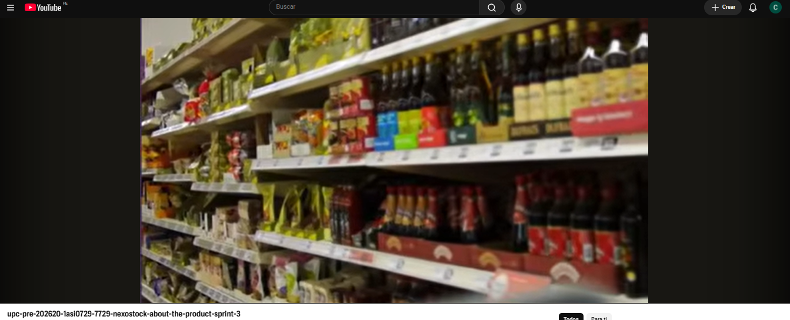

**Nota.** Elaboración propia.

**Link de Clipchamp:**

`https://upcedupe-my.sharepoint.com/personal/u20241f205_upc_edu_pe/_layouts/15/stream.aspx?id=%2Fpersonal%2Fu20241f205%5Fupc%5Fedu%5Fpe%2FDocuments%2FV%C3%ADdeos%2FClipchamp%2FAbout%2DThe%2DProduct%20Copiar%2FExports%2Fupc%2Dpre%2D202620%2D1asi0729%2D7729%2Dnexostock%2Dabout%2Dthe%2Dproduct%2Dsprint%2D3%2Emp4&ga=1&referrer=StreamWebApp%2EWeb&referrerScenario=AddressBarCopied%2Eview%2Efb4d61de%2Dd6df%2D4f05%2D98d7%2Dad1a15f4e541`

**Link de YouTube:**

`https://youtu.be/QxwsvZKVQao`

