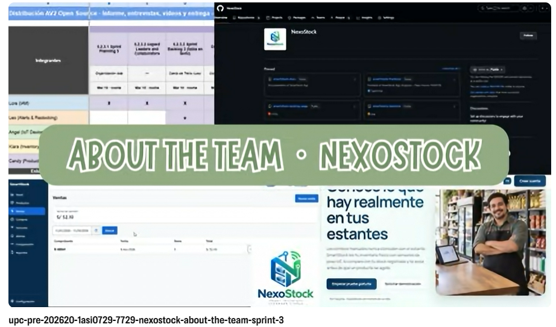

# Conclusiones

## Conclusiones y recomendaciones

### Sprint 1 – Landing Page y documentación del proyecto

- **Sobre el análisis del problema y la investigación del usuario:** Se concluye que el análisis realizado sobre propietarios y administradores de minimarkets y bodegas de barrio permitió identificar problemas recurrentes relacionados con el control manual del inventario, las diferencias entre el stock registrado y las existencias físicas, la detección tardía de productos con bajo stock y el tiempo invertido en verificaciones manuales. Esta etapa permitió comprender las necesidades de ambos segmentos y orientar la propuesta de SmartStock hacia una gestión de inventario más automatizada mediante tecnologías web e IoT.
- **Sobre la propuesta de valor y validación inicial:** La elaboración e implementación de la Landing Page permitió comunicar de manera clara la propuesta de valor de SmartStock, presentando el problema que busca resolver, los casos de uso para bodegas y minimarkets, los planes y precios, testimonios, preguntas frecuentes, comparación con otras soluciones y el formulario para solicitar una demostración. De esta manera, el Landing Page funciona como un primer medio de presentación y validación de la solución propuesta para los potenciales usuarios.
- **Sobre la documentación y modelado del proyecto:** La elaboración del reporte permitió consolidar los resultados obtenidos mediante herramientas y técnicas como Lean UX, User Personas, User Task Matrix, User Journey Mapping, Empathy Mapping, Big Picture Event Storming y Ubiquitous Language. Asimismo, el modelado realizado permitió estructurar de manera progresiva el dominio de SmartStock y definir una base para el diseño de la arquitectura, la interfaz y las funcionalidades que serán desarrolladas durante los siguientes sprints.
- **Sobre la definición de las necesidades del producto:** La definición de Epics, User Stories, criterios de aceptación y Product Backlog permitió transformar las necesidades identificadas en funcionalidades concretas y organizadas. Asimismo, la priorización de las historias correspondientes al Landing Page permitió establecer un alcance claro para el Sprint 1, concentrando el desarrollo en las User Stories US16 hasta US24.
- **Sobre la gestión y colaboración del equipo:** El uso de Trello, GitHub, GitFlow y Conventional Commits permitió organizar las tareas del Sprint, mantener un control de los cambios realizados y registrar la participación de los integrantes del equipo. La utilización de ramas feature, develop y main permitió mantener un flujo de trabajo estructurado y evidenciar los aportes realizados durante el desarrollo del Landing Page.

### Sprint 2 – Frontend Web Application e integración con la Fake API

- **Sobre la implementación del frontend:** El desarrollo de la aplicación web en Angular permitió convertir los diseños del proyecto en pantallas funcionales para los seis bounded contexts. Se implementaron flujos de autenticación, productos, sensores, alertas, inventario y reportes, con soporte para español e inglés y datos proporcionados por la Fake API.
- **Sobre la integración de Compras y Ventas:** La incorporación de ventas, compras y proveedores permitió representar las causas de las entradas y salidas del inventario. Las ventas descuentan el stock registrado y las compras lo incrementan al confirmar su recepción. Asimismo, iniciar una compra desde una alerta conecta la detección de stock bajo con la gestión de reposición.
- **Sobre la verificación de los flujos:** Las pruebas con datos simulados permitieron comprobar la navegación, el registro de operaciones y las respuestas ante situaciones como credenciales incorrectas, productos con stock insuficiente y sensores ya vinculados. Estas evidencias permiten evaluar el funcionamiento del frontend; la integración con dispositivos físicos y servicios reales deberá verificarse en los siguientes sprints.
- **Sobre la arquitectura y documentación:** La actualización de los diagramas C4, el diseño de base de datos y los contratos OpenAPI permitió precisar las responsabilidades de cada contexto y sus relaciones. La Fake API facilitó el desarrollo del frontend mientras se prepara la implementación del backend real con Spring Boot para el Sprint 3.
- **Sobre el despliegue:** La publicación del frontend en GitHub Pages y de la Fake API en Render permitió acceder a la aplicación mediante una URL pública y comprobar sus flujos fuera del entorno local. El despliegue también permitió identificar condiciones de demostración, como el tiempo de reactivación y el reinicio de los datos de la Fake API en el plan gratuito.
- **Sobre la gestión y colaboración del equipo:** La distribución de tareas por contexto, el seguimiento mediante Trello y el uso de ramas, Conventional Commits y pull requests permitieron organizar el desarrollo y registrar los aportes de los integrantes. La integración progresiva mediante develop y la preparación de la versión publicada facilitaron la coordinación de los cambios del Sprint 2.

### Sprint 3 – Web Services e integración con la Frontend Web Application

- **Sobre la implementación de los Web Services:** El desarrollo del backend con Spring Boot, Spring Data JPA y MySQL permitió reemplazar la Fake API por servicios reales y persistentes. Se organizó el código en un paquete por bounded context, con las capas domain, infrastructure, application e interfaces, y cada integrante construyó el contexto que ya había trabajado en el frontend.
- **Sobre la integración entre contextos:** Las ventas y las compras actualizan el stock mediante fachadas de anticorrupción y eventos de Spring, y el contexto de reportes consulta los datos de los demás mediante un modelo de lectura. Esto mantuvo la separación entre contextos sin duplicar la lógica de inventario.
- **Sobre la seguridad:** Se incorporaron el registro de negocios, el inicio de sesión con token JWT, la recuperación de contraseña y el aislamiento de datos por negocio, de modo que cada propietario solo accede a su información.
- **Sobre la documentación y el despliegue:** Los endpoints se documentaron con OpenAPI mediante Swagger, y el backend se empaquetó con Docker, se verificó con integración continua en GitHub Actions y se desplegó en Railway. Se publicaron las versiones v1.0.0, v1.1.0 y el hotfix v1.1.1.
- **Sobre la validación con usuarios:** Las entrevistas a seis propietarios y administradores permitieron comprobar que todos comprendieron la finalidad de SmartStock y que los tres de minimarkets confían en las alertas para reponer. También identificaron mejoras concretas: explicar los estados de los sensores, diferenciar la opción Comprobante de la acción de registrar una venta, ofrecer información sobre instalación y costo de los sensores, y agilizar la digitación con lectura de códigos de barras.
- **Sobre la gestión y colaboración del equipo:** El uso de GitFlow, ramas feature, fix, release y hotfix, Conventional Commits y pull requests permitió integrar el trabajo de los cinco integrantes y registrar su aporte por bounded context.

### Contraste con el Problem Statement y las hipótesis de Lean UX

- **Sobre el Problem Statement:** SmartStock responde al problema de la gestión manual del inventario mediante una aplicación web que registra productos, ventas y compras, genera alertas de stock bajo y contrasta el stock físico con el registrado, respaldada por Web Services desplegados. Las entrevistas de validación mostraron que los participantes comprendieron su propósito. Sin embargo, la reducción del tiempo de conteo y de las diferencias de inventario en un negocio real aún no se ha medido.
- **Sobre las alertas de stock bajo:** La hipótesis planteaba que al menos el 80 % de los usuarios considere que las alertas permiten reponer oportunamente. En la validación, los tres participantes de minimarkets afirmaron que confiarían en las alertas para decidir cuándo reponer. Con seis participantes en total, este resultado es una primera señal favorable, pero no permite confirmar el umbral del 80 % en ambos segmentos.
- **Sobre los sensores y la comparación de stock:** Las hipótesis sobre la consistencia entre las existencias físicas y las registradas (80 % de productos monitoreados) y sobre la identificación de diferencias de inventario (75 % de usuarios) requieren pruebas con sensores físicos instalados en un negocio. Esas pruebas no se realizaron, por lo que estas hipótesis siguen pendientes de validación.
- **Sobre los niveles mínimos y la reposición:** La aplicación permite configurar el umbral mínimo de cada producto e iniciar una compra desde una alerta, y estos flujos se comprobaron con servicios desplegados. La tasa de usuarios que los completan correctamente, fijada en 75 %, tampoco se ha medido con usuarios.
- **Sobre los próximos pasos:** Las recomendaciones siguientes se ordenan según estos resultados: primero corregir los problemas de usabilidad detectados, luego validar los sensores físicos en un negocio real y, finalmente, medir los criterios de éxito con una muestra mayor de usuarios.

### Recomendaciones

- **Sobre la usabilidad de la aplicación:** Se recomienda aplicar las mejoras de la evaluación según heurísticas (Tabla 63): agregar una leyenda a los estados de los sensores, destacar el botón Nueva venta y renombrar la opción Comprobante, y mantener visible el botón de registrar compra desde cada alerta.
- **Sobre el registro ágil de ventas y compras:** Se recomienda incorporar la lectura de códigos de barras y, mientras tanto, la búsqueda de productos por nombre, para evitar digitar cada ítem en compras con muchos productos.
- **Sobre los sensores IoT:** Se recomienda validar la comunicación con sensores físicos instalados en un negocio real, evaluar su comportamiento ante desconexiones o lecturas no disponibles, y publicar una explicación breve de su instalación, funcionamiento y costo.
- **Sobre las notificaciones:** Se recomienda verificar la entrega real de las notificaciones por correo y WhatsApp en el entorno desplegado, que quedó fuera de la evaluación con usuarios.
- **Sobre la calidad y la operación:** Se recomienda ampliar las pruebas automatizadas, mantener la integración continua con pruebas contra MySQL y monitorear el servicio desplegado.
- **Sobre reportes y toma de decisiones:** Se recomienda ampliar los reportes de consumo, rotación e historial de inventario, de modo que complementen el dashboard y el reporte por período ya disponibles.
- **Sobre la escalabilidad del proyecto:** Se recomienda mantener una arquitectura modular que permita ampliar SmartStock con nuevos tipos de sensores, más análisis y nuevos canales de notificación sin afectar los módulos existentes.

## Video About-the-Team

El video About-the-Team resume el proceso de trabajo del equipo NexoStock durante el desarrollo de SmartStock: la organización por bounded context, las sesiones de trabajo y la colaboración mediante GitFlow. Incluye escenas reales del trabajo del equipo, una retrospectiva narrada del proyecto y el testimonio ante cámara de cada integrante, en el que describe las actividades que realizó, el logro del Student Outcome y las competencias que desarrolló. Está publicado en YouTube e incrustado en la sección de videos del Landing Page. Tiene una duración de (completar - por asignar: mm:ss). Las secuencias del video son:

- 00:00:00 Presentación del equipo (completar - por asignar)
- (completar - por asignar: hh:mm:ss) Testimonio de cada integrante
- (completar - por asignar: hh:mm:ss) Cierre

**Figura 227**

*Video About-the-Team publicado en YouTube*

*Nota. Elaboración propia*

**Link de YouTube:** https://youtu.be/QxwsvZKVQao